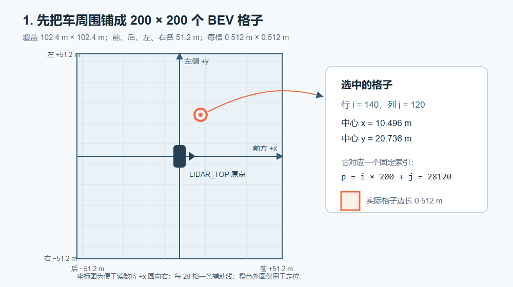
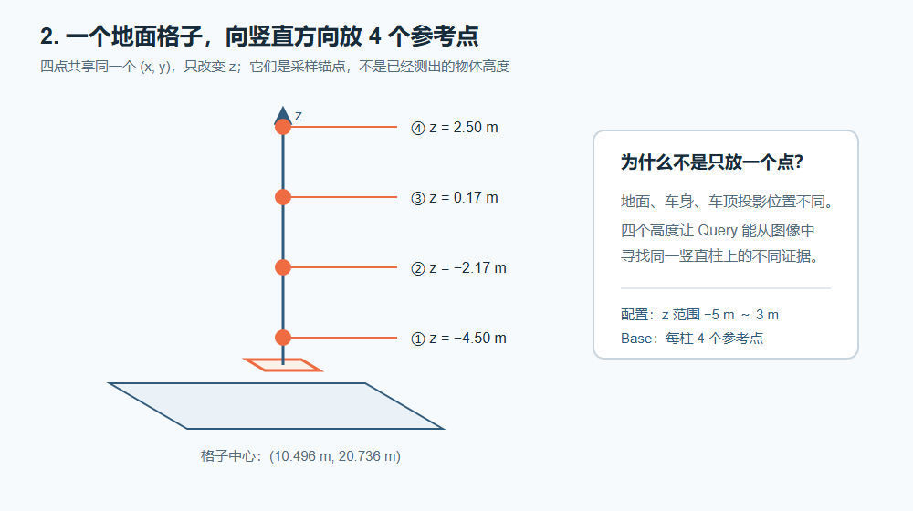
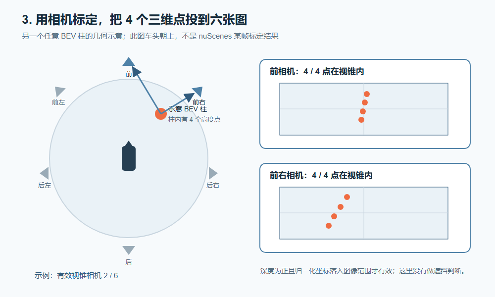
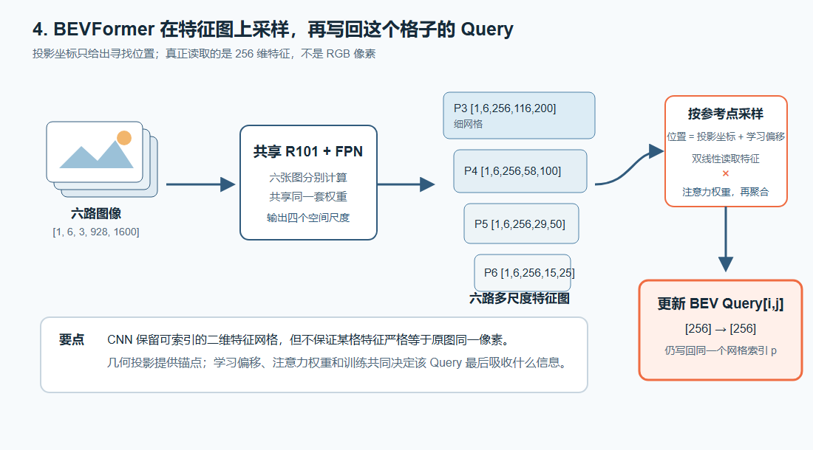

# BEVFormer-base：六相机特征怎样进入 BEV Query

这份说明只讲一条主线：**一个 BEV 格子怎样找到六相机中的特征，并把它写进自己的 Query。**

## 1. 先在车周围建立 BEV 网格



BEVFormer-base 把车周围表示为一个 `200 × 200` 的俯视网格：

- `x、y ∈ [−51.2 m, 51.2 m]`，所以总范围是 `102.4 m × 102.4 m`。当前 LiDAR 坐标约定中，`+x` 指向前方，`+y` 指向左侧。
- 每个格子是 `0.512 m × 0.512 m`。
- 每个格子绑定一个 256 维 BEV Query。

例子中的 `[i=140, j=120]`：

```text
x = −51.2 + (120 + 0.5) × 0.512 = 10.496 m
y = −51.2 + (140 + 0.5) × 0.512 = 20.736 m
p = 140 × 200 + 120 = 28120
```

这里有两个不同的东西：格子中心 `(x,y)` 是固定几何位置；`Query[p]` 是这个位置保存和更新的 256 维特征。

图中的原点是当前关键帧 `LIDAR_TOP` 坐标原点，位于车辆附近，不等于严格的车体几何中心。

## 2. 一个格子设置 4 个高度参考点



只投影地面点不够，因为车辆、行人都有高度。Base 在同一 `(x,y)` 上设置四个高度：

```text
z ≈ −4.50、−2.17、0.17、2.50 m
```

它们只是告诉模型“到这根竖直柱的不同高度附近寻找证据”，不是模型已经知道这里有多高的物体。

## 3. 把 4 个三维点投影到六张相机图像



每台相机都有自己的标定矩阵 `lidar2img[c]`：

```text
三维参考点 [x,y,z,1]
        ↓ lidar2img[c]
相机 c 中的二维参考位置 (u,v)
```

一个相机可以覆盖很多 BEV 格子；一个格子也可能同时落在多台相机的视锥内。代码只检查点在相机前方且投影落入图像范围，**这里不负责判断遮挡**。

## 4. 相机提供的是特征，不是原始像素



六张图先分别经过同一套 ResNet-101＋FPN。Base 的实际输出为：

```text
图像 [6,3,928,1600]
  → C2 [6,256,232,400]
  → C3 [6,512,116,200]
  → C4 [6,1024,58,100]
  → C5 [6,2048,29,50]
  → FPN 四级特征
```

| 层级 | 六相机特征形状 |
| --- | --- |
| P3 | `[1, 6, 256, 116, 200]` |
| P4 | `[1, 6, 256, 58, 100]` |
| P5 | `[1, 6, 256, 29, 50]` |
| P6 | `[1, 6, 256, 15, 25]` |

投影坐标 `(u,v)` 被换算成各级特征图上的位置。Spatial Cross-Attention 再由 Query 产生采样偏移和权重，从四级特征图中读取 256 维特征：

```text
投影参考位置 + 学习偏移
             ↓
读取多相机、多尺度特征
             ↓ 乘注意力权重并聚合
更新 Query[p]，仍写回原来的 BEV 格子 p
```

所以 BEVFormer 做的不是“把一个图像像素直接塞进一个格子”，而是：

> 用几何投影提供采样锚点，再按照学习到的偏移读取 CNN 特征并加权，更新对应的 BEV Query。

## 5. CNN 特征与原图位置是什么关系？

CNN 输出仍有行、列，因此可以按坐标采样；但这不等于某个特征严格代表原图同一像素。随着卷积、下采样和 DCNv2：

- 一个特征会综合周围区域的信息；
- 相邻特征的感受范围会重叠；
- DCNv2 还会改变实际读取的位置；
- 网络可能丢失信息，后面的偏移不能保证把它恢复。

因此，投影位置是**几何锚点**，不是逐像素对应的数学证明。最终是否形成有效的空间对应，要由检测训练和验证结果检验。

## 6. 一眼看完整条数据流

```text
6 张图像 [1,6,3,928,1600]
        ↓ 共享 ResNet-101 + FPN
6 路 × 4 级空间特征图
        ↑
BEV 格子 → 4 个高度点 → 投影到各相机 → 以投影为锚点采样特征
        ↓
40,000 个 BEV Query [1,40000,256]
        ↓ 6 层 BEV Encoder
BEV 特征 [1,40000,256]
        ↓ 900 个检测 Query
类别 [6,1,900,10] + 框编码 [6,1,900,10]
        ↓ 解码与筛选
最多 300 个 3D 检测框
```

第一处 `6` 是相机数；输出张量最前面的 `6` 是 Decoder 层数，二者没有关系。

## 代码位置

- Base 配置：[bevformer_base.py](C:/Users/Thomas/Desktop/project/BEVFormer-master/projects/configs/bevformer/bevformer_base.py)
- 六相机特征提取：[bevformer.py](C:/Users/Thomas/Desktop/project/BEVFormer-master/projects/mmdet3d_plugin/bevformer/detectors/bevformer.py)
- BEV 参考点与投影：[encoder.py](C:/Users/Thomas/Desktop/project/BEVFormer-master/projects/mmdet3d_plugin/bevformer/modules/encoder.py)
- 特征采样与聚合：[spatial_cross_attention.py](C:/Users/Thomas/Desktop/project/BEVFormer-master/projects/mmdet3d_plugin/bevformer/modules/spatial_cross_attention.py)
- Query 与检测头：[bevformer_head.py](C:/Users/Thomas/Desktop/project/BEVFormer-master/projects/mmdet3d_plugin/bevformer/dense_heads/bevformer_head.py)
