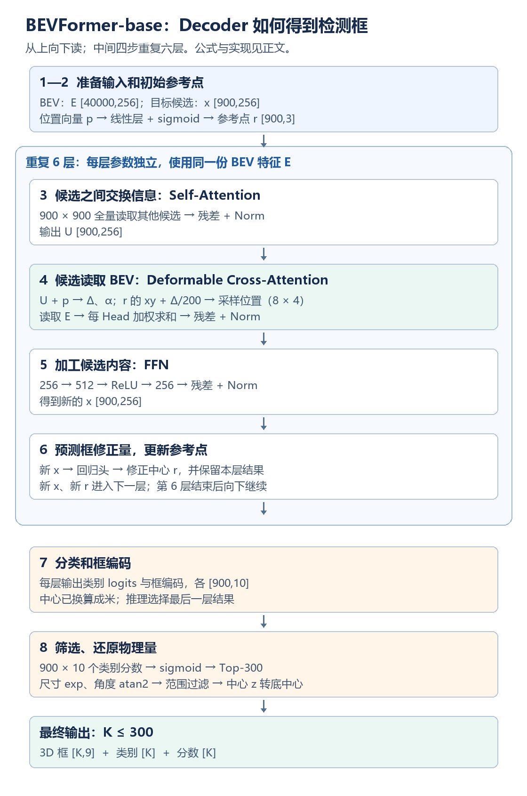
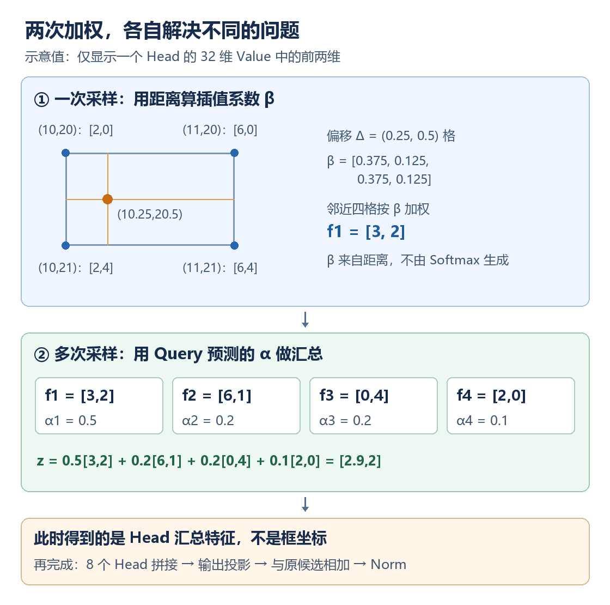

# BEVFormer-base：从 Encoder 残差到 Decoder 检测结果，逐步理解为什么这样计算

**Encoder 把六路相机的信息写成 BEV 特征图；Decoder 用 900 个目标候选向量读取这张图，逐层得到目标的位置、类别和尺寸。** 这里的“解码”不是把 Encoder 倒着运行，也不是恢复原始图像。

本文依据官方 BEVFormer-base 的代码：`as_two_stage=False`、`with_box_refine=True`，6 层 Encoder、6 层 Decoder。先接上 Encoder 的残差公式，再按执行顺序讲解 Decoder。每一步说明：**手里有什么、还缺什么、做什么运算、结果怎样供下一步使用。**

公式省略 batch 维，按单帧说明。除训练小节外，采用推理模式，此时 Dropout 不丢弃数据；线性层的偏置仅在需要时写出。文中的“作用”解释结构提供了什么能力，不表示移除一个模块后，重新设计和训练其他模型一定不可行。

## 0. 从你最初的残差公式接起：这里仍然是 Encoder

你问的起点是：

$$
\widehat q_g=q_g+\operatorname{Dropout}(o_g).
$$

下标 g 表示一个 **BEV 格子**。这里把它与后文目标候选的下标 i 分开，避免把两类 Query 当成同一个东西。

### 0.1 这次相加实际改变了什么

在 Encoder 的 Spatial Cross-Attention 中，$q_g\in\mathbb R^{256}$ 是本次空间融合前的格子状态；$o_g\in\mathbb R^{256}$ 是从相机特征中读取、加权并投影得到的更新量。

```text
格子原状态 q_g ───────────────────→ 相加
     │                                ↑
     └→ 控制相机特征采样 → 更新量 o_g ─┘
```

两个向量逐通道相加。例如只看前两维：原状态 `[1,2]`、更新量 `[0.3,−0.4]`，相加得到 `[1.3,1.6]`。新增信息既可以增强某个分量，也可以修正或抑制它；不是只能增加正数。

**为什么保留原状态？** 当前采样只提供一次局部读取的结果。如果直接用 $o_g$ 替换 $q_g$，下一步只能依赖这次更新分支；使用 $q_g+o_g$，新计算可以在已有状态上做修正。反向传播时，加法也给输入提供了一条直接的梯度路径。但后面还有 LayerNorm 等运算，不能把整层简单说成“所有旧信息原样保存”。

残差支路是直接送来相加的 $q_g$。$o_g$ 是更新分支输出；`Dropout(o_g)` 不是“从别处来的残差”。

### 0.2 Dropout 和 LayerNorm 分别解决什么问题

训练时 Dropout 随机置零更新量的一部分分量，并按保留概率缩放，作用是降低训练对特定分量组合的依赖。推理时它是恒等操作，所以实际执行 $q_g+o_g$。它不是判断哪个特征重要的规则，也不决定采样点位置。[PyTorch Dropout 定义](https://docs.pytorch.org/docs/2.14/generated/torch.nn.Dropout.html)

相加之后，执行：

$$
a_g=\operatorname{LN}(\widehat q_g).
$$

对任意一个 256 维向量 v，LayerNorm 的运算为：

$$
\mu=\frac1{256}\sum_{d=1}^{256}v_d,\qquad
\nu=\frac1{256}\sum_{d=1}^{256}(v_d-\mu)^2,
$$

$$
\operatorname{LN}(v)_d
=\gamma_d\frac{v_d-\mu}{\sqrt{\nu+\varepsilon}}+\beta_d.
$$

它调整单个向量的通道数值尺度，让后续层面对更受控的输入；γ、β 是可学习参数。它不跨 40000 个格子求平均，也不把向量变成概率。维度仍是 256，空间位置不变。Decoder 中的三次 Norm 同样各自作用于每个候选的 256 维通道。[PyTorch LayerNorm 定义](https://docs.pytorch.org/docs/2.14/generated/torch.nn.LayerNorm.html)

### 0.3 做完 FFN，才结束这一层 Encoder

$$
d_g=W_2\operatorname{ReLU}(W_1a_g+b_1)+b_2,
$$

$$
q_g^{\mathrm{out}}=\operatorname{LN}(a_g+d_g).
$$

这是推理表达式；FFN 训练时还有 Dropout。FFN 将已经读到的信息作非线性通道组合，维度经过 `256 → 512 → 256`。它的作用会在第 5 步详细展开。

如果当前还不是第六层，$q_g^{\mathrm{out}}$ 会进入下一 Encoder 层，继续执行以下完整顺序：

```text
本层输入的 40000 个 BEV Query
    ↓ Temporal Self-Attention + 残差 + Norm
    ↓ Spatial Cross-Attention + 残差 + Norm
    ↓ FFN + 残差 + Norm
本层输出的 40000 个 BEV Query → 下一层
```

| Encoder 内的步骤 | 读取的数据 | 解决的问题 |
|---|---|---|
| Temporal Self-Attention，时序融合 | BEV 时间队列；有历史时引入运动对齐后的上一帧信息 | 将历史线索用于当前格子状态，提供时间上下文 |
| Spatial Cross-Attention，空间融合 | 六相机的多尺度图像特征 | 用格子的三维参考点投影定位图像区域，读取当前相机证据 |
| FFN | 本格子已更新的向量 | 非线性加工已经汇集的信息 |

这里的“时间”指不同帧，“空间”指从相机特征到 BEV 格子的空间对应。历史队列和图像特征作为读取来源；六层之间持续更新的是 BEV Query。没有上一帧时，代码会构造替代的当前 Query 队列，不会凭空获得历史信息。

六层完成后得到 E：40000 个格子，每格 256 维。格子索引与物理空间的对应关系仍在，变化的是各格子的特征内容。增加层数提供更多次读取、融合和非线性加工的机会；它不等于简单把 CNN 的卷积窗口扩大六倍，也不是“多六层必然更准”的定理。

**到这里，Encoder 才结束。** E 有两个去向：本帧送入检测 Decoder；在时序推理中也可保存为下一帧的 `prev_bev`。下面只沿本帧检测路径往下走。

## 先看 Decoder 每一步要解决的缺口

| 步骤 | 进入时还缺什么 | 本步增加什么 | 交给下一步的结果 |
|---|---|---|---|
| 1. 准备 Object Query | 有空间特征图，还没有逐个目标的表示 | 900 个候选状态 | 候选内容 x 与位置向量 p |
| 2. 初始参考点 | 高维向量不能直接用作采样坐标 | 从 p 生成三维参考中心 | 归一化坐标 r |
| 3. Self-Attention | 各候选需要访问其他候选的状态 | 候选间信息交互 | U，仍为 900×256 |
| 4. Cross-Attention | 候选需要读取当前 BEV 场景信息 | 从参考点附近的可学习位置读取 Value | T，已融入本轮 BEV 信息 |
| 5. FFN | 加权读取结果还需要非线性加工 | 候选内部的通道组合 | 下一层内容向量 x |
| 6. 参考点修正 | 后续读取需要根据本轮结果重新定位 | 预测中心修正量 | 下一层参考点 r |
| 7. 分类与框头 | 256 维隐特征没有直接可用的类别和几何单位 | 预测具有监督语义的类别与框编码 | logits、box codes |
| 8. 后处理 | 编码和大量候选还不能直接给应用使用 | 取分数、选候选、还原物理量和接口坐标 | 3D 框、类别、分数 |



## 第 1 步：接住 Encoder 的结果，同时准备目标 Query

Encoder 的最终输出记为：

$$
E\in\mathbb R^{200\times200\times256}
\quad\longleftrightarrow\quad
E_{\mathrm{flat}}\in\mathbb R^{40000\times256}.
$$

每个 BEV 格子有一个 256 维向量。它含有融合后的场景特征，**还不是类别、坐标或检测框**。六层 Decoder 都读取这份固定的 Encoder 输出；各层会用自己的投影参数处理它。

这一阶段要解决的转换是：**从“每个空间格子有什么特征”，变成“场景里有哪些目标”。** 一辆车可能影响许多格子，格子本身也不等于一个已确定的物体。本模型选择用 900 个 Object Query 生成候选，而不是直接对每个格子输出框；逐格预测框是其他检测架构可以采用的设计。

Decoder 还需要另一组输入：900 个 **Object Query**。它们不是从 40000 个 BEV 格子中选出的 900 个点。

```python
# 模型参数，训练时更新，推理时读取
query_embedding = nn.Embedding(900, 512)
query_pos, query = torch.split(query_embedding.weight, 256, dim=-1)
# query_pos: [900, 256]；query: [900, 256]
```

对第 i 个候选，定义：

$$
p_i\in\mathbb R^{256},\qquad x_i^{(0)}\in\mathbb R^{256}.
$$

| 变量 | 含义 | 六层之间是否改变 |
|---|---|---|
| E | Encoder 输出的 BEV 特征图 | 不改变；一直供 Decoder 读取 |
| p_i | 第 i 个候选的可学习位置向量 `query_pos` | 不改变 |
| x_i | 第 i 个候选的内容向量 `query` | 每层更新 |
| r_i | 第 i 个候选的三维参考坐标 | 每层由框回归结果更新 |

**900 是人为设定的候选数量；900 组向量的数值是训练得到的。** 它不表示图中必须有 900 个物体，也不规定某个候选永远负责某个类别或某辆车。

### 为什么要分成位置向量 p 和内容向量 x

p 为候选提供持续使用的位置相关表示，用于初始参考点以及 Attention 中的控制计算；x 是逐层更新的内容状态，用来接收当前场景的信息。p 虽然叫位置向量，却不是可直接量距离的三维坐标。它的 256 个通道也没有“第一个数就是 x 坐标”这样的定义。

这两部分都从训练参数表取出，但 **参数表与本帧的中间结果不是同一件事**：

```text
训练得到的 embedding 参数表（推理期间不修改）
    ↓ 取出，作为本帧的初始输入
x^(0) → Attention/FFN → x^(1) → … → x^(6)
        这些是本次前向计算产生的运行时张量
```

Query 在推理中“更新”，指算出了新张量，不是推理时还在做反向传播训练。

每个候选最后会给出一组框参数和各类分数。候选数量设得多可以容纳更多候选假设，同时增加计算开销；900 是这一配置的选择，不是算法自动计算出的最优数量。真实目标数量由场景决定，模型通过训练让不对应目标的候选得到低分类分数。

**本步结束：** BEV 地图 E 与候选 x、p 已准备好，但候选还没有读取本帧图像证据，也没有可用于采样的坐标。

## 第 2 步：把位置向量变成初始参考坐标

**这一步的作用是给第一次稀疏读取提供起点。** 如果只有 256 维向量，却没有从它到位置的规则，就无法知道应在 BEV 数组的哪一处读取。

位置向量 p_i 有 256 个数，不能直接当作三维坐标。模型先做一次线性映射：

$$
r_i^{(0)}=\sigma(W_rp_i+b_r)\in(0,1)^3,
\qquad W_r\in\mathbb R^{3\times256}.
$$

其中 σ 是逐元素 sigmoid。r_i 的三个数分别表示归一化的 x、y、z。

例如 r = (0.6,0.4,0.5) 表示当前参考中心位于模型 x 范围的 60%、y 范围的 40%、z 范围的 50%。这三个数是“读取和修正所围绕的位置假设”，不是已经确认那里存在一个物体。

```python
reference_points = reference_points_linear(query_pos).sigmoid()
# [900, 256] → [900, 3]
```

这与预先摆好一组固定尺寸的 Anchor Box 不同：**这里先有可学习向量，再生成参考中心；初始阶段没有指定框的宽、长、高。** 不同 YOLO 版本的 Anchor 设计不同，这里只与传统预设 Anchor Box 作比较。

对于同一个训练好的模型，不同帧开始时的 $x_i^{(0)}$、$p_i$、$r_i^{(0)}$ 相同。内容向量与参考点在读取当前帧 E 之后，才逐渐变成当前场景对应的候选状态；位置向量 $p_i$ 保持不变。

**固定起点为什么还能检测不同场景？** 同一组起点在不同帧会读出不同的 BEV 特征；读出的差异改变 x，然后改变下一层的参考点与采样策略。固定的是启动条件，不是最终预测。

后面会出现三种容易混淆的位置表示：

| 名称 | 形状 | 是什么 | 不能当成什么 |
|---|---|---|---|
| p_i | 256 维 | 可学习的位置向量 | 三维物理坐标 |
| r_i | 3 维 | 本轮参考中心 x、y、z | 完整的检测框 |
| Δ_i | 8×4×2 | 各 Head 在参考中心周围的采样偏移 | 下一层框中心的修正量 δ |

**Δ 用来选“读哪些地方”，δ 用来修正“候选中心在哪里”。它们由不同线性层或预测头产生，不能混用。**

下面开始执行一层 Decoder。用 ℓ = 0,…,5 表示层索引，本层输入为：

$$
\left(X^{(\ell)},R^{(\ell)},P,E\right).
$$

## 第 3 步：Self-Attention，让 900 个候选交换信息

**这一步的作用是建立候选之间的依赖。** 如果每个候选只独立读取 E，它的更新就无法直接利用其他候选已经收集的内容。Self-Attention 提供这种信息传递路径。第一层的候选还只是学习到的起始状态；后续层中，它们已经携带前一轮读取的场景信息。

“Self”表示 Query、Key、Value 都由同一组候选产生。它不是说一个候选只看自己。

先不读 BEV，先让候选之间互相读取。Q、K、V 三种投影分别用于：构造读取请求、构造匹配键、提供被汇总的内容。对每个 Head h：

$$
Q_h=(X^{(\ell)}+P)W_h^Q,\qquad
K_h=(X^{(\ell)}+P)W_h^K,\qquad
V_h=X^{(\ell)}W_h^V.
$$

这里 X、P 按行存放 900 个向量，三个投影矩阵的形状均为 `[256,32]`。每个 Head 的 Q、K、V 都有 900 行、32 列。

$$
A_h=\operatorname{Softmax}_{j}
\left(\frac{Q_hK_h^{\mathsf T}}{\sqrt{32}}\right)
\in\mathbb R^{900\times900}.
$$

这里有三个连续动作：

1. 第 i 行 Q 与第 j 行 K 做点积，产生候选 i 读取候选 j 的打分；这个打分是可学习特征空间中的关系，不一定是物理距离。
2. 除以 √32，控制点积随 Head 维度累积后的数值尺度。
3. 对 j 做 Softmax，把第 i 个候选的 900 个打分变成总和为 1 的权重，再据此汇总 V。

例如一行权重主要集中在第 7、12、30 个候选，它就主要读取这些候选的 Value。权重来自当前状态的点积计算，不是提前存好的邻接表。

$$
U=\operatorname{LN}_1\left[
X^{(\ell)}+\operatorname{Concat}_{h=1}^{8}(A_hV_h)
W_o^{\mathrm{self}}
\right].
$$

按单个候选理解：它对其他 900 个候选计算权重，再把它们的内容加权汇总，更新自己的内容。结果 U 仍是 `[900,256]`。

**这一部分是 900×900 的全量 Attention。** 它提供候选之间的信息交互，但本身不等同于“执行 NMS”，也不保证重复框在这里被完全消除。

得到的 U 仍是每候选 256 维，表示“结合了其他候选状态后的自己”。**它还没有完成本层对 BEV 的读取**，所以下一步必须把场景特征 E 接进来。这里的残差保留 x，Norm 的含义与第 0 节相同。

## 第 4 步：Cross-Attention，让每个候选读取 BEV 特征

这是“BEV Deformable Cross-Attention”：候选向量与 BEV 特征交互，并通过可学习的偏移选择采样位置。它不计算每个候选与全部 40000 个 BEV 格子的相关度。

**这一步把“目标候选的内部状态”与“当前场景的观测信息”连接起来。** 先把三个词拆开：BEV 指被读取的二维鸟瞰特征图；Cross 指候选与另一组数据 E 交互；Deformable 指读取位置通过可学习偏移变化，而不是固定整数窗口。

若直接做全量 Cross-Attention，每个 Head 要产生 900×40000 个候选—格子打分；本配置只为每候选、每 Head 预测 4 次采样。减少的是这种全量匹配与读取，并不意味着 Value 投影、前面的 Self-Attention 等计算也全都省掉了。它延续了 Deformable DETR 的少量参考点采样设计。[Deformable DETR 论文](https://arxiv.org/abs/2010.04159)

### 4.1 BEV 特征提供被读取的数据

先在每个格子上做 Value 投影，再按通道分成 8 份：

$$
V(y,x)=W_vE(y,x)+b_v\in\mathbb R^{256},
$$

$$
V(y,x)=\operatorname{Concat}
\left(V_1(y,x),\ldots,V_8(y,x)\right),
\qquad V_h(y,x)\in\mathbb R^{32}.
$$

**8 个 Head 的 Value 来自同一个格子的特征投影，再切分通道。** 它们不是额外指定的 8 个 Query，也不是预先选出的 8 个空间位置。

为什么先投影再切分？W_v 可以把原始 256 个通道混合成适合读取的通道组合；切分后，每个 Head 获得 32 维子空间，并使用自己的采样位置和权重。这样不同 Head 可以从不同位置、不同特征组合中获取信息，最后再合并。

```text
某一个格子的 E：256维
    ↓ 可学习的 256→256 投影
V：[0…31 | 32…63 | 64…95 | … | 224…255]
       Head 1    Head 2    Head 3        Head 8
```

它不是把同一个向量复制 8 次，也没有人工指定“Head 1 看汽车、Head 2 看行人”。8 是配置的分组数，具体投影和读取方式由训练决定；更多 Head 也不保证更好。

### 4.2 Query 提供“去哪里读、每处占多少权重”

对第 i 个候选，令 u_i = U_i + p_i。由它预测：

$$
\Delta_i=\operatorname{reshape}(W_{\Delta}u_i+b_{\Delta})
\in\mathbb R^{8\times4\times2},
$$

$$
a_i=\operatorname{reshape}(W_au_i+b_a)
\in\mathbb R^{8\times4},
$$

$$
\alpha_{i,h,k}
=\frac{\exp(a_{i,h,k})}{\sum_{j=1}^{4}\exp(a_{i,h,j})}.
$$

每个 Head 有 4 个二维偏移和 4 个权重，权重之和为 1。**权重由 Query 预测，不是先遍历整张 BEV 图，再挑出相关度最高的 4 个点。**

这个预测本身只是线性层：W_Δ 的形状为 `[64,256]`，因为 8×4×2 = 64；W_a 的形状为 `[32,256]`，因为 8×4 = 32。先输出一串数字，再 reshape 成 Head、采样编号、坐标分量，不是额外启动 8 个独立模型。

这里的 α 是本次前向计算产生的 **标量权重**，不是直接保存于 checkpoint 的一张固定注意力表。保存在 checkpoint 中的是 W_a、b_a；当前 u 不同，计算出的 α 可以不同。

### 4.3 参考点加偏移，得到真正的采样位置

本层使用输入参考点 $r_i^{(\ell)}$ 的 x、y 分量：

$$
s_{i,h,k}
=r_{i,xy}^{(\ell)}
+\left(\frac{\Delta_{i,h,k,x}}{200},
\frac{\Delta_{i,h,k,y}}{200}\right).
$$

s 是归一化二维坐标。偏移量 Δ 以 BEV 特征格为单位。例如 Δ_x = 2，表示沿 x 方向移动 2 个 BEV 格，即 1.024 米；这只是单位换算，不表示网络固定偏移 2 格。

**为什么需要偏移？** 参考中心只是一个初始或中间位置假设。与目标有关的边缘、相邻部分或上下文，不一定恰好位于中心；参考中心本身也可能还不准确。允许移动采样位置，模型就能根据候选状态决定怎样读取，而不必每次都读同一个中心。

偏移可以是小数、正数或负数，不受“必须在相邻一格”这样的硬性限制。s 是读取位置，r 是参考中心，最后输出的框中心又由回归头修正；三者可能不同。**某个采样点落在哪里，不等于物体中心就在哪里。**

**z 不参与这里的二维 BEV 采样；它保留在三维参考点中，用于后面的框中心预测。**

### 4.4 在采样位置读取 Feature，再加权汇总

采样位置通常落在格子之间，用双线性插值：

$$
f_{i,h,k}=\operatorname{Bil}(V_h,s_{i,h,k})\in\mathbb R^{32}.
$$

为明确这个运算，设 s = (s_x,s_y)，对应连续数组坐标：

$$
\xi=200s_x-\frac12,\qquad \eta=200s_y-\frac12.
$$

取 ξ、η 周围最多四个格点，将它们的 32 维向量按距离加权：

$$
\operatorname{Bil}(V_h,s)
=\sum_{m\in\{\lfloor\eta\rfloor,\lfloor\eta\rfloor+1\}}
\sum_{n\in\{\lfloor\xi\rfloor,\lfloor\xi\rfloor+1\}}
(1-|\eta-m|)(1-|\xi-n|)V_h(m,n).
$$

边界外的格点按零处理。这里对应实现中的半格中心、`align_corners=False` 采样约定。

如果改成简单四舍五入取格子，采样位置小幅移动时，读出的向量往往完全不变；越过格子边界时又突然跳变。双线性插值让读取结果随小数坐标连续变化，也为训练偏移提供几乎处处可用的梯度。实际求和时，每个通道使用相同的插值系数。

### 4.5 再用 Attention 权重汇总多次采样

再把同一个 Head 的 4 次采样加权求和：

$$
z_{i,h}=\sum_{k=1}^{4}\alpha_{i,h,k}f_{i,h,k}
\in\mathbb R^{32}.
$$

α 是一个数，f 是一个 32 维向量。**运算是 α 乘采样得到的 Feature Value，逐维加权；不是把 Query 的 256 维向量直接与 Feature 的 32 维向量相乘。** Query 在这里通过“坐标”和“权重”控制读取。

必须分清两套权重：

| 权重 | 怎么得到 | 对什么加权 | 作用 |
|---|---|---|---|
| 双线性插值系数 β | 采样坐标与四个邻近格点的距离 | 一次采样周围的格点特征 | 在连续位置上构造一个 Feature 向量 f |
| Attention 权重 α | Query 经过线性层与 Softmax | 同一 Head 的四个采样向量 f | 决定四次读取各占多少贡献 |

β 由几何计算，但坐标受可学习偏移控制；α 则直接由 Query 分支预测。二者都可能随采样策略变化，计算规则不同。

最后拼接 8 个 Head、投影、做残差与归一化：

$$
o_i=W_o^{\mathrm{cross}}
\operatorname{Concat}_{h=1}^{8}(z_{i,h})+b_o,
$$

$$
T_i=\operatorname{LN}_2(U_i+o_i)\in\mathbb R^{256}.
$$

拼接把 8×32 维重新组成 256 维；输出投影 W_o 将不同 Head 的信息混合成适合更新候选状态的向量。这样 o 与原候选 U 的维度一致，残差相加才有定义。Norm 随后调整每个候选内部的通道尺度。

这就完成了 Query 与 Feature 的实际交互：

```text
Query → 偏移 Δ、权重 α
参考点 r_xy + 归一化偏移 Δ/200 → 采样坐标 s
BEV 特征 V + 采样坐标 s → 采样向量 f
权重 α × 采样向量 f → 汇总结果 o
原候选 U + 新读到的 o → 更新后的候选 T
```

残差加法中的原候选来自本层 Self-Attention 的输出 U；o 是从 BEV 读取后产生的增量。训练时实际为 `U + Dropout(o)`：**Dropout 不是残差来源，跳过当前计算直接传来的 U 才是残差支路。** 推理时 Dropout 为恒等操作。

Base 的 Decoder 是 **8 Head × 1 个 BEV Level × 每 Head 4 点**，每个候选每层共 32 次连续位置采样；它们不一定是 32 个不同格子。不要与 Encoder 中读取多相机、多尺度图像特征的采样数混淆。

### 4.6 手算一次“读取 Feature，再更新候选”的中间部分

以下特征值只为演示计算，不是模型实测值。只展示某个 Head 的 32 维 Value 中前两维；其余维度的运算相同。

参考中心在连续格点坐标 `(10,20)`，即归一化坐标 `(10.5/200,20.5/200)`。若第一采样点的偏移 Δ = `(0.25,0.5)`，它落在连续格点位置 `(10.25,20.5)`。



四个邻近格点的向量及插值系数如下：

| 格点 `(x,y)` | Value 的前两维 | 插值系数 β |
|---|---|---|
| (10,20) | [2,0] | (1−0.25)×(1−0.5) = 0.375 |
| (11,20) | [6,0] | 0.25×(1−0.5) = 0.125 |
| (10,21) | [2,4] | (1−0.25)×0.5 = 0.375 |
| (11,21) | [6,4] | 0.25×0.5 = 0.125 |

所以第一次采样得到：

$$
f_1=0.375[2,0]+0.125[6,0]+0.375[2,4]+0.125[6,4]=[3,2].
$$

假设另外三次采样分别得到 $f_2=[6,1]$、$f_3=[0,4]$、$f_4=[2,0]$，Query 预测的 α 为 `[0.5,0.2,0.2,0.1]`。则该 Head 汇总出的前两维是：

$$
z_h=0.5[3,2]+0.2[6,1]+0.2[0,4]+0.1[2,0]=[2.9,2].
$$

其他 7 个 Head 按各自的位置和权重同样计算。之后才能执行 `拼接 → 输出投影 → 与 U 残差相加 → Norm`。**[2.9,2] 是一个 Head 的部分汇总特征，既不是原 Query，也不是最终框坐标。**

要继续算出完整 256 维结果及最终框，需要实际 checkpoint 中的所有投影、FFN、预测头参数；不能凭这个两维例子直接断言目标是什么。

**本步结束：** T 是吸收了这一轮 BEV 读取结果的候选向量。下一步不再选位置，而是加工 T 内部的通道组合。

## 第 5 步：FFN 加工候选内部的特征

FFN 是 Feed-Forward Network，即前馈网络。**Cross-Attention 解决“从哪里读取、怎样汇总”，FFN 解决“读到之后，怎样组合成更有用的候选表示”。**

它在每个候选的通道维度上计算：

$$
g_i=W_2\operatorname{ReLU}(W_1T_i+b_1)+b_2,
$$

$$
x_i^{(\ell+1)}=\operatorname{LN}_3(T_i+g_i).
$$

其中 W_1 将 256 维变成 512 维，W_2 再变回 256 维。FFN 是前馈网络，参数在本层的 900 个候选之间共享；这一步不重新采样 BEV，也不直接混合不同候选。

这三段计算分别有什么作用？

| 运算 | 实际改变 | 为什么放在这里 |
|---|---|---|
| 256→512 的 Linear | 每个隐藏通道都是原 256 通道的加权组合 | 为已汇集的特征构造更多中间组合 |
| ReLU | 对每个中间值取 max(0,value) | 让不同输入激活不同组合，形成非线性 |
| 512→256 的 Linear | 将激活后的组合重新混合成 256 维更新量 | 接回候选状态，与残差维度保持一致 |
| 残差 + Norm | 把更新量并入旧状态，再调整尺度 | 输出可以继续交给下一轮 Attention |

“非线性组合”并不是一句抽象口号：假如有两个输入分量 a、b，隐藏单元可以算 `ReLU(a+b−1)`。只有组合满足条件时它才为正，输出层可以利用这一变化。真实模型中的通道语义没有人工命名，这只是说明运算能表达什么。

如果把两层 Linear 中间的 ReLU 去掉，这两层自身可以合成一个仿射变换：

$$
W_2(W_1T+b_1)+b_2=(W_2W_1)T+(W_2b_1+b_2).
$$

加入 ReLU 后一般不能这样合并，扩展到 512 维才有机会形成更丰富的分段非线性组合。这不表示其他模型模块都是线性的；这里只解释 FFN 这两层之间为何有激活函数。

经过 `Self-Attention → Cross-Attention → FFN`，本层已经把 $X^{(\ell)}$ 更新为 $X^{(\ell+1)}$，形状始终为 `[900,256]`。

**本步结束：** 每个候选都有加工后的 256 维状态，但仍不是可供应用读取的坐标和类别。下一步用具有明确监督目标的回归头，把这些特征读成几何修正量。

## 第 6 步：预测框的修正量，更新下一层的参考点

**本步建立“本次读取结果 → 下次读取位置”的反馈。** 若参考中心始终固定，后续层虽能改变偏移，也缺少这条直接利用几何预测来重新定位中心的路径。Base 显式使用逐层框修正。

从新的候选向量预测 10 个框参数：

$$
t_i^{(\ell)}=\operatorname{Reg}_{\ell}(x_i^{(\ell+1)})
=[\delta_x,\delta_y,\ell_w,\ell_l,\delta_z,\ell_h,s_\theta,c_\theta,v_x,v_y].
$$

其中中心修正量在数组的 **0、1、4** 位置。将其与本层输入参考点合并：

$$
r_i^{(\ell+1)}
=\sigma\left[
\operatorname{logit}(r_i^{(\ell)})
+[\delta_x,\delta_y,\delta_z]
\right].
$$

logit(u) = log(u/(1−u))，代码会作数值截断。先到 logit 空间加修正，再 sigmoid，能使更新后的参考坐标仍处于 0～1。

例如只看 x 方向：旧参考坐标为 0.5，logit(0.5) = 0；若回归头给出 δ_x = log(1.5)，则新参考坐标为 sigmoid(log(1.5)) = 0.6。下一层围绕 0.6 采样，而不再围绕 0.5。

δ_x 是 **logit 空间中的修正量**，不是“直接移动 0.405 米”或“移动 0.405 格”。米制位移由 sigmoid 结果和模型坐标范围共同决定。

**时序必须是：先用旧参考点读取 BEV，再用读取后的特征预测新参考点。** 不能用尚未算出的新参考点指导本层已经发生的读取。

现在进入下一层：

$$
(X^{(\ell)},R^{(\ell)})
\xrightarrow[\text{同一份 }E,\ P]{\text{第 }\ell\text{ 层}}
(X^{(\ell+1)},R^{(\ell+1)}).
$$

连续执行六次，得到 $X^{(6)}$、$R^{(6)}$，同时保留每层的结果。六层的结构相同、参数各自独立，**并没有硬编码“第一层找位置、第二层判类别”等职责**。

第二层以后的候选已包含场景信息，可以重新预测采样偏移与权重，并围绕更新后的参考点读取 BEV。六层因此是逐步修正，不是把完全相同的输入计算六次；“必须六层”也不是数学定理，而是模型配置选择。

### 为什么一次不够，为什么又不能说必须六次

不是逻辑上“一次一定不够”，而是多层给模型增加了如下计算机会：

```text
第一次：从学习到的初始状态出发 → 读取BEV → 得到含本帧证据的候选
下一次：利用上次候选和修正中心 → 重新选择位置/权重 → 再读取BEV
再下一次：继续利用更新结果选择读取方式
```

这里同时有三种改变：x 改变了，r 改变了，本层网络参数也与上一层不同。虽然 E 没变，读取 E 的函数已经变了，所以可以得到不同结果。

一层模型也可以训练；六层通常是表达能力、计算量和实际精度之间的设计选择。层数增多不保证每个样本的框误差都单调下降，既不能把六层当成固定迭代到数学收敛，也不能只用“CNN 只能看局部”解释它。

还要分清：前面的六层 Encoder 更新 **40000 个空间格子状态**，这里的六层 Decoder 更新 **900 个目标候选状态**，这是两个独立的层堆栈。增加深度会改变模型容量和计算量，不会自动增加训练数据；大模型 Scaling Law 也不能证明这里恰好六层最优。

代码传递新参考点时调用 `detach()`。它只停止跨层参考坐标这条路径的梯度，不会冻结整个 Query，也不会阻止每层回归头通过自身检测损失训练。

**本步结束：** 本层的特征和参考中心都有了新版本。未到第六层时，它们用于下一轮；已经完成的各层结果也保留给检测 Head。没有某一层必须被命名为“只找轮廓”或“只定类别”。

## 第 7 步：把候选向量转换为类别和框编码

**本步负责把隐特征变成带有明确任务含义的数。** 一个 256 维向量不会天然包含“第 1 维是车长、第 2 维是类别”。分类与回归网络通过训练监督，学会从这 256 个数计算需要的结果。

这里“分类 Head / 回归 Head”指输出预测分支，与前面把 Attention 通道分成 8 组的“Attention Head”不是同一种分组。

每层都有分类头与回归头。分类头输出：

$$
c_i^{(\ell)}=\operatorname{Cls}_{\ell}(x_i^{(\ell+1)})
\in\mathbb R^{10}.
$$

这 10 个数是 nuScenes 的 10 类分类 logits，还不是归一化概率。

### 7.1 为什么一个特征向量能变出“汽车”和“宽度”

这不是给某些通道人为贴标签，而是训练过程规定了输出的意义。举一个监督例子：某个预测经匹配对应一辆标注为 car 的车，真实宽度为 2 米，那么：

| 输出位置 | 训练期用什么目标约束 | 推理期做什么 |
|---|---|---|
| car 的分类 logit | 该候选应预测 car，其他类为负 | 从 x 计算该类别得分 |
| 宽度编码 ℓ_w | 接近 log(2) | 从 x 计算宽度编码，再 exp 得米制宽度 |
| 中心相关分量 | 经参考点修正后接近标注中心 | 从 x 计算几何修正 |

损失经预测头反向传播，使前面的特征逐渐包含完成这些任务所需的信息。推理没有标注、没有这次反向传播，只应用训练好的函数。

源码中两条分支都是小型前馈网络：分类分支重复 `Linear → LayerNorm → ReLU` 后输出 10 维；回归分支重复 `Linear → ReLU` 后输出 10 维。二者读取同一个 x，但参数和训练目标不同。各 Decoder 层也有各自独立的预测分支。

分类回答“候选与各类别有多匹配”，回归回答“候选框放在哪里、尺寸和方向怎样”。它们是并列预测，不是先把 256 维向量转换成类别，再由类别推导框。

### 7.2 将参考中心转换为米，再保留其他框编码

框回归的 t 已在第 6 步定义。由 $r^{(\ell+1)}=(\bar x,\bar y,\bar z)$ 得到米制中心：

$$
x=102.4\bar x-51.2,\qquad
y=102.4\bar y-51.2,\qquad
z=8\bar z-5.
$$

因此，送给后处理的框编码是：

$$
b_i^{(\ell)}
=[x,y,\ell_w,\ell_l,z,\ell_h,s_\theta,c_\theta,v_x,v_y].
$$

| 分量 | 此时的含义 |
|---|---|
| x、y、z | 已经换算成米的框中心 |
| ℓ_w、ℓ_l、ℓ_h | 宽、长、高的对数编码 |
| s_θ、c_θ | 以 sinθ、cosθ 为训练目标的预测值 |
| v_x、v_y | 平面速度，单位 m/s |

尺寸使用 log 编码，解码时 exp 可得到正尺寸，并改变尺寸误差在训练中的尺度；方向用 sin/cos 表示，使相近方向不会因为跨过 −π/π 边界而在目标编码上突变。速度不用于当前框的旋转或尺寸解码，但属于 nuScenes 的预测内容。

框的 10 个编码分量与 10 个类别无关，只是数量恰好相等。不是整个框向量都经过 sigmoid，也不是整个向量都在 0～1 内。

源码在 Decoder 内调用回归头更新参考点；随后 Head 又对保留的层输出调用同一个回归头来整理框。**这是同一层预测的两种用途，不是再次叠加同一个修正量。** Head 仍使用本层输入参考点 $r^{(\ell)}$，不能拿 $r^{(\ell+1)}$ 再加一次 δ。

汇总六层后：

```text
all_cls_scores : [6, B, 900, 10]
all_bbox_preds : [6, B, 900, 10]
```

训练使用各层的监督；标准推理只取最后一层进入最终筛选。

**为什么训练保留每层预测？** 各层都有检测损失，早期层的输出也直接受到约束，尤其能够训练该层用于参考中心修正的回归分支。推理仍需执行前面各层来生成后面的输入，只是在最终结果选择时使用第六层，不是跳过前五层。

**本步结束：** 我们有 900 个候选的分类分数原始值，以及中心已是米制、尺寸和方向仍用编码表示的框。下一步不再学习特征，而是按确定规则把预测整理成应用接口。

## 第 8 步：从最后一层预测中选出最终结果

### 8.1 对每个类别做 sigmoid，再取 Top-300

sigmoid 把每个 logit 映射到 0～1，形成可比较的类别分数。它们不要求跨 10 类相加为 1；没有目标的候选可以让十类分数都很低。分数也不自动等于经过严格校准的正确概率。

```python
logits = all_cls_scores[-1, 0]    # 最后一层、第0个样本：[900, 10]
codes = all_bbox_preds[-1, 0]     # 最后一层、第0个样本：[900, 10]
prob = logits.sigmoid()          # 每类独立分数；不是10类 softmax
scores, index = prob.flatten().topk(300)
labels = index % 10
query_index = index // 10
codes = codes[query_index]
```

Top-300 是从 **900×10 = 9000 个“候选—类别”组合**中选出，不是先对每个候选取一个类别，再从 900 个候选选 300 个。理论上，同一个候选可能以不同类别被选中多次。

TopK 的作用是限制输出规模，优先保留高分预测；它没有重新读取图像，也没有用 IoU 判断两个框是否重复。`index // 10` 找回该分数属于哪一个候选，`index % 10` 找回对应类别，然后取出那个候选的框。

### 8.2 将框编码还原成物理量

$$
w=e^{\ell_w},\qquad l=e^{\ell_l},\qquad h=e^{\ell_h},
\qquad\theta=\operatorname{atan2}(s_\theta,c_\theta).
$$

于是 10 维编码变成 9 维物理框：

$$
[x,y,z,w,l,h,\theta,v_x,v_y].
$$

两维方向编码变成一维角度，所以少了一维。预测的 s_θ、c_θ 不保证严格落在单位圆上，解码使用 atan2 取方向。

这是整个流程中第二种“解码”：前面的 **检测 Decoder** 是学习到的特征网络，这里的 **框编码解码** 是 exp、atan2 等确定的数值换算。两者不能混为一个网络模块。

**这里不再缩放中心坐标。** 虽然函数叫 `denormalize_bbox`，中心从归一化坐标到米的换算已在第 7 步完成。

### 8.3 范围过滤，再按输出接口调整 z

Base 保留中心位于以下范围内的框：

```text
x ∈ [−61.2, 61.2] m
y ∈ [−61.2, 61.2] m
z ∈ [−10, 10] m
```

这是 `post_center_range`，与前面的模型坐标范围 `pc_range` 是不同参数。标准 Base 未设置额外的分数阈值，也不执行传统 IoU NMS；最终数量 K ≤ 300，不等于真实物体数量一定有 300 个。

范围过滤的作用是限制输出中心的有效区域。标准 Base 的预测中心范围比这个过滤范围更窄，正常有限预测通常会通过，因此这里的 K≤300 是接口上界，并不表示该配置每帧必然过滤掉一部分。

不做 NMS，与训练时的一对一目标匹配设计有关：匹配鼓励模型把一个真实目标分配给一个预测，其他候选受到无目标分类监督。但它不保证推理结果绝不重复，也不表示所有 Top-300 结果都是真物体。应用如果另加分数阈值，会形成与这里标准配置不同的筛选规则。

过滤后，Head 为底中心坐标约定的框对象调整：

$$
z_{\mathrm{bottom}}=z_{\mathrm{center}}-\frac h2.
$$

这次减法只是为了满足框对象采用的坐标约定，不是再次优化物体位置。几何上描述的仍是同一个框，只是从几何中心换成底面中心作为存储的基准点。

最终 detector 包装为：

```python
result["pts_bbox"] = {
    "boxes_3d":  box_object,  # .tensor: [K,9]，含底中心z、尺寸、yaw、速度
    "scores_3d": scores,      # [K]
    "labels_3d": labels,      # [K]
}
```

这是当前样本坐标系下的模型检测结果；nuScenes 评估时变换到全局坐标和导出提交 JSON，是后续数据集处理步骤。

### 用一个数字例子串起来

以下只演示计算，不是实测预测。假设某个候选在最后一层得到：

```text
修正后的归一化中心：(0.6, 0.4, 0.5)
尺寸编码：(ln 2, ln 4, ln 1.5)
方向编码：(sinθ, cosθ) = (0, 1)
速度：(3, 0) m/s
car 的 logit：3
```

那么：

```text
米制中心：(10.24, −10.24, −1.00) m
宽、长、高：(2, 4, 1.5) m
yaw：atan2(0,1) = 0 rad
car 分数：sigmoid(3) ≈ 0.9526
底中心 z：−1 − 1.5/2 = −1.75 m
```

如果这个“候选—car”组合进入 Top-300，并通过中心范围检查，最终框张量中的一行就是：

```text
[10.24, −10.24, −1.75, 2, 4, 1.5, 0, 3, 0]
```

## 把八步放进一个程序

下面是与上述公式等价的单帧推理伪代码。辅助运算对应前文定义；为显露依赖关系，把源码分散在 Transformer、Decoder、Head 中的步骤排在一起，并复用本层的回归量。

这里的 `self_attention` 和 `ffn` 返回更新量，残差与 Norm 显式写在外面。某些实际 MMCV 模块已经在内部包含残差，不能把这个伪代码直接套到这些模块外面再相加一次。可运行模型的调用以文末源码为准。

```python
E = encoder_output.reshape(200, 200, 256)
p, x = split(learned_embedding_900x512, [256, 256])
r = sigmoid(reference_linear(p))                 # [900,3]
all_logits, all_codes = [], []

for layer in range(6):
    r_in = r                                    # 本层输入参考点

    # 第3步：900个候选之间，全量 self-attention
    u = norm1[layer](x + self_attention[layer](q=x+p, k=x+p, v=x))

    # 第4步：每个候选读取BEV；8个head，每head采4点
    value = value_linear[layer](E).reshape(200, 200, 8, 32)
    delta = offset_linear[layer](u+p).reshape(900, 8, 4, 2)
    alpha = softmax(weight_linear[layer](u+p).reshape(900, 8, 4), axis=-1)
    location = r_in[:, None, None, :2] + delta / [200, 200]
    samples = bilinear_sample_per_head(value, location)  # [900,8,4,32]
    heads = sum(alpha[..., None] * samples, axis=2)      # [900,8,32]
    o = output_linear[layer](heads.reshape(900, 256))
    t = norm2[layer](u + o)

    # 第5步：候选内部的通道加工
    x = norm3[layer](t + ffn[layer](t))           # [900,256]

    # 第6、7步：预测 → 修正参考中心 → 整理框
    raw = regression_head[layer](x)              # [900,10]
    r_new = sigmoid(logit(r_in) + raw[:, [0, 1, 4]])
    codes = raw.copy()
    codes[:, [0, 1, 4]] = r_new * [102.4, 102.4, 8] + [-51.2, -51.2, -5]
    all_codes.append(codes)
    all_logits.append(classification_head[layer](x))
    r = stop_gradient(r_new)                     # 供下一层采样

# 第8步：只使用第6层预测；TopK后解码尺寸/角度，再过滤
scores, index = topk(sigmoid(all_logits[-1]).flatten(), k=300)
labels, query_index = index % 10, index // 10
boxes = decode_size_and_yaw(all_codes[-1][query_index])  # [300,9]
keep = center_in_range(boxes, [-61.2, -61.2, -10, 61.2, 61.2, 10])
boxes, scores, labels = boxes[keep], scores[keep], labels[keep]
boxes[:, 2] -= boxes[:, 5] / 2                    # 中心z → 底中心z
return boxes, scores, labels
```

## 训练如何让这些步骤学会找物体

前面的步骤说明了“给定参数怎样算出结果”。还需要回答你追问的另一半：**不知道物体在哪里，也没有标注采样位置，为什么这些函数能学会正确地读取？**

### 训练的监督来自目标框，不来自“正确采样点”

一帧数据有若干真实目标，每个目标有类别、三维框等标注；模型产生 900 个候选。因为候选没有预先固定与哪一个真实目标对应，所以先计算候选与真实目标的匹配代价，再用 Hungarian 算法建立一对一匹配。

例如有两辆真实车，训练会根据当前预测找到分别对应它们的两个候选。被匹配候选的分类和框接受对应标注监督；未匹配候选的十类分类目标都为负，不需要再输出第 11 个背景类别。

```text
900个预测 + 本帧真实目标
    ↓ 分类与框的匹配代价
Hungarian：确定预测和标注的一对一对应
    ↓
匹配者：分类损失 + 框回归损失
未匹配者：无目标分类监督
    ↓ 六层都计算相应损失
反向传播，更新网络参数
```

Base 使用 sigmoid Focal Loss 和编码框的 L1 Loss，配置权重分别为 2.0、0.25，IoU loss 权重为 0。Hungarian 匹配在分离梯度后的代价上计算，算法本身不反向传播；可微损失作用在匹配完成后的网络预测上。

因此，“900 个预测与真实目标匹配”与“900 个 Query 对 40000 个 BEV 位置做相关度”是两件完全不同的事。**训练没有因为用了 Hungarian，就偷偷做一次全量 BEV Attention。**

### 检测损失如何影响采样权重 α

一组采样的汇总为 $z=\sum_k\alpha_k f_k$。假设后面的网络已经把损失对 z 的梯度传回来，那么：

$$
\frac{\partial L}{\partial\alpha_k}
=\left\langle\frac{\partial L}{\partial z},f_k\right\rangle.
$$

这说明某个采样向量 f_k 对最终检测误差的影响，可以通过链式法则传回它的权重。再通过 Softmax 和产生 logits 的线性层，更新 W_a、b_a 以及输入 Query 的相关参数。

这不是显式给每个位置打一个“重要/不重要”的标签，而是优化最终检测任务，使采样组合更有用。

### 检测损失如何影响采样位置 Δ

先用一维插值看清梯度来源。两个相邻格子的特征值是 F_0、F_1，用 d 表示格子之间的小数比例：

$$
f(d)=(1-d)F_0+dF_1,\qquad 0\le d\le1.
$$

因此：

$$
\frac{\partial L}{\partial d}
=\frac{\partial L}{\partial f}(F_1-F_0).
$$

如果移动位置会改变读取值，最终损失就可能给出“往哪个方向调整能降低误差”的梯度。实际二维情况分别对 x、y 求导。

例如 F_0=2、F_1=6，当前 d=0.25，读取 f=3。为了单独展示梯度，临时定义一个教学损失 $L=\tfrac12(f-5)^2$，则：

$$
\frac{\partial L}{\partial d}=(3-5)(6-2)=-8.
$$

若示意性地按学习率 0.01 直接更新 d，得到 d=0.33，f=3.32，损失从 2 降到 1.4112。**这里的目标值 5 只用于演示求导；真实 BEVFormer 没有给采样值提供这个标签，也不是直接优化一个独立 d 变量。**

真实的因果链是：

```text
检测损失
    ↓ 通过预测头、FFN、残差等计算的导数
候选内容的梯度
    ↓
采样汇总 z 的梯度
    ↓ 双线性插值
采样坐标 s 的梯度
    ↓ s = r_xy + Δ/(200,200)
偏移 Δ 的梯度
    ↓ Δ = Linear(Query)
更新偏移预测层参数、相关上游参数
```

梯度使用当前参数计算，优化器更新的是 W_Δ、b_Δ 等模型参数；下一次前向才会计算出新的偏移。插值几乎处处可微，但平坦特征区域、越界零填充区域等可能提供很弱或为零的位置梯度，所以“能训练”不等于“任何初始化都能找到所有有用位置”。

### 起始策略和训练、推理的区别

初始候选的 embedding 与参考点映射有可训练参数。采样偏移初始化为按 Head 分方向、每个 Head 按采样编号扩展距离的布局；offset 线性层的权重初始为零，bias 给出这套布局。Attention logits 的权重和 bias 初始为零，所以每 Head 的四次采样初始权重都是 1/4。之后训练会改变这些参数。

| 内容 | 训练 | 推理 |
|---|---|---|
| 候选间 Self-Attention | 全量 900×900 | 全量 900×900 |
| 候选读取 BEV | 每候选每 Head 稀疏采 4 点 | 同样稀疏采 4 点 |
| Dropout | 按配置随机屏蔽分量 | 恒等操作 |
| 检测标注与损失 | 用于监督及更新参数 | 不需要，不更新参数 |
| Query 内容与参考点 | 随前向计算逐层更新 | 同样逐层更新，属于运行状态变化 |

不存在“训练先读全图，推理才改为只读部分”的切换。第一层在 eval 下的初始 Query、参考点、采样坐标与权重不随当前帧改变；第一次读出的 BEV Value 随场景变化，之后的候选和采样策略才包含本帧证据。训练时的 Dropout 随机性不等于读取图像后的适应。

### 没读取的远处特征，真的不重要吗

不能这样推断。结构并没有证明其他点与候选无关，也没有先对全部点完成重要性排名。它采用有限采样的归纳偏置，依靠不同候选、不同 Head、逐层更新，以及 BEV 特征中已有的上下文来学习有效读取。

每个采样向量本身已经由前面的网络融合得到，并不只包含原始图像某一个像素的信息；但这仍不等于它包含所有需要的信息。若关键线索没有被有效读取，模型就可能漏检或定位不准。这是模型能力与计算量的取舍，要由数据和评估检验，不是全量 Attention 等价性的证明。

这样，前向与训练的关系才完整：**前向规定“如何产生预测”，标注规定“什么预测是对的”，反向传播调整前向函数中的参数。**

## 对应源码

以下链接指向本机核对过的官方 BEVFormer 源码；不是编译器重写实现。本文按执行代码解释，部分上游 docstring 中的框维度或 “NMS” 描述存在遗留表述。

| 本文步骤 | 文件与入口 |
|---|---|
| Encoder 的六层循环及 BEV Query 传递 | [encoder.py:221](C:/Users/Thomas/Desktop/project/BEVFormer-master/projects/mmdet3d_plugin/bevformer/modules/encoder.py:221) |
| Encoder 层内部 TSA / SCA / FFN / Norm 的顺序 | [encoder.py:360](C:/Users/Thomas/Desktop/project/BEVFormer-master/projects/mmdet3d_plugin/bevformer/modules/encoder.py:360) |
| Base 的 900 Query、6 层、8 Head、FFN、后处理配置 | [bevformer_base.py:65](C:/Users/Thomas/Desktop/project/BEVFormer-master/projects/configs/bevformer/bevformer_base.py:65) |
| 创建 Query embedding；各层独立预测头 | [bevformer_head.py:94](C:/Users/Thomas/Desktop/project/BEVFormer-master/projects/mmdet3d_plugin/bevformer/dense_heads/bevformer_head.py:94) |
| 拆分位置/内容向量，生成初始参考点，传入 BEV | [transformer.py:263](C:/Users/Thomas/Desktop/project/BEVFormer-master/projects/mmdet3d_plugin/bevformer/modules/transformer.py:263) |
| 六层迭代、参考点更新与 detach | [decoder.py:90](C:/Users/Thomas/Desktop/project/BEVFormer-master/projects/mmdet3d_plugin/bevformer/modules/decoder.py:90) |
| Cross-Attention 的 Value、偏移、权重与采样 | [decoder.py:297](C:/Users/Thomas/Desktop/project/BEVFormer-master/projects/mmdet3d_plugin/bevformer/modules/decoder.py:297) |
| Head 中生成六层分类结果与米制中心 | [bevformer_head.py:175](C:/Users/Thomas/Desktop/project/BEVFormer-master/projects/mmdet3d_plugin/bevformer/dense_heads/bevformer_head.py:175) |
| 最后一层的 sigmoid、TopK、范围过滤 | [nms_free_coder.py:41](C:/Users/Thomas/Desktop/project/BEVFormer-master/projects/mmdet3d_plugin/core/bbox/coders/nms_free_coder.py:41) |
| 尺寸与方向解码 | [util.py:26](C:/Users/Thomas/Desktop/project/BEVFormer-master/projects/mmdet3d_plugin/core/bbox/util.py:26) |
| 框中心转底中心，包装框对象 | [bevformer_head.py:500](C:/Users/Thomas/Desktop/project/BEVFormer-master/projects/mmdet3d_plugin/bevformer/dense_heads/bevformer_head.py:500) |
| 检测结果转成应用输出 | [bevformer.py:369](C:/Users/Thomas/Desktop/project/BEVFormer-master/projects/mmdet3d_plugin/bevformer/detectors/bevformer.py:369) |
| 匹配代价、Hungarian 与梯度分离 | [hungarian_assigner_3d.py:106](C:/Users/Thomas/Desktop/project/BEVFormer-master/projects/mmdet3d_plugin/core/bbox/assigners/hungarian_assigner_3d.py:106) |
| 分类与回归损失 | [bevformer_head.py:372](C:/Users/Thomas/Desktop/project/BEVFormer-master/projects/mmdet3d_plugin/bevformer/dense_heads/bevformer_head.py:372) |
| 六层检测监督 | [bevformer_head.py:451](C:/Users/Thomas/Desktop/project/BEVFormer-master/projects/mmdet3d_plugin/bevformer/dense_heads/bevformer_head.py:451) |

官方仓库：[fundamentalvision/BEVFormer](https://github.com/fundamentalvision/BEVFormer)。PNG 插图位于本 Markdown 同目录下的 `assets/bevformer-query-guide/`，文件名分别为 `10-decoder-to-detections.png`、`11-decoder-sampling-example.png`；下载图文压缩包并解压，可保留相对路径显示图片。
