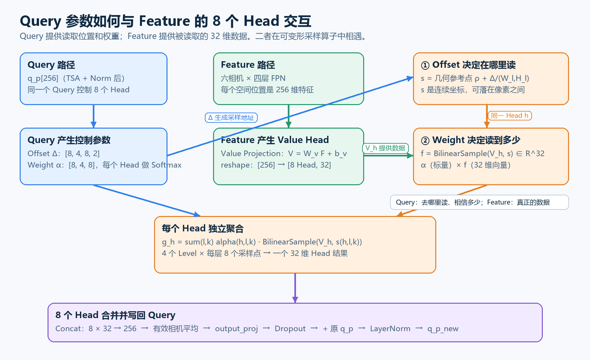

# BEVFormer：Query 参数如何与 Feature 的 8 个 Head 交互

本文把下面这条计算链完整展开：

```text
Query 产生 Offset 和 Weight
            ↓
控制从多相机、多尺度 Feature 的哪里读取、读取多少
            ↓
8 个 Head 分别采样并加权
            ↓
拼接、相机融合、输出投影
            ↓
Dropout 后与原 Query 残差相加
            ↓
LayerNorm 得到新 Query
```

核心结论是：

> **Query 不直接与图像 Feature 做点积。Query 产生读取地址和混合权重；Feature 提供被读取的数据；融合结果经过投影后作为增量写回原 Query。**



---

## 1. 先区分所有变量

以下变量都针对某个 BEV 格子 `p`：

| 变量 | 来源 | Base 中的形状 | 作用 |
| --- | --- | --- | --- |
| $q_p$ | BEV Query | `[256]` | 当前格子保存的状态 |
| $q_p^{\mathrm{SCA}}$ | TSA 与第一层 Norm 的输出 | `[256]` | 预测采样控制参数 |
| $\Delta_{p,h,l,k}$ | Query 路径 | `[2]` | 第 `h,l,k` 个采样偏移 |
| $\alpha_{p,h,l,k}$ | Query 路径 | 标量 | 该采样结果的混合权重 |
| $\widetilde F_{c,l}(x,y)$ | 图像 Backbone/FPN | `[256]` | 相机 `c`、层级 `l` 的空间特征 |
| $V_{c,l}^{(h)}(x,y)$ | Feature 的 Value 投影 | `[32]` | Head `h` 的图像数据 |
| $f_{p,c,h,l,k}$ | 双线性采样 | `[32]` | 从指定位置实际读取的特征 |
| $g_{p,c}^{(h)}$ | Head 内加权求和 | `[32]` | 一个 Head 的融合结果 |
| $g_{p,c}$ | 8 Head 拼接 | `[256]` | 一台相机对该 Query 的结果 |
| $\overline g_p$ | 有效相机平均 | `[256]` | 六相机融合结果 |
| $o_p$ | 输出投影 | `[256]` | 准备写入 Query 的更新量 |

索引含义：

```text
c：相机，0～5
h：Head，0～7
l：FPN Level，0～3
k：每个 Head、每个 Level 的采样点，0～7
```

Base 还有四个柱高参考点。八个采样点不是“每个高度八个点”，而是：

```text
4 个高度 × 每个高度 2 个偏移位置 = 8 个采样点
```

---

## 2. 八个 Head 到底是什么

八个 Head 不是八台相机、八个 Query、八个目标，也不是八个单独保存的向量。

`8` 是模型结构中人为设定的超参数：

```python
embed_dims = 256
num_heads = 8
head_dim = 256 // 8  # 32
```

因此同一个 Query 的一次 Attention 被组织为八条并行计算分支：

```text
Head 0：32 维 Value + 自己的 Offset + 自己的 Weight
Head 1：32 维 Value + 自己的 Offset + 自己的 Weight
...
Head 7：32 维 Value + 自己的 Offset + 自己的 Weight
```

Head 本身只是一个计算分支编号。每个 Head 具体关注什么位置、尺度和特征，由训练决定。

---

## 3. Feature 路径：图像数据怎样进入 Head

六相机图像先经过共享的 Backbone 和 FPN。某个相机、某个 FPN 层、某个空间位置的特征为：

$$
F^{\mathrm{FPN}}_{c,l}(x,y)\in\mathbb R^{256}.
$$

加入相机编码与层级编码：

$$
\widetilde F_{c,l}(x,y)
=
F^{\mathrm{FPN}}_{c,l}(x,y)
+e_c^{\mathrm{cam}}
+e_l^{\mathrm{level}}.
$$

然后经过 Value Projection：

$$
V_{c,l}(x,y)
=
W_v\widetilde F_{c,l}(x,y)+b_v,
$$

其中：

$$
W_v\in\mathbb R^{256\times256}.
$$

再将结果 reshape 为：

$$
V_{c,l}(x,y)\in\mathbb R^{8\times32}.
$$

即：

$$
V_{c,l}
=
\operatorname{Concat}
\left(
V_{c,l}^{(0)},
V_{c,l}^{(1)},
\ldots,
V_{c,l}^{(7)}
\right),
$$

其中：

$$
V_{c,l}^{(h)}(x,y)\in\mathbb R^{32}.
$$

### 不是机械切分原始 FPN 通道

由于切分前存在可学习的 $W_v$，可以把它按输出行理解为八块：

$$
W_v=
\begin{bmatrix}
W_v^{(0)}\\
W_v^{(1)}\\
\vdots\\
W_v^{(7)}
\end{bmatrix},
\qquad
W_v^{(h)}\in\mathbb R^{32\times256}.
$$

所以：

$$
V_{c,l}^{(h)}
=
W_v^{(h)}\widetilde F_{c,l}+b_v^{(h)}.
$$

每个 Head 的 32 维 Value 都可以综合原始全部 256 个 Feature 通道。

---

## 4. Query 路径：产生每个 Head 的控制参数

进入 Spatial Cross-Attention 的 Query 为：

$$
q_p^{\mathrm{SCA}}\in\mathbb R^{256}.
$$

在官方 BEVFormer-base 调用链中，BEV 位置编码加在前面的 Temporal Self-Attention 中；`SpatialCrossAttention` 调用没有再次传入 `query_pos`。所以 Offset 和 Weight 直接由 TSA 与第一层 Norm 的输出预测：

$$
q_p^{\mathrm{SCA}}
=
\operatorname{Norm}
\left(
\operatorname{TSA}(q_p^{\mathrm{in}},\mathrm{prev\_bev})
\right).
$$

### 4.1 产生 Offset

$$
\Delta_p
=
W_\Delta q_p^{\mathrm{SCA}}+b_\Delta.
$$

Base 中：

$$
W_\Delta\in\mathbb R^{512\times256},
$$

因为：

$$
512
=8_{\mathrm{head}}
\times4_{\mathrm{level}}
\times8_{\mathrm{point}}
\times2_{xy}.
$$

reshape 后：

```text
sampling_offsets
[8 Head, 4 Level, 8 Point, 2 xy]
```

第 `h` 个 Head 因而拥有自己的一组：

$$
\Delta_{p,h,l,k}=(\Delta x,\Delta y).
$$

### 4.2 产生 Weight

$$
a_p
=
W_\alpha q_p^{\mathrm{SCA}}+b_\alpha.
$$

Base 中 $a_p\in\mathbb R^{256}$，因为：

$$
256
=8_{\mathrm{head}}
\times4_{\mathrm{level}}
\times8_{\mathrm{point}}.
$$

输出 reshape 为：

```text
attention_logits
[8 Head, 4 Level, 8 Point]
```

每个 Head 独立对自己的 `4 × 8 = 32` 个 Logit 做 Softmax：

$$
\alpha_{p,h,l,k}
=
\frac{\exp(a_{p,h,l,k})}
{\displaystyle
\sum_{l'=0}^{3}\sum_{k'=0}^{7}
\exp(a_{p,h,l',k'})}.
$$

因此：

$$
\sum_{l=0}^{3}\sum_{k=0}^{7}
\alpha_{p,h,l,k}=1.
$$

Offset 决定“在哪里读”，Weight 决定“读到的数据占多少”。

### 4.3 Offset 一开始从哪里来

Offset 不是每次随机生成的。官方实现将 `sampling_offsets.weight` 初始化为零，将 bias 初始化为八个 Head 各自方向不同的放射状位置。训练开始后，`weight` 和 `bias` 都通过反向传播学习。

`attention_weights` 的 weight 和 bias 初始为零，因此初始 Softmax 权重都是 $1/32$；训练后才会针对不同 Query 形成不同的采样权重。

因此训练后的 Offset 是 Query 的确定性函数：

$$
\Delta_p=W_\Delta q_p^{\mathrm{SCA}}+b_\Delta.
$$

它的数值以当前 FPN 特征图的网格为尺度。比如 $\Delta x=2$ 表示在该 Level 上横向移动约两个 Feature cell；它不是移动两个 BEV 格子。Offset 可以是小数，所以采样点也可以落在四个 Feature cell 之间。

---

## 5. Query 和 Feature 第一次交互：Offset 控制读取地址

BEV 三维参考点投影到相机后得到几何基准位置：

$$
\rho_{p,c,m}\in[0,1]^2.
$$

Base 使用四个高度锚点、每个高度两个 Offset。源码把八个 Offset 临时 reshape 为：

```text
[8 Point, 2 xy] → [2 Offset-group, 4 Height, 2 xy]
```

用扁平索引 $k$ 表示时：

$$
k=4j+m,
\qquad
j\in\{0,1\},
\qquad
m\in\{0,1,2,3\}.
$$

所以：

$$
m(k)=k\bmod4.
$$

这就是下式中的 $m(k)$：它指出第 $k$ 个 Offset 应加到四个高度参考点中的哪一个。

Query 预测的 Offset 按当前 FPN 层宽高归一化。最终采样位置是：

$$
s_{p,c,h,l,k}
=
\rho_{p,c,m(k)}
+
\left(
\frac{\Delta x_{p,h,l,k}}{W_l},
\frac{\Delta y_{p,h,l,k}}{H_l}
\right).
$$

这里没有执行 Query 与 Feature 的向量乘法。

Query 产生的 Offset 改变了 Feature 的读取地址：

```text
几何基准位置 ρ
        +
Query 预测偏移 Δ
        ↓
最终 Feature 读取位置 s
```

---

## 6. 根据地址，从 Feature 中读取 32 维向量

采样位置 $s=(s_x,s_y)$ 是 `[0,1]` 归一化坐标。对第 `l` 层特征图，连续特征坐标为：

$$
x=W_ls_x-\frac{1}{2},
\qquad
y=H_ls_y-\frac{1}{2}.
$$

通过四邻域双线性插值，Head `h` 读取：

$$
f_{p,c,h,l,k}
=
\mathcal B
\left(
V_{c,l}^{(h)},
s_{p,c,h,l,k}
\right).
$$

结果为：

$$
f_{p,c,h,l,k}\in\mathbb R^{32}.
$$

所以：

```text
Query 提供 s：在哪里读取
Feature 提供 f：读取到什么内容
```

---

## 7. Query 和 Feature 第二次交互：Weight 控制贡献比例

Query 产生的 $\alpha_{p,h,l,k}$ 是一个标量；采样得到的 $f_{p,c,h,l,k}$ 是一个 32 维向量。

二者交互为标量乘向量：

$$
\alpha_{p,h,l,k}f_{p,c,h,l,k}.
$$

例如：

$$
\alpha=0.7,
\qquad
f=[10,20,30],
$$

则：

$$
\alpha f
=
0.7[10,20,30]
=
[7,14,21].
$$

Weight 不改变采样坐标，只改变这个采样特征对最终结果的贡献。

---

## 8. 一个 Head 的完整计算

每个 Head 在四个 FPN Level、每层八个位置采样。每层的八个位置来自“四个高度 × 每个高度两个 Offset”，因此共有：

$$
4\times8=32
$$

个采样结果。

第 `h` 个 Head 的融合结果为：

$$
g_{p,c}^{(h)}
=
\sum_{l=0}^{3}
\sum_{k=0}^{7}
\alpha_{p,h,l,k}
f_{p,c,h,l,k}.
$$

把 $f$ 展开：

$$
g_{p,c}^{(h)}
=
\sum_{l=0}^{3}
\sum_{k=0}^{7}
\alpha_{p,h,l,k}
\mathcal B
\left(
V_{c,l}^{(h)},
s_{p,c,h,l,k}
\right).
$$

输出仍然是：

$$
g_{p,c}^{(h)}\in\mathbb R^{32}.
$$

---

## 9. 八个 Head 合并为一台相机的结果

八个 Head 分别输出：

```text
Head 0 → g⁽⁰⁾[32]
Head 1 → g⁽¹⁾[32]
...
Head 7 → g⁽⁷⁾[32]
```

将它们按通道拼接：

$$
g_{p,c}
=
\operatorname{Concat}
\left(
g_{p,c}^{(0)},
g_{p,c}^{(1)},
\ldots,
g_{p,c}^{(7)}
\right).
$$

所以：

$$
g_{p,c}\in\mathbb R^{256}.
$$

八个 Head 的目标不是产生八个检测结果，而是共同生成一个更丰富的 256 维 Query 更新候选。

---

## 10. 六台相机如何合并

设能看到格子 `p` 的有效相机集合为 $\mathcal V_p$：

$$
N_p=\max\left(1,\left|\mathcal V_p\right|\right).
$$

官方实现对有效相机结果做算术平均：

$$
\overline g_p
=
\frac{1}{N_p}
\sum_{c\in\mathcal V_p}g_{p,c}.
$$

这里没有额外的跨相机 Softmax。

在官方实现中，同一个 Query 被复制到它可见的相机分支，并且所有相机共享 $W_\Delta$ 和 $W_\alpha$。因此，同一个 Query 在不同相机分支产生的 Offset 和 Weight **数值相同**。相机差异来自投影基准位置 $\rho_{p,c,m}$ 和图像 Value $V_{c,l}$，所以最终采样位置与读取内容不同。

---

## 11. 输出投影：把 Feature 结果变成 Query 更新量

六相机融合结果为：

$$
\overline g_p\in\mathbb R^{256}.
$$

它来自图像 Value 空间，还需要经过输出投影：

$$
o_p=W_o\overline g_p+b_o,
$$

其中：

$$
W_o\in\mathbb R^{256\times256}.
$$

$o_p$ 可以理解为：

> 本次相机观测准备写入该 BEV Query 的 256 维更新量。

`output_proj` 还会重新混合八个 Head 的通道，使结果适合与 Query 相加。

---

## 12. Dropout 不是残差

训练阶段对更新量应用 Dropout：

$$
d_p=\operatorname{Dropout}(o_p).
$$

如果 Dropout 概率为 $r$，训练时每个通道近似为：

$$
d_{p,i}
=
\frac{m_i}{1-r}o_{p,i},
\qquad
m_i\sim\operatorname{Bernoulli}(1-r).
$$

Dropout 的作用是随机抑制更新分支中的部分通道，减少过拟合。

推理时：

$$
\operatorname{Dropout}(o_p)=o_p.
$$

所以 Dropout 不是残差，也不会产生一条新的残差来源。

---

## 13. 原 Query 才是残差分支

残差相加为：

$$
\widehat q_p
=
\underbrace{q_p}_{\text{原 Query，残差分支}}
+
\underbrace{\operatorname{Dropout}(o_p)}_{\text{图像更新分支}}.
$$

随后执行：

$$
q_p^{\mathrm{new}}
=
\operatorname{LayerNorm}(\widehat q_p).
$$

这里要区分代码边界：`SpatialCrossAttention.forward()` 只计算

$$
\widehat q_p=q_p+\operatorname{Dropout}(o_p).
$$

紧随其后的 LayerNorm 由外层 `BEVFormerLayer` 按 `cross_attn → norm` 的顺序执行。

残差的含义是：

```text
新状态 = 原状态 + 本次相机观测带来的修正量
```

它保留了 Query 中已有的：

- BEV 位置先验；
- Temporal Self-Attention 融合的历史信息；
- 前面 Encoder 层已经写入的图像信息。

如果图像更新量接近零：

$$
o_p\approx0,
$$

则：

$$
\widehat q_p\approx q_p.
$$

原状态不会被一次无效观测直接覆盖。

---

## 14. 一次交互的闭环

将所有阶段按依赖关系排列：

```text
                         Query 路径
qₚ[256]（TSA + Norm 后）───────────────────────────────┐
   │                                                   │
   ├─ Linear ─────────→ Offset Δ                        │
   │                          │                        │
   │                          └─→ 最终采样位置 s       │
   │                                                   │
   └─ Linear ─────────→ Weight α                        │
                                                       │
                         Feature 路径                   │
图像 ─→ Backbone/FPN ─→ camera/level embed ─→ Wᵥ       │
                                                │      │
                                                └→ 8 Head × 32
                                                        │
s ─────────────────────────→ 双线性采样 Feature         │
                                      │                 │
                                      └→ f[32]          │
α ───────────────────────────────────────×              │
                                               │        │
                                每个 Head 加权求和       │
                                               │        │
                              8 Head Concat → g[256]     │
                                               │        │
                                      有效相机平均       │
                                               │        │
                                     output_proj → o[256]
                                               │        │
                                         Dropout(o)     │
                                               │        │
qₚ 残差路径 ────────────────────────────────────┴─→ 相加
                                                        ↓
                                                   LayerNorm
                                                        ↓
                                                 qₚ_new[256]
```

两种真正的 Query–Feature 交互是：

1. Query 的 Offset 控制从 Feature 的哪里读取；
2. Query 的 Weight 控制读到的 Feature 占多大比例。

第三步是状态融合：图像结果经过 $W_o$ 后与原 Query 相加。

---

## 15. 一个可以手算的双 Head 例子

为了方便手算，假设：

```text
Query/输出维度：4
Head 数量：2
每个 Head：2 维
每个 Head 只采两个位置
推理阶段 Dropout 关闭
```

原 Query：

$$
q=[1,2,1,0].
$$

Query 为 Head 0 产生权重：

$$
\alpha^{(0)}=[0.8,0.2].
$$

根据 Head 0 的 Offset，在 Feature 中读取：

$$
f_1^{(0)}=[10,0],
\qquad
f_2^{(0)}=[0,8].
$$

因此：

$$
g^{(0)}
=0.8[10,0]+0.2[0,8]
=[8,1.6].
$$

Query 为 Head 1 产生权重：

$$
\alpha^{(1)}=[0.25,0.75].
$$

根据 Head 1 的 Offset，在 Feature 中读取：

$$
f_1^{(1)}=[2,6],
\qquad
f_2^{(1)}=[10,2].
$$

因此：

$$
g^{(1)}
=0.25[2,6]+0.75[10,2]
=[8,3].
$$

拼接两个 Head：

$$
g
=
\operatorname{Concat}
\left(g^{(0)},g^{(1)}\right)
=[8,1.6,8,3].
$$

为了演示，暂时假设 $W_o$ 是单位矩阵，则：

$$
o=g=[8,1.6,8,3].
$$

推理阶段 Dropout 关闭，因此：

$$
\widehat q=q+o.
$$

$$
\widehat q
=[1,2,1,0]+[8,1.6,8,3]
=[9,3.6,9,3].
$$

最后再执行 LayerNorm 得到新 Query。

这个例子中的分工非常明确：

```text
Query：产生两个 Head 的采样位置与权重
Feature：提供四个被采样的 2 维向量
Head：分别完成加权求和
残差：把结果写入原 Query，而不是覆盖原 Query
```

---

## 16. 与普通 QKᵀV Attention 的区别

普通 Attention 使用：

$$
\alpha
=
\operatorname{Softmax}
\left(
\frac{QK^T}{\sqrt d}
\right).
$$

权重来自 Query 与 Key 的相似度。

BEVFormer Spatial Cross-Attention 使用：

$$
\Delta=W_\Delta q^{\mathrm{SCA}}+b_\Delta,
$$

$$
\alpha
=
\operatorname{Softmax}
\left(W_\alpha q^{\mathrm{SCA}}+b_\alpha\right),
$$

$$
f=\mathcal B(V,\rho+\widehat\Delta),
$$

$$
g=\sum\alpha f.
$$

当前层中不存在完整的 Query–Feature 点积矩阵。Feature 主要作为被动态寻址和加权的数据源。

---

## 17. 为什么后续层仍然能根据 Feature 调整控制参数

虽然当前层的 Weight 不是通过 $q^Tf$ 计算，但本层结束时：

$$
q^{(r+1)}
=
\operatorname{LayerNorm}
\left(
q^{(r)}+o^{(r)}
\right).
$$

$o^{(r)}$ 来自相机 Feature，所以新的 Query 已经包含图像信息。

下一层再用新 Query 预测：

$$
\Delta^{(r+1)},
\qquad
\alpha^{(r+1)}.
$$

六层形成反馈迭代：

```text
第 1 层 Query → 控制采样 → 将图像 Feature 写入 Query
                      ↓
第 2 层 Query → 根据已有图像内容重新控制采样
                      ↓
第 3～6 层继续修正
```

---

## 18. 对应源码

### 18.1 定义 Value、Offset 和 Weight 投影

[spatial_cross_attention.py](C:/Users/Thomas/Desktop/project/BEVFormer-master/projects/mmdet3d_plugin/bevformer/modules/spatial_cross_attention.py:245)

```python
self.sampling_offsets = nn.Linear(
    embed_dims,
    num_heads * num_levels * num_points * 2
)

self.attention_weights = nn.Linear(
    embed_dims,
    num_heads * num_levels * num_points
)

self.value_proj = nn.Linear(embed_dims, embed_dims)
```

### 18.2 Feature 投影并切为八个 Head

[spatial_cross_attention.py](C:/Users/Thomas/Desktop/project/BEVFormer-master/projects/mmdet3d_plugin/bevformer/modules/spatial_cross_attention.py:334)

```python
value = self.value_proj(value)

value = value.view(
    bs,
    num_value,
    self.num_heads,
    -1
)
```

### 18.3 Query 产生每个 Head 的 Offset 和 Weight

[spatial_cross_attention.py](C:/Users/Thomas/Desktop/project/BEVFormer-master/projects/mmdet3d_plugin/bevformer/modules/spatial_cross_attention.py:338)

```python
sampling_offsets = self.sampling_offsets(query).view(
    bs,
    num_query,
    self.num_heads,
    self.num_levels,
    self.num_points,
    2
)

attention_weights = self.attention_weights(query).view(
    bs,
    num_query,
    self.num_heads,
    self.num_levels * self.num_points
)

attention_weights = attention_weights.softmax(-1)
```

### 18.4 基准位置加 Offset

[spatial_cross_attention.py](C:/Users/Thomas/Desktop/project/BEVFormer-master/projects/mmdet3d_plugin/bevformer/modules/spatial_cross_attention.py:357)

```python
sampling_offsets = sampling_offsets / offset_normalizer
sampling_locations = reference_points + sampling_offsets
```

### 18.5 三种输入在采样算子中相遇

[spatial_cross_attention.py](C:/Users/Thomas/Desktop/project/BEVFormer-master/projects/mmdet3d_plugin/bevformer/modules/spatial_cross_attention.py:390)

```python
output = MultiScaleDeformableAttnFunction.apply(
    value,                 # 来自 Feature
    spatial_shapes,
    level_start_index,
    sampling_locations,    # 来自 Query 的 Offset + 几何参考点
    attention_weights,     # 来自 Query 的 Weight
    self.im2col_step
)
```

### 18.6 Dropout、残差和写回 Query

[spatial_cross_attention.py](C:/Users/Thomas/Desktop/project/BEVFormer-master/projects/mmdet3d_plugin/bevformer/modules/spatial_cross_attention.py:173)

```python
slots = self.output_proj(slots)

return self.dropout(slots) + inp_residual
```

其中：

```text
slots        → 相机 Feature 产生的 Query 更新量
self.dropout → 只作用于更新分支
inp_residual → 原 Query，也就是残差分支
```

### 18.7 外层 LayerNorm

[bevformer_base.py](C:/Users/Thomas/Desktop/project/BEVFormer-master/projects/configs/bevformer/bevformer_base.py:104)

```python
operation_order=(
    'self_attn', 'norm',
    'cross_attn', 'norm',
    'ffn', 'norm'
)
```

[encoder.py](C:/Users/Thomas/Desktop/project/BEVFormer-master/projects/mmdet3d_plugin/bevformer/modules/encoder.py:377)

```python
elif layer == 'norm':
    query = self.norms[norm_index](query)
```

因此源码中的实际边界是：

```text
SpatialCrossAttention：q_hat = q + dropout(o)
BEVFormerLayer：        q_new = norm(q_hat)
```

---

## 19. 常见误解

### 误解一：八个 Head 是八个 Query

不是。一个 BEV 格子仍然只有一个 256 维 Query。八个 Head 是八条并行采样分支，最后重新拼成一个 256 维结果。

### 误解二：Head 是从 Feature 中检测出来的八个目标

不是。Head 数量 `8` 是结构参数。每个 Head 的数据由可学习的 Value Projection 从 Feature 中产生。

### 误解三：Query 与 Feature 先做逐元素乘法

不是。Query 先产生地址和权重；地址控制 Feature 采样，权重再乘采样后的 32 维 Feature。

### 误解四：Dropout 是残差

不是。原 Query 是残差；Dropout 只作用于相机更新量。

### 误解五：新 Feature 直接替换 Query

不是。图像融合结果经过 $W_o$ 后作为增量与原 Query 相加。

---

## 20. 一句话记忆

```text
Query 产生 Offset 决定“去哪里读”；
Query 产生 Weight 决定“相信多少”；
Feature 的 8 个 Head 提供“真正读到的数据”；
output_proj 把数据变成 Query 更新量；
Dropout 只正则化更新量；
原 Query 通过残差路径保留并接收这次更新。
```
