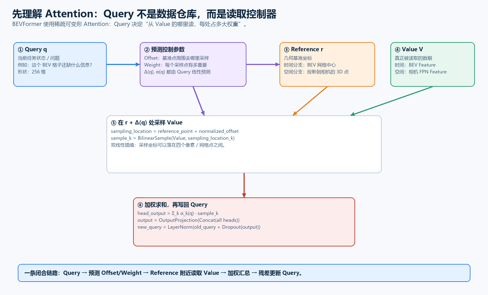
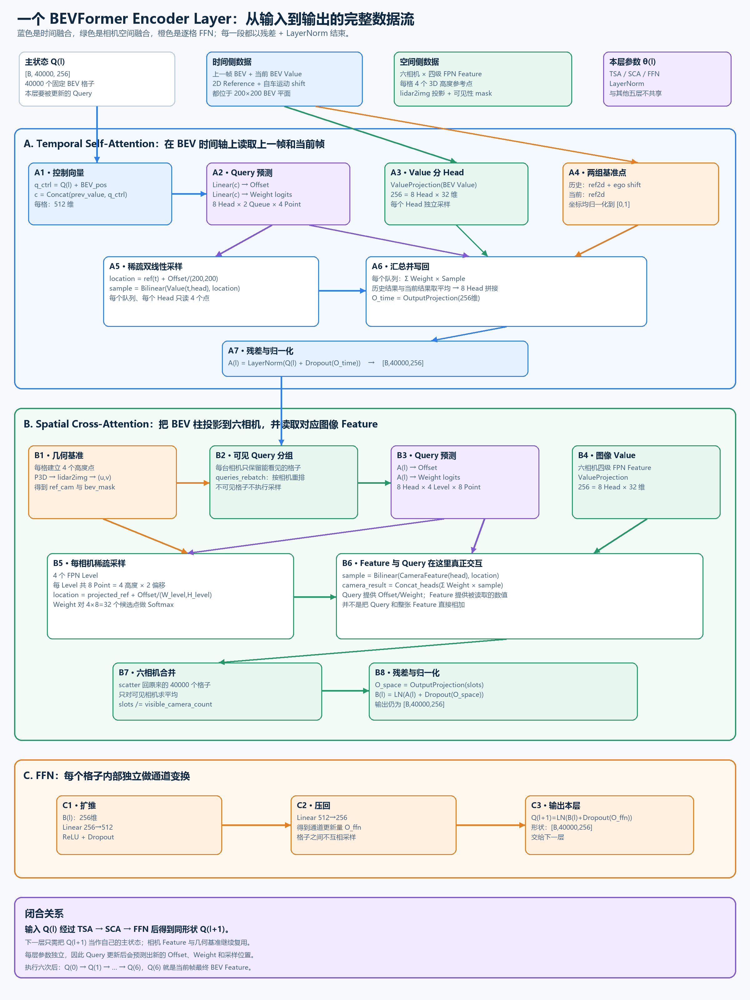
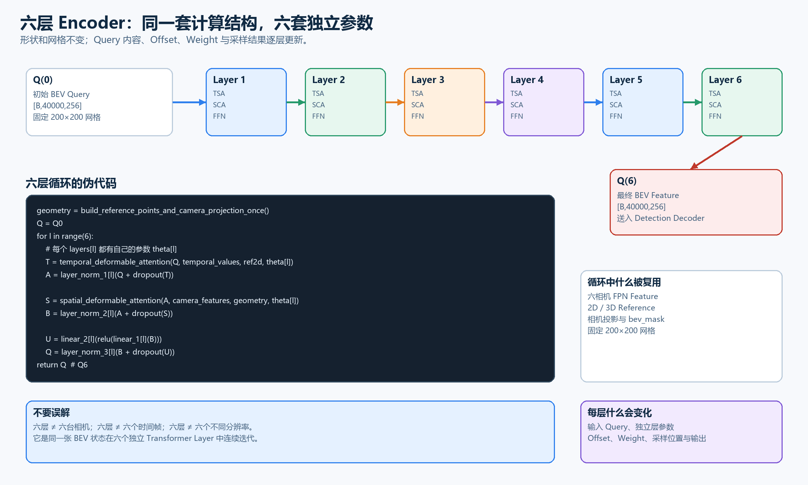

# BEVFormer 六层 Encoder：Temporal Attention 与 Spatial Attention 的封闭推导

这份说明只回答一件事：

> 一个 BEV Query 怎样经过 Temporal Self-Attention、Spatial Cross-Attention 和 FFN，变成下一层 Query；同样的结构又怎样连续执行六层。

全文使用官方 BEVFormer-base 的配置：

```text
BEV 网格：       200 × 200 = 40000 个格子
每个 Query：     256 维
Attention Head： 8 个，每个 Head 32 维
Encoder Layer：  6 层，参数互不共享
TSA：            2 个时间队列 × 每 Head 4 个采样点
SCA：            6 相机 × 4 FPN Level × 每 Head/Level 8 个采样点
```

---

## 1. 先理解 Attention 到底在做什么

Attention 可以理解为一次**由 Query 控制的数据读取**。

它至少有三个角色：

| 名称 | 作用 | BEVFormer 中的实例 |
| --- | --- | --- |
| Query | 表示当前状态，并决定去哪里读、各处占多大权重 | 某个 BEV 格子的 256 维向量 |
| Value | 真正被读取的数据 | 上一帧 BEV、当前 BEV 或相机 FPN Feature |
| Reference Point | 读取操作的几何基准位置 | BEV 格中心，或者 BEV 三维点在相机中的投影 |



### 1.1 标准 Attention

普通 Transformer 常写成：

$$
\operatorname{Attention}(Q,K,V)
=
\operatorname{Softmax}
\left(
\frac{QK^{\mathsf T}}{\sqrt d}
\right)V.
$$

它让一个 Query 与所有 Key 做相似度计算，再对所有 Value 加权求和。

如果有 40000 个 BEV Query，完整的 BEV-to-BEV 注意力矩阵会接近：

$$
40000\times40000.
$$

计算量和显存都非常大。

### 1.2 BEVFormer 的可变形 Attention

BEVFormer 不计算完整的 $QK^{\mathsf T}$。它让 Query 只预测少量采样点：

$$
\Delta(q)=W_{\Delta}q+b_{\Delta},
$$

$$
\alpha(q)=
\operatorname{Softmax}(W_{\alpha}q+b_{\alpha}).
$$

其中：

- $\Delta(q)$：相对 Reference Point 的采样偏移；
- $\alpha(q)$：不同采样点的权重；
- 二者都是 Query 的函数。

一个 Head 的一般形式为：

$$
z_h(q,V,r)
=
\sum_{j=1}^{J}
\alpha_{h,j}(q)
\operatorname{Bil}
\left(
V^{(h)},
r_j+\Delta_{h,j}(q)
\right).
$$

`Bil` 表示双线性插值。采样坐标不需要落在整数像素或整数 BEV 格点上；它会从周围四个位置插值得到一个向量。

八个 Head 的结果拼回 256 维：

$$
o
=
W_o
\operatorname{Concat}
\left(
z_0,z_1,\ldots,z_7
\right)+b_o.
$$

最后通过残差写回 Query：

$$
q_{new}
=
\operatorname{LayerNorm}
\left[
q_{old}+\operatorname{Dropout}(o)
\right].
$$

因此完整关系是：

```text
Query
  ↓ 预测
Offset + Weight
  ↓ 与 Reference Point 组合
Sampling Location
  ↓ 从 Value 双线性采样
Sampled Feature
  ↓ 按 Weight 加权求和
Attention Output
  ↓ Output Projection + Dropout + Residual + LayerNorm
New Query
```

Query 不是被读取的图像数据。Query 是控制器；Value 才是内容。

---

## 2. 一层 Encoder 收到什么

设第 $l$ 层输入为：

$$
Q^{(l)}in\mathbb R^{B\times40000\times256}.
$$

第 $p$ 个格子的 Query 为：

$$
q_p^{(l)}\in\mathbb R^{256}.
$$

单层还有四类侧输入：

| 数据 | 形状或内容 | 用在哪里 |
| --- | --- | --- |
| 上一帧 BEV | $[B,40000,256]$ | Temporal Self-Attention |
| BEV 2D Reference | $[B,40000,1,2]$ | Temporal Self-Attention |
| 六相机四尺度 Feature | 六相机展平后的四个 FPN Level | Spatial Cross-Attention |
| 投影坐标与可见性 | `reference_points_cam`、`bev_mask` | Spatial Cross-Attention |

一层的完整流程如下：



下面从 $Q^{(l)}$ 开始，不省略中间步骤。

---

## 3. Temporal Self-Attention：什么是“时间注意力”

Temporal Self-Attention，简称 TSA，解决的问题是：

> 对于当前 BEV 格子 $p$，应该从上一帧 BEV 和当前帧 BEV 的哪些邻域读取信息？

它操作的是 **BEV Feature**，不是六相机原始图像。

称为 `Temporal`，因为它读取上一时刻和当前时刻的 BEV；称为 `Self-Attention`，因为 Query 与 Value 都属于 BEV 表示空间。

### 3.1 第一步：建立两个时间队列

存在上一帧时，两路 Value 为：

```text
Queue 0：对齐后的上一帧 BEV
Queue 1：本帧进入 Encoder 前的初始 BEV Value
```

记为：

$$
X_0=X_{hist},\qquad X_1=X_{cur}.
$$

每一路都是：

$$
X_t\in\mathbb R^{B\times40000\times256}.
$$

官方实现会在六层循环开始前，把这两个 Value 打包成首维为 $2B$ 的张量。存在历史帧时，这个 Value 张量会被六层复用；逐层改变的是控制 Query。

第一帧没有上一帧时，TSA 会把该层输入 Query 复制两份作为两路 Value。这时没有真实历史信息。

### 3.2 第二步：时间坐标对齐

每个 BEV 格子有二维中心：

$$
r_p=
\left(
\frac{x_p+0.5}{200},
\frac{y_p+0.5}{200}
\right).
$$

当前队列使用：

$$
r_{p,cur}=r_p.
$$

上一帧参考位置根据自车运动做平移补偿：

$$
r_{p,hist}=r_p+s_{ego}.
$$

上一帧 BEV 本身还会根据自车 yaw 做旋转对齐。这里的目标是让“上一帧的同一个世界位置”尽量与当前 BEV 格对齐。

### 3.3 第三步：构造预测 Offset 和 Weight 的控制向量

先把 BEV 位置编码加入当前 Query：

$$
\bar q_p^{(l)}=q_p^{(l)}+e_p.
$$

再与历史 Value 对应位置拼接：

$$
u_p^{(l)}
=
\operatorname{Concat}
\left(
x_{hist,p},
\bar q_p^{(l)}
\right)
\in\mathbb R^{512}.
$$

这个 512 维向量只负责产生控制参数：

$$
\Delta_{p,h,t,k}^{T,l}
=
\operatorname{reshape}
\left(
W_{\Delta,T}^{(l)}u_p^{(l)}+b_{\Delta,T}^{(l)}
\right),
$$

$$
a_{p,h,t,k}^{T,l}
=
\operatorname{reshape}
\left(
W_{\alpha,T}^{(l)}u_p^{(l)}+b_{\alpha,T}^{(l)}
\right).
$$

形状是：

```text
Offset：[B,40000,8 Head,2 Queue,1 Level,4 Point,2 xy]
Logit： [B,40000,8 Head,2 Queue,1 Level,4 Point]
```

每个 Queue、每个 Head 的四个点单独做 Softmax：

$$
\alpha_{p,h,t,k}^{T,l}
=
\frac{\exp(a_{p,h,t,k}^{T,l})}
{\sum_{j=1}^{4}\exp(a_{p,h,t,j}^{T,l})}.
$$

所以：

$$
\sum_{k=1}^{4}\alpha_{p,h,t,k}^{T,l}=1.
$$

历史队列和当前队列之间没有学习到的门控权重；两路结果最后直接求平均。

### 3.4 第四步：把 Value 投影并拆成八个 Head

两路 BEV Value 先经过 Value Projection：

$$
V_t=W_{v,T}^{(l)}X_t+b_{v,T}^{(l)}.
$$

每个格子仍为 256 维，然后按通道切成八个 Head：

$$
V_t
=
\operatorname{Concat}
\left(
V_t^{(0)},V_t^{(1)},\ldots,V_t^{(7)}
\right),
$$

$$
V_t^{(h)}\in\mathbb R^{40000\times32}.
$$

这里不是从八个位置取八个 Query。它只是把同一个256维 Value 的通道切成八组，每组32维。

### 3.5 第五步：计算真正的采样坐标

对格子 $p$、Head $h$、时间队列 $t$、采样点 $k$：

$$
\xi_{p,h,t,k}^{T,l}
=
r_{p,t}
+
\frac{\Delta_{p,h,t,k}^{T,l}}{(200,200)}.
$$

Reference 给出基准位置，Offset 给出基准位置附近的相对移动。

### 3.6 第六步：双线性采样和加权求和

从第 $t$ 路 BEV Value 的第 $h$ 个 Head 中采样：

$$
f_{p,h,t,k}^{T,l}
=
\operatorname{Bil}
\left(
V_t^{(h)},
\xi_{p,h,t,k}^{T,l}
\right)
\in\mathbb R^{32}.
$$

四个采样结果按权重汇总：

$$
z_{p,h,t}^{T,l}
=
\sum_{k=1}^{4}
\alpha_{p,h,t,k}^{T,l}
f_{p,h,t,k}^{T,l}
\in\mathbb R^{32}.
$$

八个 Head 拼回 256 维：

$$
z_{p,t}^{T,l}
=
\operatorname{Concat}_{h=0}^{7}
z_{p,h,t}^{T,l}.
$$

两条时间队列直接求平均：

$$
z_p^{T,l}
=
\frac{z_{p,hist}^{T,l}+z_{p,cur}^{T,l}}{2}.
$$

### 3.7 第七步：输出投影、残差与 LayerNorm

输出投影：

$$
o_p^{T,l}
=
W_{o,T}^{(l)}z_p^{T,l}+b_{o,T}^{(l)}.
$$

残差相加：

$$
\widetilde q_p^{T,l}
=
q_p^{(l)}
+
\operatorname{Dropout}(o_p^{T,l}).
$$

第一处 LayerNorm：

$$
A_p^{(l)}
=
\operatorname{LN}_1^{(l)}
\left(
\widetilde q_p^{T,l}
\right).
$$

到这里 TSA 完成，输出：

$$
A^{(l)}\in\mathbb R^{B\times40000\times256}.
$$

### 3.8 TSA 的逐行伪代码

```python
def temporal_attention(Q, bev_pos, temporal_value, ref2d, ego_shift, layer):
    # Q: [B,40000,256]
    identity = Q

    if temporal_value is None:              # 第一帧
        temporal_value = stack(Q, Q)        # [2B,40000,256]

    # 1. Query 只负责产生读取控制参数
    q_control = Q + bev_pos                  # [B,40000,256]
    control = concat(history_value, q_control)
                                               # [B,40000,512]

    offsets = layer.tsa_offset(control)
    offsets = reshape(offsets, [B,40000,8,2,1,4,2])

    logits = layer.tsa_weight(control)
    logits = reshape(logits, [B,40000,8,2,1,4])
    weights = softmax(logits, over="4 points of each queue/head")

    # 2. Value 才是被读取的内容
    values = layer.tsa_value_proj(temporal_value)
    values = reshape(values, [2*B,40000,8,32])

    refs = stack(ref2d + ego_shift, ref2d)    # 历史 / 当前
    locations = refs + offsets / [200, 200]

    # 3. 在两张 BEV Value 上进行稀疏双线性采样
    samples = deformable_bilinear_sample(values, locations)
    per_queue = weighted_sum(samples, weights) # [B,2,40000,256]

    temporal_result = mean(per_queue, over="2 queues")
    temporal_result = layer.tsa_output_proj(temporal_result)

    # TemporalSelfAttention.forward 在残差后返回；Norm 在外层执行
    return layer.norm1(identity + dropout(temporal_result))
```

---

## 4. Spatial Cross-Attention：什么是“空间注意力”

Spatial Cross-Attention，简称 SCA，解决的问题是：

> 当前 BEV 格子对应到六台相机的哪些位置；应该从四个尺度的图像 Feature 中读取哪些邻域信息？

称为 `Spatial`，因为它围绕相机图像空间中的位置采样；称为 `Cross-Attention`，因为：

```text
Query：BEV 坐标系中的 Query
Value：相机图像坐标系中的 FPN Feature
```

两者来自不同表示空间。

### 4.1 第一步：给一个 BEV 格子建立四个 3D 高度点

一个 BEV 格子只确定地面上的 $(x,y)$。为了覆盖不同高度的物体，官方 Base 为每个格子建立四个高度参考点：

$$
P_{p,m}^{3D}
=
(x_p,y_p,z_m),
\qquad m\in\{0,1,2,3\}.
$$

因此：

$$
R^{3D}\in\mathbb R^{B\times4\times40000\times3}.
$$

### 4.2 第二步：把 3D 点投影到六台相机

对第 $c$ 台相机：

$$
\begin{bmatrix}
\tilde u\\
\tilde v\\
\tilde w\\
1
\end{bmatrix}
=
T_c^{lidar\rightarrow image}
\begin{bmatrix}
x\\y\\z\\1
\end{bmatrix}.
$$

执行透视除法：

$$
u=\frac{\tilde u}{\tilde w},
\qquad
v=\frac{\tilde v}{\tilde w}.
$$

再按图像宽高归一化到 $[0,1]$，得到：

$$
\rho_{p,c,m}in\mathbb R^2.
$$

只有同时满足下面条件的点才有效：

```text
深度 > 0
0 < u < 1
0 < v < 1
```

由此产生：

```text
reference_points_cam：[6,B,40000,4,2]
bev_mask：             [6,B,40000,4]
```

这个投影在进入六层循环前计算一次，并被六层复用。

### 4.3 第三步：按相机筛选可见 Query

不是每台相机都能看到全部40000个 BEV 格子。

代码根据 `bev_mask` 建立每台相机的可见格子列表：

```text
Camera 0：只保留它能看到的 Query
Camera 1：只保留它能看到的 Query
...
Camera 5：只保留它能看到的 Query
```

这个过程叫 `queries_rebatch`。它减少无效计算，但不会改变格子的全局编号；计算结束后还会 scatter 回原来的40000个位置。

### 4.4 第四步：当前 Query 预测空间 Offset 和 Weight

TSA 输出 $A_p^{(l)}$ 直接作为 SCA 的控制 Query：

$$
\Delta_{p,h,r,k}^{S,l}
=
\operatorname{reshape}
\left(
W_{\Delta,S}^{(l)}A_p^{(l)}+b_{\Delta,S}^{(l)}
\right),
$$

$$
a_{p,h,r,k}^{S,l}
=
\operatorname{reshape}
\left(
W_{\alpha,S}^{(l)}A_p^{(l)}+b_{\alpha,S}^{(l)}
\right).
$$

形状为：

```text
Offset：[B×6 Camera,VisibleQuery,8 Head,4 Level,8 Point,2]
Logit： [B×6 Camera,VisibleQuery,8 Head,4 Level,8 Point]
```

对每个 Query、每个 Head，四个 Level 的32个候选点共同做 Softmax：

$$
\alpha_{p,c,h,r,k}^{S,l}
=
\frac{
\exp(a_{p,c,h,r,k}^{S,l})
}{
\sum_{r'=0}^{3}
\sum_{k'=0}^{7}
\exp(a_{p,c,h,r',k'}^{S,l})
}.
$$

所以：

$$
\sum_{r=0}^{3}\sum_{k=0}^{7}
\alpha_{p,c,h,r,k}^{S,l}=1.
$$

八个 Point 与四个高度点的关系是：

```text
4 个高度参考点 × 每个高度 2 个学习偏移 = 8 个采样点
```

### 4.5 第五步：把相机 Feature 投影并拆 Head

第 $c$ 台相机、第 $r$ 个 FPN Level 的 Feature 记为：

$$
F_{c,r}\in\mathbb R^{H_r\times W_r\times256}.
$$

Value Projection：

$$
V_{c,r}^{(l)}
=
W_{v,S}^{(l)}F_{c,r}+b_{v,S}^{(l)}.
$$

再把256个通道拆成八个 Head：

$$
V_{c,r}^{(l,h)}
\in
\mathbb R^{H_r\times W_r\times32}.
$$

### 4.6 第六步：Reference、Offset 与 Feature 真正发生交互

第 $k$ 个采样点对应某一个高度锚点 $m(k)$。采样位置为：

$$
\xi_{p,c,h,r,k}^{S,l}
=
\rho_{p,c,m(k)}
+
\frac{
\Delta_{p,c,h,r,k}^{S,l}
}{(W_r,H_r)}.
$$

从相机 Feature 的对应位置读取32维向量：

$$
f_{p,c,h,r,k}^{S,l}
=
\operatorname{Bil}
\left(
V_{c,r}^{(l,h)},
\xi_{p,c,h,r,k}^{S,l}
\right)
\in\mathbb R^{32}.
$$

对四个 Level、每级八个 Point 加权求和：

$$
g_{p,c,h}^{S,l}
=
\sum_{r=0}^{3}
\sum_{k=0}^{7}
\alpha_{p,c,h,r,k}^{S,l}
f_{p,c,h,r,k}^{S,l}.
$$

八个 Head 拼回256维：

$$
g_{p,c}^{S,l}
=
\operatorname{Concat}_{h=0}^{7}
g_{p,c,h}^{S,l}.
$$

这一步就是 Query 与 Feature 真正交互的位置：

```text
Query → 产生 Offset 和 Weight
Feature → 在 Offset 指定的位置提供采样值
Weight → 决定这些 Feature 值怎样汇总
```

### 4.7 第七步：合并六台相机

每台相机的结果 scatter 回原 BEV 格子。对能看到格子 $p$ 的有效相机集合 $\mathcal V_p$ 求平均：

$$
\bar g_p^{S,l}
=
\frac{1}{\max(1,|\mathcal V_p|)}
\sum_{c\in\mathcal V_p}
g_{p,c}^{S,l}.
$$

这里不是固定除以6。例如某个格子只有前相机和前右相机可见，就只平均这两台相机。

### 4.8 第八步：输出投影、残差与 LayerNorm

$$
o_p^{S,l}
=
W_{o,S}^{(l)}\bar g_p^{S,l}+b_{o,S}^{(l)}.
$$

$$
\widetilde q_p^{S,l}
=
A_p^{(l)}
+
\operatorname{Dropout}(o_p^{S,l}).
$$

$$
B_p^{(l)}
=
\operatorname{LN}_2^{(l)}
\left(
\widetilde q_p^{S,l}
\right).
$$

SCA 输出仍然是：

$$
B^{(l)}\in\mathbb R^{B\times40000\times256}.
$$

### 4.9 SCA 的逐行伪代码

```python
def spatial_attention(A, camera_features, ref_cam, bev_mask, layer):
    # A: [B,40000,256]，已经经过 TSA + Norm
    identity = A

    # 1. 每台相机只处理自己能看到的 BEV Query
    visible_indices = build_visible_query_indices(bev_mask)
    queries_per_camera = rebatch(A, visible_indices)
    refs_per_camera = rebatch(ref_cam, visible_indices)

    # 2. BEV Query 产生空间采样控制参数
    offsets = layer.sca_offset(queries_per_camera)
    offsets = reshape(offsets, [B*6,N_visible,8,4,8,2])

    logits = layer.sca_weight(queries_per_camera)
    logits = reshape(logits, [B*6,N_visible,8,4*8])
    weights = softmax(logits, over="4 levels × 8 points")

    # 3. 相机 Feature 是真正被读取的 Value
    values = flatten_four_fpn_levels(camera_features)
    values = layer.sca_value_proj(values)
    values = reshape(values, [B*6,N_image,8,32])

    # 每个高度参考点对应两个学习偏移，共八个点
    locations = expand_four_height_refs(refs_per_camera)
    locations = locations + offsets / [W_level, H_level]

    # 4. 每台相机内部做稀疏双线性采样与加权求和
    samples = deformable_bilinear_sample(values, locations)
    result_per_camera = weighted_sum(samples, weights)
                                               # [B,6,N_visible,256]

    # 5. 回填到全局40000格，并平均所有可见相机
    slots = scatter_add(result_per_camera, visible_indices,
                        output_shape=[B,40000,256])
    slots = slots / clamp(visible_camera_count, min=1)
    spatial_result = layer.sca_output_proj(slots)

    return layer.norm2(identity + dropout(spatial_result))
```

---

## 5. FFN：Attention 之后为什么还需要它

TSA 和 SCA 负责从其他位置读取信息。FFN 不再改变采样位置，而是对每个格子的256个通道独立做非线性组合：

$$
u_p^{(l)}
=
W_2^{(l)}
\operatorname{ReLU}
\left(
W_1^{(l)}B_p^{(l)}+b_1^{(l)}
\right)
+b_2^{(l)}.
$$

维度变化：

```text
256 → Linear → 512 → ReLU → Linear → 256
```

第三次残差与归一化：

$$
Q_p^{(l+1)}
=
\operatorname{LN}_3^{(l)}
\left[
B_p^{(l)}
+
\operatorname{Dropout}(u_p^{(l)})
\right].
$$

至此，第 $l$ 层从 $Q^{(l)}$ 得到了同形状的 $Q^{(l+1)}$，逻辑闭合。

---

## 6. 一整个 Encoder Layer 的无跳步伪代码

```python
def encoder_layer(Q_l, temporal_value, camera_features, geometry, layer_l):
    # ------------------------------------------------------------
    # A. Temporal Self-Attention
    # ------------------------------------------------------------
    T = temporal_deformable_read(
        query=Q_l,
        value=temporal_value,
        reference_2d=geometry.ref2d,
        ego_shift=geometry.ego_shift,
        parameters=layer_l.tsa,
    )
    A_l = layer_l.norm1(Q_l + dropout(T))

    # ------------------------------------------------------------
    # B. Spatial Cross-Attention
    # ------------------------------------------------------------
    S = spatial_deformable_read(
        query=A_l,
        value=camera_features,
        projected_reference=geometry.reference_points_cam,
        visible_mask=geometry.bev_mask,
        parameters=layer_l.sca,
    )
    B_l = layer_l.norm2(A_l + dropout(S))

    # ------------------------------------------------------------
    # C. Feed-Forward Network
    # ------------------------------------------------------------
    U = layer_l.linear2(relu(layer_l.linear1(B_l)))
    Q_next = layer_l.norm3(B_l + dropout(U))

    return Q_next                  # [B,40000,256]
```

真实代码中，TSA/SCA 模块内部已经执行 `Dropout + Residual`，外层 `BEVFormerLayer` 再执行对应的 LayerNorm。上面的伪代码为了显示数学结构，把残差显式写在调用处。

---

## 7. 六层怎样完整串联



进入循环前，只构造一次几何数据：

```python
ref2d = build_200x200_grid_centers()
ref3d = build_four_height_points_for_every_bev_cell()
reference_points_cam, bev_mask = project_to_six_cameras(ref3d)
```

六层循环：

```python
Q = Q0                                      # [B,40000,256]

for l in range(6):
    Q = encoder_layer(
        Q_l=Q,
        temporal_value=temporal_value,
        camera_features=four_level_six_camera_features,
        geometry=shared_geometry,
        layer_l=layers[l],                  # 每层是独立对象
    )

Q6 = Q                                     # [B,40000,256]
```

数学递推为：

$$
Q^{(l+1)}
=
\mathcal E_{\theta_l}
\left(
Q^{(l)},
X_{temporal},
F_{camera},
R_{2D},
R_{cam},
M
\right),
$$

其中：

$$
l=0,1,2,3,4,5.
$$

最终：

$$
Q^{(6)}
=
\mathcal E_{\theta_5}
\circ\mathcal E_{\theta_4}
\circ\cdots\circ
\mathcal E_{\theta_0}
(Q^{(0)}).
$$

这里的复合表达式只是前面六次伪代码循环的数学缩写。

### 六层复用什么

```text
固定 200×200 BEV 网格
六相机四级 FPN Feature
2D / 3D Reference Point
reference_points_cam
bev_mask
```

### 六层改变什么

```text
输入 Query 内容
每层独立的 TSA/SCA/FFN 参数
Query 预测的 Offset
Query 预测的 Weight
真实采样位置
每层输出 Feature
```

因此，六层不是机械地计算六次相同结果。上一层更新了 Query，下一层就会重新决定“去哪里读”和“读到的数据占多大权重”。

---

## 8. 一个极小数值例子

真实模型的一个 Head 输出32维。为了看清加权过程，下面把每个采样向量临时简化成一个标量。

历史队列四个采样值：

$$
[2,4,6,8]
$$

Query 预测的权重：

$$
[0.1,0.2,0.3,0.4].
$$

历史结果：

$$
z_{hist}
=0.1\times2+0.2\times4+0.3\times6+0.4\times8
=6.
$$

当前队列四个采样值：

$$
[1,3,5,7]
$$

权重：

$$
[0.4,0.3,0.2,0.1].
$$

当前结果：

$$
z_{cur}
=0.4\times1+0.3\times3+0.2\times5+0.1\times7
=3.
$$

TSA 两个队列平均：

$$
z=\frac{6+3}{2}=4.5.
$$

真实模型中，这个计算同时发生在：

```text
40000 个 Query
× 8 个 Head
× 2 个时间队列
× 每队列 4 个采样点
× 每个采样值 32 维
```

SCA 的逻辑相同，只是 Value 换成相机 FPN Feature，Reference 换成投影到相机的3D点，并增加四个 FPN Level 与可见相机合并。

---

## 9. 与官方代码一一对应

| 阶段 | 官方代码 |
| --- | --- |
| Base 六层配置和 `operation_order` | [bevformer_base.py](C:/Users/Thomas/Desktop/project/BEVFormer-master/projects/configs/bevformer/bevformer_base.py:78) |
| 2D/3D Reference Point | [encoder.py](C:/Users/Thomas/Desktop/project/BEVFormer-master/projects/mmdet3d_plugin/bevformer/modules/encoder.py:34) |
| 3D 点投影与 `bev_mask` | [encoder.py](C:/Users/Thomas/Desktop/project/BEVFormer-master/projects/mmdet3d_plugin/bevformer/modules/encoder.py:89) |
| 两个时间队列和六层循环 | [encoder.py](C:/Users/Thomas/Desktop/project/BEVFormer-master/projects/mmdet3d_plugin/bevformer/modules/encoder.py:196) |
| 单层 TSA→Norm→SCA→Norm→FFN→Norm | [encoder.py](C:/Users/Thomas/Desktop/project/BEVFormer-master/projects/mmdet3d_plugin/bevformer/modules/encoder.py:348) |
| TSA 的 control、Offset、Weight、采样与平均 | [temporal_self_attention.py](C:/Users/Thomas/Desktop/project/BEVFormer-master/projects/mmdet3d_plugin/bevformer/modules/temporal_self_attention.py:177) |
| SCA 的按相机重排、scatter 与相机平均 | [spatial_cross_attention.py](C:/Users/Thomas/Desktop/project/BEVFormer-master/projects/mmdet3d_plugin/bevformer/modules/spatial_cross_attention.py:126) |
| SCA 内部 Offset、Weight 与多尺度采样 | [spatial_cross_attention.py](C:/Users/Thomas/Desktop/project/BEVFormer-master/projects/mmdet3d_plugin/bevformer/modules/spatial_cross_attention.py:245) |

官方六层循环最关键的代码是：

```python
for lid, layer in enumerate(self.layers):
    output = layer(bev_query, ...)
    bev_query = output
```

`bev_query = output` 就是层间接口：上一层输出成为下一层输入。

---

## 10. 最终用一条因果链记忆

```text
一个 BEV 格子的 Query
  ↓
TSA：从上一帧/当前帧 BEV 邻域读取信息
  ↓ 残差 + Norm
SCA：把该格子的 3D 柱投影到六相机，并从图像 Feature 邻域读取信息
  ↓ 残差 + Norm
FFN：在这个格子的 256 个通道内部进行非线性变换
  ↓ 残差 + Norm
下一层 Query
  ↓
同样过程使用另一套参数再执行，直到第六层
  ↓
Q(6)：当前帧完整 BEV Feature，交给 Detection Decoder
```

必须抓住的核心只有一句：

> Temporal Attention 和 Spatial Attention 都是“Query 产生 Offset/Weight，再从对应 Value 的少量位置读取数据”；区别只是前者读取 BEV 时间状态，后者读取六相机图像 Feature。
