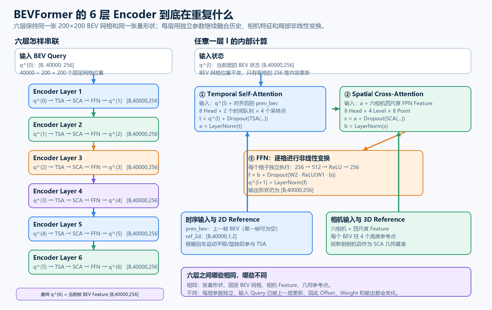

# BEVFormer：六层 BEV Encoder 的数学原理、代码和图像含义

## 1. 先给出完整结论

BEVFormer-base 的 Encoder 由六个**结构相同、参数独立**的 `BEVFormerLayer` 串联组成。每层都执行：

```text
Temporal Self-Attention
        ↓
LayerNorm
        ↓
Spatial Cross-Attention
        ↓
LayerNorm
        ↓
FFN
        ↓
LayerNorm
```

六层始终处理同一张 `200×200` BEV 网格：

$$
Q^{(l)}\in\mathbb R^{B\times40000\times256}.
$$

层与层之间不改变网格分辨率，也不把 `40000` 个 Query 合并或下采样。改变的是每个格子的 256 维内容：

$$
Q^{(0)}\rightarrow Q^{(1)}\rightarrow\cdots\rightarrow Q^{(6)}.
$$

最终：

$$
E_{\mathrm{BEV}}=Q^{(6)}
\in\mathbb R^{B\times40000\times256}.
$$



---

## 2. 六层之前已经准备好的输入

### 2.1 当前帧 BEV Query

模型维护 `200×200=40000` 个可学习 BEV Query：

$$
Q^{(0)}=[q_0^{(0)},q_1^{(0)},\ldots,q_{39999}^{(0)}].
$$

每个：

$$
q_p^{(0)}\in\mathbb R^{256}.
$$

格子编号 $p$ 在六层中不变。第 $p$ 个 Query 始终对应同一个 BEV 网格位置。

### 2.2 上一帧 BEV

如果存在上一帧：

$$
P\in\mathbb R^{B\times40000\times256}.
$$

模型先根据自车位移和旋转对齐上一帧 BEV，再交给 Temporal Self-Attention。第一帧没有历史时，代码使用当前 BEV 的副本填充两路时间队列。

### 2.3 六相机四尺度 Feature

Backbone 与 FPN 已经生成四层图像特征：

```text
Level 0：[B,6,256,H0,W0]
Level 1：[B,6,256,H1,W1]
Level 2：[B,6,256,H2,W2]
Level 3：[B,6,256,H3,W3]
```

这些 Feature 在六个 Encoder 层中作为共同的图像数据源。

### 2.4 2D 与 3D Reference Point

Encoder 在进入六层循环前生成两类几何参考点。

TSA 使用每个 BEV 格子的二维中心：

$$
r_p^{2D}
=
\left(
\frac{x_p+0.5}{200},
\frac{y_p+0.5}{200}
\right),
$$

形状为：

```text
[B, 40000, 1, 2]
```

SCA 为每个 BEV 柱生成四个不同高度的三维参考点：

```text
[B, 4 Height, 40000, 3 xyz]
```

然后通过六台相机的 `lidar2img` 矩阵投影到图像平面，得到：

```text
reference_points_cam：[6 Camera, B, 40000, 4 Height, 2 xy]
bev_mask：             [6 Camera, B, 40000, 4 Height]
```

Reference Point 和相机可见性在六层循环开始前计算一次。六层复用相同的几何基准，但每层会根据自己的 Query 预测不同的 Offset 和 Weight。

---

## 3. 单个 Encoder Layer 的封闭数学过程

设第 $l$ 层输入为：

$$
Q^{(l)}\in\mathbb R^{B\times40000\times256}.
$$

每层依次完成 TSA、SCA 和 FFN。

### 3.1 为什么每个模块都有残差和 LayerNorm

三个子模块都学习一个“更新量”，再写回原状态：

$$
x_{\mathrm{updated}}
=
x_{\mathrm{old}}
+
\operatorname{Dropout}
\left(
\Delta x
\right).
$$

残差路径使已有 BEV 信息不会被一次采样直接覆盖，也为反向传播提供较短的梯度路径。

Base 使用 Post-Norm。每次残差相加后，对每个 Query 的 256 个通道执行：

$$
\operatorname{LN}(x)_d
=
\gamma_d
\frac{x_d-\mu(x)}
{\sqrt{\sigma^2(x)+\varepsilon}}
+\beta_d.
$$

LayerNorm 不在 40000 个格子之间求平均；它分别规范化每个格子的 256 维向量。

---

## 4. 第一步：Temporal Self-Attention

TSA 解决的问题是：

> 当前 BEV 格子应从上一帧和当前帧的哪些邻域位置读取信息？

### 4.1 当前 Query 与历史状态共同产生控制参数

在加入 BEV 位置编码后，当前 Query 与上一帧对应位置的 BEV Value 拼接：

$$
c_p^{(l)}
=
\operatorname{Concat}
\left(
P_p,
q_p^{(l)}+e_p^{\mathrm{BEV}}
\right)
\in\mathbb R^{512}.
$$

由它预测采样偏移和权重：

$$
\Delta_{p,h,t,k}^{(l)}
=
W_{\Delta,t}^{(l)}c_p^{(l)}+b_{\Delta,t}^{(l)},
$$

$$
\alpha_{p,h,t,k}^{(l)}
=
\operatorname{Softmax}_k
\left(
W_{\alpha,t}^{(l)}c_p^{(l)}+b_{\alpha,t}^{(l)}
\right).
$$

Base 中：

```text
8 Head
2 个时间队列：上一帧、当前帧
1 个 BEV Level
每个 Head、每个时间队列 4 个采样点
```

对应形状：

```text
Offset：[B,40000,8,2,1,4,2]
Weight：[B,40000,8,2,1,4]
```

### 4.2 在两张 BEV 上进行稀疏采样

对于时间队列 $t$：

$$
s_{p,h,t,k}^{(l)}
=
r_{p,t}^{2D}
+
\frac{\Delta_{p,h,t,k}^{(l)}}{(200,200)}.
$$

其中上一帧参考点已经按照自车运动进行平移补偿。

对上一帧或当前 BEV Value 执行双线性采样：

$$
f_{p,h,t,k}^{(l)}
=
\operatorname{Bil}
\left(
V_t^{(h)},s_{p,h,t,k}^{(l)}
\right)
\in\mathbb R^{32}.
$$

每个 Head 加权聚合：

$$
g_{p,h,t}^{(l)}
=
\sum_{k=1}^{4}
\alpha_{p,h,t,k}^{(l)}f_{p,h,t,k}^{(l)}.
$$

代码将上一帧和当前帧两路结果取平均，再拼接八个 Head 并执行输出投影：

$$
o_{p,t}^{(l)}
=
W_{o,t}^{(l)}
\operatorname{Concat}_{h=1}^{8}
\left[
\frac{g_{p,h,0}^{(l)}+g_{p,h,1}^{(l)}}{2}
\right].
$$

### 4.3 TSA 残差与第一层 Norm

TSA 模块内部先执行残差相加：

$$
\widehat q_{p,t}^{(l)}
=
q_p^{(l)}
+
\operatorname{Dropout}
\left(o_{p,t}^{(l)}\right).
$$

外层 `BEVFormerLayer` 随后执行：

$$
a_p^{(l)}
=
\operatorname{LayerNorm}
\left(\widehat q_{p,t}^{(l)}\right).
$$

---

## 5. 第二步：Spatial Cross-Attention

SCA 解决的问题是：

> 这个 BEV 格子应该从哪些相机、哪些 FPN Level、哪些邻域位置读取图像特征？

### 5.1 几何投影确定基准位置

第 $p$ 个 BEV 柱的四个高度参考点先投影到各相机：

$$
\rho_{p,c,m}
=
\Pi_c
\left(
X_{p,m}^{3D}
\right),
$$

其中：

```text
c：相机，0～5
m：高度点，0～3
```

`bev_mask` 删除位于相机后方或图像范围外的投影点。

### 5.2 当前层 Query 预测 Offset 和 Weight

官方 Base 路径中，BEV 位置编码已经在 TSA 使用；SCA 调用没有再次显式传入 `query_pos`。因此控制参数直接由 $a_p^{(l)}$ 产生：

$$
\Delta_{p,h,r,k}^{(l)}
=
W_{\Delta,s}^{(l)}a_p^{(l)}+b_{\Delta,s}^{(l)},
$$

$$
\alpha_{p,h,r,k}^{(l)}
=
\operatorname{Softmax}_{r,k}
\left(
W_{\alpha,s}^{(l)}a_p^{(l)}+b_{\alpha,s}^{(l)}
\right).
$$

Base 中：

```text
8 Head
4 个 FPN Level
每个 Level 共 8 个采样点
8 Point = 4 个高度 × 每个高度 2 个 Offset
```

对应形状：

```text
Offset：[B,40000,8,4,8,2]
Weight：[B,40000,8,4,8]
```

### 5.3 从图像 Feature Head 中读取数据

相机特征先做 Value Projection 并拆为八个 32 维 Head：

$$
V_{c,r}
=
W_{\mathrm{val}}^{(l)}F_{c,r}+b_{\mathrm{val}}^{(l)}
\in
\mathbb R^{8\times32}.
$$

采样位置为：

$$
s_{p,c,h,r,k}^{(l)}
=
\rho_{p,c,m(k)}
+
\frac{\Delta_{p,h,r,k}^{(l)}}{(W_r,H_r)}.
$$

然后双线性采样并按权重求和：

$$
g_{p,c,h}^{(l)}
=
\sum_{r=0}^{3}
\sum_{k=0}^{7}
\alpha_{p,h,r,k}^{(l)}
\operatorname{Bil}
\left(
V_{c,r}^{(h)},s_{p,c,h,r,k}^{(l)}
\right).
$$

八个 Head 拼成 256 维。不同可见相机的结果求和，再除以有效相机数量：

$$
\overline g_p^{(l)}
=
\frac{1}{N_p}
\sum_{c\in\mathcal V_p}
\operatorname{Concat}_{h=1}^{8}
g_{p,c,h}^{(l)}.
$$

### 5.4 SCA 残差与第二层 Norm

输出投影：

$$
o_{p,s}^{(l)}
=
W_{o,s}^{(l)}\overline g_p^{(l)}+b_{o,s}^{(l)}.
$$

残差相加：

$$
\widehat q_{p,s}^{(l)}
=
a_p^{(l)}
+
\operatorname{Dropout}
\left(o_{p,s}^{(l)}\right).
$$

这正是此前讨论的：

$$
\widehat q_p=q_p+\operatorname{Dropout}(o_p).
$$

随后由外层执行：

$$
b_p^{(l)}
=
\operatorname{LayerNorm}
\left(\widehat q_{p,s}^{(l)}\right).
$$

---

## 6. 第三步：FFN

Attention 负责跨位置读取数据；FFN 在每个 BEV 格子内部独立进行通道混合和非线性变换。

Base 的隐藏维度为 512：

$$
u_p^{(l)}
=
W_2^{(l)}
\operatorname{ReLU}
\left(
W_1^{(l)}b_p^{(l)}+b_1^{(l)}
\right)
+b_2^{(l)}.
$$

形状：

```text
[256] → Linear → [512] → ReLU → Linear → [256]
```

残差相加：

$$
\widehat q_{p,f}^{(l)}
=
b_p^{(l)}
+
\operatorname{Dropout}
\left(u_p^{(l)}\right).
$$

第三个 LayerNorm 给出这一层的最终输出：

$$
q_p^{(l+1)}
=
\operatorname{LayerNorm}
\left(
\widehat q_{p,f}^{(l)}
\right).
$$

---

## 7. 单层可以写成一个递推函数

定义第 $l$ 层参数为 $\theta_l$，则：

$$
Q^{(l+1)}
=
\mathcal E_{\theta_l}
\left(
Q^{(l)},
P,
F_{\mathrm{cam}},
R_{2D},
R_{3D}
\right).
$$

六层为：

$$
Q^{(6)}
=
\mathcal E_{\theta_5}
\circ
\mathcal E_{\theta_4}
\circ
\cdots
\circ
\mathcal E_{\theta_0}
\left(Q^{(0)}\right).
$$

其中：

$$
\theta_0,\theta_1,\ldots,\theta_5
$$

互不共享。六层只是结构相同，每层都有独立的 TSA、SCA、FFN 和 LayerNorm 参数。

---

## 8. 六层之间到底有什么变化

| 项目 | 六层是否相同 | 说明 |
| --- | --- | --- |
| BEV 网格位置 | 相同 | 始终为固定 `200×200` 网格 |
| 张量形状 | 相同 | 始终 `[B,40000,256]` |
| 相机 FPN Feature | 相同 | 每层读取同一批当前帧 Feature |
| 2D/3D Reference | 相同 | 在六层循环前计算并复用 |
| 输入 Query 内容 | 不同 | 来自上一层的更新结果 |
| Offset 与 Weight | 不同 | 由不同 Query 和不同层参数预测 |
| TSA/SCA/FFN 参数 | 不同 | 六层不共享权重 |

不能硬性规定“第一层检测汽车、第二层检测行人”或“第一层一定粗、最后一层一定细”。这些职责不是代码预设的。更准确的理解是：六层反复执行信息检索、残差更新和非线性变换，使 BEV 表示逐渐适合下游检测。

---

## 9. 这些张量在图像上是什么

每层输出可以恢复成：

$$
Q^{(l)}
\rightarrow
\mathbb R^{B\times200\times200\times256}.
$$

它是一张**具有空间位置的 256 通道特征图**，并不是 RGB 图像。

一个 BEV 格子对应固定地面区域；六层之后它仍对应相同区域。改变的是该格子内部的 256 个特征数值。

为了让人观察，可使用三种可视化方法：

1. **通道热力图**：选一个通道，画成 `200×200` 灰度图；
2. **特征范数图**：计算每格 $\lVert q_p\rVert_2$，观察哪些区域响应强；
3. **PCA 伪彩色图**：把 256 维压缩成 3 维，映射为 RGB。

这些图只是解释手段，模型计算时始终使用完整 256 维 Feature。

官方 Base 配置 `return_intermediate=False`，因此默认只返回第六层结果。若要对比六层热力图，可以设置 `return_intermediate=True` 或注册 forward hook；此时六层堆叠结果的逻辑形状为：

```text
[6 Layer, B, 40000, 256]
```

---

## 10. 官方代码如何实现

### 10.1 配置六层和执行顺序

[bevformer_base.py](C:/Users/Thomas/Desktop/project/BEVFormer-master/projects/configs/bevformer/bevformer_base.py:78)

```python
encoder=dict(
    type='BEVFormerEncoder',
    num_layers=6,
    num_points_in_pillar=4,
    transformerlayers=dict(
        type='BEVFormerLayer',
        attn_cfgs=[
            dict(type='TemporalSelfAttention', num_levels=1),
            dict(
                type='SpatialCrossAttention',
                deformable_attention=dict(
                    type='MSDeformableAttention3D',
                    num_points=8,
                    num_levels=4,
                ),
            ),
        ],
        feedforward_channels=512,
        operation_order=(
            'self_attn', 'norm',
            'cross_attn', 'norm',
            'ffn', 'norm',
        ),
    ),
)
```

### 10.2 在六层循环前生成 Reference Point

[encoder.py](C:/Users/Thomas/Desktop/project/BEVFormer-master/projects/mmdet3d_plugin/bevformer/modules/encoder.py:185)

```python
ref_3d = self.get_reference_points(
    bev_h, bev_w,
    num_points_in_pillar=4,
    dim='3d',
)

ref_2d = self.get_reference_points(
    bev_h, bev_w,
    dim='2d',
)

reference_points_cam, bev_mask = self.point_sampling(
    ref_3d,
    self.pc_range,
    img_metas,
)
```

### 10.3 六层串联

[encoder.py](C:/Users/Thomas/Desktop/project/BEVFormer-master/projects/mmdet3d_plugin/bevformer/modules/encoder.py:224)

```python
for lid, layer in enumerate(self.layers):
    output = layer(
        bev_query,
        key,
        value,
        ref_2d=hybird_ref_2d,
        ref_3d=ref_3d,
        reference_points_cam=reference_points_cam,
        bev_mask=bev_mask,
        prev_bev=prev_bev,
        ...
    )

    bev_query = output
```

这一句是层间关系的核心：

```python
bev_query = output
```

上一层输出直接成为下一层输入。

### 10.4 单层内部顺序

[encoder.py](C:/Users/Thomas/Desktop/project/BEVFormer-master/projects/mmdet3d_plugin/bevformer/modules/encoder.py:348)

```python
for layer in self.operation_order:
    if layer == 'self_attn':
        query = self.attentions[0](...)

    elif layer == 'norm':
        query = self.norms[norm_index](query)

    elif layer == 'cross_attn':
        query = self.attentions[1](...)

    elif layer == 'ffn':
        query = self.ffns[0](query)
```

### 10.5 TSA 两路结果融合

[temporal_self_attention.py](C:/Users/Thomas/Desktop/project/BEVFormer-master/projects/mmdet3d_plugin/bevformer/modules/temporal_self_attention.py:197)

```python
query = torch.cat([value[:bs], query], -1)

sampling_offsets = self.sampling_offsets(query)
attention_weights = self.attention_weights(query).softmax(-1)

# 上一帧和当前帧两路结果取平均
output = output.view(
    num_query,
    embed_dims,
    bs,
    self.num_bev_queue,
)
output = output.mean(-1)

return self.dropout(self.output_proj(output)) + identity
```

### 10.6 SCA 残差输出

[spatial_cross_attention.py](C:/Users/Thomas/Desktop/project/BEVFormer-master/projects/mmdet3d_plugin/bevformer/modules/spatial_cross_attention.py:162)

```python
slots = slots / count[..., None]
slots = self.output_proj(slots)

return self.dropout(slots) + inp_residual
```

---

## 11. 最简记忆方式

```text
一层 Encoder：
从历史 BEV 找信息
→ 从六相机 Feature 找信息
→ 在每个格子内部做非线性变换
→ 保持同一张 200×200 BEV 网格

六层 Encoder：
用六套独立参数，把这套更新连续执行六次。
```

