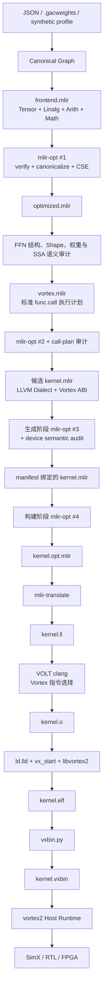
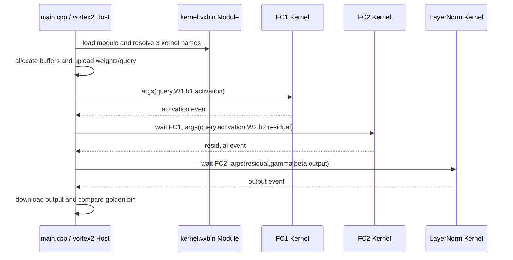

# BEVFormer Direct-MLIR → Vortex 编译器分层架构

本文对应 General-AI-Compiler 的
[`lg/bevformer-vortex-direct-mlir`](https://github.com/luogantt/General-AI-Compiler/tree/lg/bevformer-vortex-direct-mlir)
分支，系统说明一个 BEVFormer Transformer FFN 如何从模型图逐层变成 Vortex
可执行的 `.vxbin`。

本文以代码提交 `a7110bb` 为实现基线；分支本身会继续向前移动，验证结论对应的
工具链、产物摘要和日期以第 15 节链接的验证记录为准。

2026-10-14 新增可选的 `dxa-double-buffer` MatMul 调度，沿用本文 ABI 和编译链，
将 FC1/FC2 改为 LMEM 分块、DXA 预取与跨 Tile 累加。首版 scalar 的实现说明保留，
新增路径见[双缓冲设计](designs/vortex_buffered_mlir.md)、[源码对应图](bevformer-vortex-buffered-code-map.html)
与[本轮数值/周期对照](validation/vortex/buffered-mlir-2026-10-14/README.md)。

这条路径的核心结论是：**设备端不再生成或编译 C++ Kernel；GAC 直接生成 LLVM
Dialect MLIR，VOLT 继续负责最终的 Vortex 指令选择、寄存器分配、发散控制和 ELF
生成。** 主机端 `main.cpp`、Vortex 启动代码、链接脚本和 `vortex2` Runtime 仍然保留，
因为它们承担设备调度与程序装载，并不属于设备 Kernel 实现。

## 1. 当前支持范围

当前分支实现的是一个可验证的纵向切片，而不是完整 BEVFormer：

```text
query
  → MatMul(fc1_weight)
  → Bias + ReLU
  → MatMul(fc2_weight)
  → Bias + query residual
  → LayerNorm(scale, bias)
  → output
```

用公式表示：

```text
A = ReLU(Q × W1 + b1)
R = Q + A × W2 + b2
Y = LayerNorm(R, gamma, beta, epsilon)
```

其中：

| 符号 | Shape | 含义 |
|---|---:|---|
| `Q` | `[rows, channels]` | 展平后的 BEV query |
| `W1` | `[channels, hidden]` | FFN 第一层权重 |
| `b1` | `[hidden]` | 第一层偏置 |
| `W2` | `[hidden, channels]` | FFN 第二层权重 |
| `b2` | `[channels]` | 第二层偏置 |
| `gamma`、`beta` | `[channels]` | LayerNorm 仿射参数 |

当前约束为静态 Shape、连续 FP32、RV32。ResNet/FPN、Attention、
MSDeformableAttention、GridSample、Decoder、检测头和 `prev_bev` 状态管理尚未进入
这条 Vortex direct lowering。Direct 路径也不会回退到 CUDA、PTX、cuBLAS 或 CuPy。

分支同时保留 `cpp-template` compatibility 模式。要使用本文介绍的路径，命令行必须
显式传入：

```text
--device-lowering direct-mlir
```

| 模式 | 设备源码 | 设备实现路径 | 本文中的角色 |
|---|---|---|---|
| `direct-mlir` | `kernel.mlir` | LLVM Dialect MLIR → VOLT | 本文主线，已完成 synthetic 全链路验证 |
| `cpp-template` | `kernel.cpp` | 固定 Vortex C++ 模板 → VOLT | 保留的 compatibility 路径，也是 CLI 默认值 |

## 2. 总体架构

这套设计不把模型直接翻译成一段不可审计的机器码，而是建立三个职责不同的 MLIR
层次，再进入 LLVM/VOLT 后端：



三个 MLIR 层次的职责如下：

| 层次 | 文件 | 解决的问题 |
|---|---|---|
| 模型语义层 | `frontend.mlir`、`optimized.mlir` | 模型到底要计算什么 |
| 执行计划层 | `vortex.mlir` | 拆成哪些 Kernel、调用顺序和 buffer 关系是什么 |
| 设备代码层 | `kernel.mlir` | 每个 Vortex 线程执行哪些 LLVM Dialect 指令 |

这样分层的目的，是把“模型语义是否正确”“Kernel 调度是否正确”“目标机器 ABI 是否
正确”分开验证。任何一层不符合冻结合同都会停止编译，而不是带着错误继续生成二进制。

其中 `optimized.mlir → vortex.mlir` 和 `vortex.mlir → kernel.mlir` 是 GAC Python
后端实现的确定性、受限 lowering；它们不是 stock `mlir-opt` 自动完成的通用 conversion
pass。`mlir-opt` 在这些边界负责真实的解析、验证、规范化和 CSE。

## 3. 第 0 层：输入与模型来源

命令入口是
[`tools/build_bevformer_vortex.py`](../tools/build_bevformer_vortex.py)，实际实现位于
[`src/gac/tools/build_bevformer_vortex.py`](../src/gac/tools/build_bevformer_vortex.py)。
它接受四类输入：

1. `--model`：包含权重的 GAC Canonical Graph JSON。
2. `--weights`：经过校验的 `.gacweights`，从指定 Encoder layer 抽取 FFN。
3. `--synthetic-smoke`：`[1,2,4] → 8 → 4` 的最小正确性 workload。
4. `--synthetic-width-smoke` 或 `--synthetic-production`：生产通道宽度或完整
   `2500 × 256` profile。

这一层只负责得到确定的 Graph、静态 Shape、六组权重和权重来源信息。合成数据用于
编译链与数值 smoke，不用于模型精度结论。

## 4. 第 1 层：Canonical Graph 冻结模型语义

`compile_vortex_direct()` 首先复用 `compile_vortex()` 建立共享前端。
[`_match_bevformer_ffn()`](../src/gac/backends/vortex.py) 不接受任意图，而是要求精确的
节点序列：

```text
MatMul → AddReLU → MatMul → Add → Add → LayerNorm
```

它同时检查：

- 图输入必须是 `query`，输出必须是 `output`；
- 输入和输出必须符合 `[1, rows, channels]`；
- 只能出现 `fc1_weight`、`fc1_bias`、`fc2_weight`、`fc2_bias`、
  `norm_weight`、`norm_bias` 六组常量；
- 权重 Shape 与角色必须吻合；
- dtype 必须为 FP32；
- LayerNorm epsilon 必须是有限正数；
- 元素数、FP32 byte size 和索引不能超过 RV32 可表示范围。

这一步形成 `VortexFFNPlan`，其中保存 `rows`、`channels`、`hidden`、epsilon、输入输出
Shape 以及三个目标 Kernel 名称。后续每一层都必须重新证明自己仍然符合这份计划。

## 5. 第 2 层：Tensor/Linalg MLIR 表达计算含义

Canonical Graph 首先由通用 MLIR 前端生成 `frontend.mlir`。这一层使用标准方言：

- `func`：函数边界；
- `tensor`：静态张量；
- `linalg`：两个 MatMul 和逐元素计算；
- `arith`：加法、比较和 ReLU；
- `math`：LayerNorm 所需数学运算。

随后外部 `mlir-opt` 执行：

```text
--verify-each --canonicalize --cse
```

输出保存为 `optimized.mlir`。这里是真实调用 LLVM/MLIR 工具链中的 `mlir-opt`
可执行文件，并非 Python 模拟优化器，也不是通过动态库调用一段 C 接口。

优化后，后端不会直接相信文本结果。
[`_parse_optimized_mlir()`](../src/gac/backends/vortex.py) 和
[`_audit_optimized_weights()`](../src/gac/backends/vortex.py) 会重新审计：

- 是否恰好存在两个 `linalg.matmul`；
- 是否存在预期的 ReLU 和 LayerNorm；
- 函数 ABI、静态类型与 Shape 是否一致；
- 六组 `dense` 常量能否恢复为完全相同的 little-endian FP32 bytes；
- 权重的 SSA 用途是否与 `fc1`、`fc2`、LayerNorm scale/bias 的语义角色一致。

因此，即使两个权重 Shape 相同，互换 scale 和 bias，或只改变一个 bit，也会被拒绝。

## 6. 第 3 层：`vortex.mlir` 冻结执行计划

通过模型语义审计后，后端生成第二份标准 MLIR：`vortex.mlir`。它不包含设备循环，
而是用 `func.call` 表达三次抽象 Kernel call-plan 调用：

文件名中的 `vortex` 表示目标执行计划；它仍然只使用标准 `func`、`arith` 和静态
`memref`，不是自定义 Vortex Dialect，也不会被直接链接或在 Runtime 中执行。

```text
fc1(query, fc1_weight, fc1_bias → activation)
fc2(query, activation, fc2_weight, fc2_bias → residual)
layer_norm(residual, norm_weight, norm_bias → output; epsilon)
```

这一层保存：

- 10 个静态 FP32 memref 的类型和顺序；
- 三次调用的精确 SSA buffer 数据流；
- launch size：`rows × hidden`、`rows × channels`、`rows`；
- LayerNorm epsilon；
- 六个外部权重文件的 SHA-256；
- 上游 `optimized.mlir` 的摘要。

第二次 `mlir-opt` 验证并规范化这份计划，然后
[`_parse_vortex_mlir()`](../src/gac/backends/vortex.py) 再次检查调用数量、顺序、类型、
SSA 实参、launch 常量和权重绑定。

保留 call-plan 层的原因，是让模型分析与设备代码生成解耦。未来 MatMul 可以改成
LMEM tiled、TCU 或库调用，但三个 Kernel 的输入输出和调用关系仍可沿用同一份经过
审计的计划。

## 7. 第 4 层：直接生成 LLVM Dialect 设备 Kernel

[`compile_vortex_direct()`](../src/gac/backends/vortex.py) 在共享前端完成后执行以下工作：

1. 要求所选 `mlir-opt` 必须来自固定的 VOLT LLVM 20.1.8 revision。
2. 计算 `optimized.mlir` 和 `vortex.mlir` 的 SHA-256。
3. 调用
   [`emit_bevformer_ffn_device_mlir()`](../src/gac/backends/vortex_device_mlir.py)
   生成 `kernel.mlir`。
4. 第三次调用外部 `mlir-opt` 验证并规范化设备 module。
5. 调用
   [`audit_bevformer_ffn_device_mlir()`](../src/gac/backends/vortex_device_mlir.py)
   对规范化后的设备代码做结构和语义审计。

实现上，`compile_vortex_direct()` 当前复用 `compile_vortex()` 来构建共享前端和 call
plan，因此内存中会短暂构造 compatibility 的 C++ 字符串；Direct 分支随后清空
`kernel_source` 并替换为 `device_mlir`。发布的 Direct artifact、Makefile 和实际设备
编译都不保存、读取或编译该 C++ Kernel。

`kernel.mlir` 只使用 LLVM Dialect，并通过少量 inline asm/intrinsic 表达 Vortex
特性。当前没有自定义 `Vortex` Dialect，也没有把设备 C++ 源码藏在中间步骤中。

### 7.1 三个 Kernel 的线程映射

| Kernel | 线程映射 | 单线程工作 |
|---|---|---|
| `bevformer_fc1_bias_relu` | 一个线程对应一个 `[row, hidden]` 输出 | 串行遍历 `channels`，完成 MatMul、Bias、ReLU |
| `bevformer_fc2_bias_residual` | 一个线程对应一个 `[row, channel]` 输出 | 串行遍历 `hidden`，完成 MatMul、Bias、Residual |
| `bevformer_layer_norm` | 一个线程对应一行 | 串行计算 mean、variance 和仿射输出 |

线程全局索引来自三个 Vortex CTA CSR：

| CSR | 含义 |
|---:|---|
| `0xcd3` | thread id x |
| `0xcd6` | block id x |
| `0xcd9` | block dimension x |

设备 MLIR 使用：

```text
global_id = block_id × block_dim + thread_id
```

CSR 通过 `llvm.inline_asm "csrr $0, $1"` 读取；block id、block dimension 和参数指针
使用 `llvm.riscv.vx.uniform` 标记 uniform 性质。VOLT 的发散分析据此在越界分支周围
生成 `vx_split_n` / `vx_join`。

### 7.2 为什么首版仍然是标量循环

这一阶段的目标是先证明以下闭环成立：

```text
MLIR 语义正确
  → ABI 正确
  → VOLT 能选择 Vortex 指令
  → ELF/vxbin 能被 Runtime 识别
  → SimX 数值一致
```

标量循环便于建立可解释的基线。它不是最终性能方案；删除 C++ Kernel 本身也不会让
相同算法自动变快。

## 8. Vortex Kernel ABI

### 8.1 目标与数据布局

设备 module 固定为：

```text
target triple: riscv32-unknown-unknown-elf
data layout:   e-m:e-p:32:32-i64:64-n32-S128
ISA:           RV32IMAF + xvortex + zicond
ABI:           ilp32f
```

使用 canonical triple 是为了与 Clang driver 保持一致，避免 `-Werror` 下的
`-Woverride-module`。实际 driver 参数写作 `--target=riscv32-unknown-elf`，Clang 会把
它 canonicalize 为 module 中的 `riscv32-unknown-unknown-elf`，两者并不冲突。

### 8.2 `a0` 参数缓冲区

Host 通过 `args_host` 提交参数，Vortex Runtime 把 blob 复制到 device scratch；启动
代码再从 `VX_CSR_MSCRATCH` 取得该 blob 的地址并送入 Kernel 的 `a0`。三个 Kernel 的
参数布局分别为：

| Kernel | Size / Align | 字段与 byte offset |
|---|---:|---|
| FC1 | `48 / 8` | `rows@0`、`channels@4`、`hidden@8`、padding@12、`query@16`、`weight@24`、`bias@32`、`output@40` |
| FC2 | `56 / 8` | `rows@0`、`channels@4`、`hidden@8`、padding@12、`query@16`、`activation@24`、`weight@32`、`bias@40`、`output@48` |
| LayerNorm | `48 / 8` | `rows@0`、`channels@4`、`epsilon@8`、padding@12、`input@16`、`scale@24`、`bias@32`、`output@40` |

Host/Kernel 边界传递的是这三个固定布局 struct 和 raw device address，不传递 MLIR
MemRef descriptor。

Host 结构体在 [`_common_header()`](../src/gac/backends/vortex.py) 中通过 `sizeof`、
`alignof` 和 `offsetof` 的 `static_assert` 固定布局；相同合同也写入 `manifest.json`。

Vortex host API 提供的地址在参数 blob 中以 `i64` 保存，但当前设备为 RV32。Host 在
launch 前拒绝大于 `UINT32_MAX` 的地址；设备端再显式执行：

```text
i64 address → llvm.trunc → i32 → llvm.inttoptr → !llvm.ptr
```

这样既保持 Host API 的存储类型，又不会静默丢失有效地址位。

### 8.3 Kernel 如何被 Runtime 找到

普通 `llvm.func` 不能直接成为可启动的 Vortex Kernel。每个入口同时具备四项信息：

1. `passthrough = ["vortex-kernel"]`：告诉 VOLT 使用 Kernel 约定。
2. `llvm.global.annotations` 中的 `vortex.kernel`：让 VOLT 生成
   `__vx_kentry_<name>` alias。
3. `.vx_entry.<name>` 可执行 section：保存入口代码。
4. `llvm.used` 与 `llvm.compiler.used`：防止优化和 linker GC 删除入口。

链接完成后，`vxbin.py` 扫描 ELF 中的 `__vx_kentry_*`，把三个公开 Kernel 名称写入
`VXSYMTAB`。Host 才能通过名字创建 `vortex2` Kernel 对象。

## 9. 第 5 层：统一 LLVM/VOLT 工具链

本地普通 MLIR checkout 曾使用 LLVM 24，而 Vortex 的 VOLT 后端基于 LLVM 20.1.8。
LLVM IR/bitcode 不是跨大版本稳定 ABI，因此 direct 路径不允许 LLVM 24 生成 IR 后再
交给 LLVM 20。

分支固定一棵同时包含以下组件的 VOLT LLVM：

```text
LLVM version: 20.1.8
revision:     b2ecfe086df2d00233a87f3d3ebe6a74aba129e2
projects:     clang;lld;mlir
targets:      RISCV;X86
```

[`tools/build_volt_mlir_wsl.sh`](../tools/build_volt_mlir_wsl.sh) 负责检查 revision、在
Linux 文件系统准备源码、构建工具并写入 `.gac-build-revision` 完成标记。生成的
Makefile 要求同一个 `LLVM_PATH` 同时提供：

- `mlir-opt`；
- `mlir-translate`；
- `clang` / `clang++`；
- `ld.lld`；
- LLVM object inspection 工具。

设备构建顺序为：

```text
kernel.mlir
  → mlir-opt
  → kernel.opt.mlir
  → mlir-translate --mlir-to-llvmir
  → kernel.ll
  → VOLT clang
  → kernel.o
```

Makefile 显式指定同一工具树中的 `ld.lld`，避免从 `PATH` 意外选择其他 linker。

## 10. 第 6 层：链接、ELF 与 `.vxbin`

`kernel.o` 还不是可运行程序。Vortex build 系统继续加入：

- `vx_start.S` / KMU 启动代码；
- `libvortex2.a` 设备运行库；
- `link32.ld`；
- Vortex 目标编译与链接参数。

`ld.lld` 生成 `kernel.elf` 后，`vxbin.py` 提取可装载内容和 Kernel symbol table，生成
`kernel.vxbin`。

这里保留 VOLT 是必要的。MLIR/LLVM IR 只表达程序；真正把通用 IR 变成 Vortex/RISC-V
机器指令、完成寄存器分配和 relocation 的仍然是 VOLT。

## 11. 第 7 层：Host Runtime 与三 Kernel 调度

设备 C++ Kernel 已经移除，但 artifact 仍包含 `main.cpp`。它只负责 Host 工作：

1. 打开 Vortex device 和 command queue；
2. 分配 query、权重、activation、residual、output buffer；
3. 上传常驻权重和每轮输入；
4. 从 `kernel.vxbin` 创建 module；
5. 按名字取得三个 Kernel；
6. 构造三个 ABI 参数 blob；
7. 按依赖顺序提交 FC1 → FC2 → LayerNorm；
8. 读取 output；
9. 与冻结的 `golden.bin` 比较；
10. 输出 H2D、Kernel event、D2H、端到端和误差 JSON。

运行时关系如下：



## 12. Artifact 结构与完整性保护

[`write_vortex_artifact()`](../src/gac/backends/vortex.py) 只允许写入不存在或为空的目标
目录，并通过 staging directory 原子发布。Direct 模式生成 17 个受 manifest 管理的
payload，再额外写入 `manifest.json`：

```text
frontend.mlir             optimized.mlir
vortex.mlir               kernel.mlir
main.cpp                   common.h
model_config.h             Makefile
verify_artifact.py
fc1_weight.bin             fc1_bias.bin
fc2_weight.bin             fc2_bias.bin
norm_weight.bin            norm_bias.bin
query.bin                  golden.bin
manifest.json
```

Direct artifact 中不能出现设备 `kernel.cpp`。构建时产生的 `kernel.opt.mlir`、
`kernel.ll`、object、ELF、`.vxbin`、dump 和 Host executable 属于派生产物，不在这
17 个输入 payload 中。

`verify_artifact.py` 在编译前检查：

- manifest 文件集合必须与白名单精确相等；
- 禁止重复 JSON key、非有限数、路径穿越和 symlink；
- 每个文件的 byte size 与 SHA-256；
- 三份上游 MLIR 的摘要绑定；
- `kernel.mlir` 与 manifest 的摘要绑定；
- 六个权重文件、`vortex.mlir` 权重属性和 manifest 是否一致；

Direct 参数 ABI 会写入 manifest 供审阅和部署工具读取；布局正确性由 Host header 的
`static_assert`、device MLIR semantic audit 和单元测试共同保证，当前
`verify_artifact.py` 不重复解析这部分 ABI metadata。

生成的 Makefile 把 artifact 与 toolchain 校验放在 Host、object、ELF、`.vxbin` 和所有
`run-*` 目标之前，并强制重建 Direct 路径的派生产物，避免旧 `kernel.ll` 或旧 ELF
绕过当前 `kernel.mlir`。

## 13. 为什么还需要多重审计

这条分支采用“生成后重新解析并证明”的策略：

| 审计边界 | 防止的问题 |
|---|---|
| Canonical Graph matcher | 不支持的模型拓扑被错误接收 |
| optimized MLIR parser | `mlir-opt` 后 Shape、op 或函数 ABI 偏离 |
| weight audit | 权重 bit、Shape 或语义角色错配 |
| call-plan parser | buffer 交换、调用乱序、launch/epsilon 错误 |
| device MLIR audit | Kernel 算法、参数解包、CSR 或入口 metadata 被破坏 |
| artifact verifier | 部署目录混入旧文件或文件被替换 |
| toolchain verifier | LLVM 版本或 VOLT revision 混用 |
| Runtime golden check | 最终执行结果与 NumPy oracle 不一致 |

当前后端是受限编译器，因此“明确拒绝不支持的输入”比对任意 MLIR 做猜测式 lowering
更可靠。

## 14. 如何构建和运行

### 14.1 切换分支

```bash
git fetch origin
git switch lg/bevformer-vortex-direct-mlir
```

### 14.2 构建固定的 MLIR/VOLT 工具链

```bash
export LLVM_ROOT=/path/to/vortex-llvm-project
git -C "$LLVM_ROOT" checkout b2ecfe086df2d00233a87f3d3ebe6a74aba129e2

LLVM_ROOT="$LLVM_ROOT" bash tools/build_volt_mlir_wsl.sh
export LLVM_PATH="$HOME/.cache/gac-volt-llvm20/current-build"
```

脚本默认也会查找仓库外部的 sibling `llvm-project`。它不会自动把任意 LLVM checkout
改到目标 revision；revision 不匹配时会直接失败。

### 14.3 生成 Direct-MLIR smoke artifact

```bash
PYTHONPATH=src python3 tools/build_bevformer_vortex.py \
  --synthetic-smoke \
  --device-lowering direct-mlir \
  --mlir-opt "$LLVM_PATH/bin/mlir-opt" \
  --output build/bevformer-vortex-direct-smoke
```

在 Windows 上调用 WSL 中的工具时，再加入：

```text
--wsl --wsl-distribution Ubuntu-24.04
```

### 14.4 放入 Vortex regression build 并运行

生成的 Makefile 使用 Vortex regression **build tree** 目录合同，应部署到已经配置并
构建为 `XLEN=32` 的 Vortex build tree：

```text
$VORTEX_BUILD/tests/regression/<artifact-name>/
```

然后执行：

```bash
export VORTEX_BUILD=/path/to/vortex/build
export DEPLOY_DIR="$VORTEX_BUILD/tests/regression/gac_bevformer_direct_mlir"
mkdir -p "$DEPLOY_DIR"
rsync -av --delete build/bevformer-vortex-direct-smoke/ "$DEPLOY_DIR/"

make -C "$DEPLOY_DIR" LLVM_PATH="$LLVM_PATH" verify-artifact verify-toolchain
make -C "$DEPLOY_DIR" LLVM_PATH="$LLVM_PATH" -j"$(nproc)"
make -C "$DEPLOY_DIR" LLVM_PATH="$LLVM_PATH" run-simx \
  OPTS="--data-dir . --kernel kernel.vxbin --warmup 1 --repeat 10"
```

## 15. 已完成的验证

2026-10-13 的验证使用：

| 项目 | 固定值 |
|---|---|
| LLVM/VOLT | `20.1.8` / `b2ecfe086df2d00233a87f3d3ebe6a74aba129e2` |
| Vortex | `v3.0` / `7fe19369587c087f902c3e2bc2add612aa910a95` |
| 目标 | RV32IMAF + xvortex + zicond，`ilp32f` |
| workload | synthetic `[1,2,4] → 8 → 4` |
| 正确性 | `max_abs_error = 1.1920929e-7`，阈值 `1e-3` |
| SimX event-profile 均值 | `4.447282 ms` |
| Host-observed Kernel 均值 | `4.513678 ms` |
| SimX 端到端均值 | `4.602381 ms` |
| 指令统计 | `9999` instructions，`50591` cycles，IPC `0.198` |

验证实际完成：

```text
kernel.mlir
  → mlir-opt
  → mlir-translate
  → VOLT clang
  → kernel.o
  → ld.lld
  → kernel.elf
  → vxbin.py
  → kernel.vxbin
  → vortex2
  → SimX
```

完整证据位于
[`docs/validation/vortex/direct-mlir-2026-10-13`](validation/vortex/direct-mlir-2026-10-13/README.md)。
分支测试结果为 `524 passed, 33 skipped`。

Compatibility C++ 模式另有官方 checkpoint 和生产通道宽度的验证记录，但这些结果
不能算作 Direct-MLIR 的实测证据。本文对 Direct 路径只声明上面的 synthetic smoke
全链路结果。

这些时间是 tiny synthetic workload 在软件模拟器上的 wall-clock/event 数据，只用于
验证 ISA、ABI、调度和数值闭环。它们不是 Vortex FPGA/ASIC 性能，也不是完整
BEVFormer 推理延时，不能换算 FPS 或与 RTX 3070 CUDA Event 结果直接比较。

## 16. 代码导航

| 位置 | 作用 |
|---|---|
| [`src/gac/tools/build_bevformer_vortex.py`](../src/gac/tools/build_bevformer_vortex.py) | CLI、输入选择和 Direct/compatibility 路由 |
| [`src/gac/backends/mlir.py`](../src/gac/backends/mlir.py) | Canonical Graph 到 Tensor/Linalg MLIR |
| [`src/gac/backends/vortex.py`](../src/gac/backends/vortex.py) | Graph/MLIR 审计、call plan、Host、Makefile、artifact |
| [`src/gac/backends/vortex_device_mlir.py`](../src/gac/backends/vortex_device_mlir.py) | LLVM Dialect Kernel 生成与语义审计 |
| [`tools/build_volt_mlir_wsl.sh`](../tools/build_volt_mlir_wsl.sh) | 固定 LLVM/VOLT 20.1.8 工具链构建 |
| [`tests/test_vortex_backend.py`](../tests/test_vortex_backend.py) | 编译流程、ABI、manifest、Makefile 和负向测试 |
| [`tests/test_vortex_device_mlir.py`](../tests/test_vortex_device_mlir.py) | Device MLIR emitter/auditor 测试 |
| [`docs/designs/vortex_direct_mlir_abi.md`](designs/vortex_direct_mlir_abi.md) | ABI、入口、CSR 与 VectorAdd bring-up 细节 |
| [`docs/bevformer_vortex_backend.md`](bevformer_vortex_backend.md) | 两种 Vortex lowering 的使用与部署说明 |

阅读代码时推荐从以下调用链进入：

```text
tools/build_bevformer_vortex.py
  → gac.tools.build_bevformer_vortex.main
  → compile_vortex_direct
      → compile_vortex
          → compile_mlir
          → verify_mlir(frontend MLIR)
          → _match_bevformer_ffn
          → _parse_optimized_mlir
          → _audit_optimized_weights
          → _runtime_call_mlir
          → verify_mlir(call-plan MLIR)
          → _parse_vortex_mlir
      → _require_volt_llvm20_toolchain
      → emit_bevformer_ffn_device_mlir
      → verify_mlir(device LLVM-dialect MLIR)
      → audit_bevformer_ffn_device_mlir
  → write_vortex_artifact
  → generated Makefile: verify → mlir-opt → mlir-translate → VOLT → link → vxbin
```

## 17. 关键设计取舍

### 17.1 为什么不直接从 Graph 一步生成机器码

一步生成难以定位错误。三层 MLIR 分别保留模型含义、调度边界和设备实现，使每层都能
独立查看、做 hash、运行 verifier，并与上一层合同对照。

### 17.2 为什么没有先实现完整 Vortex Dialect

第一阶段优先打通真实机器码闭环。LLVM Dialect 已能表达循环、访存和 FP32 算术，
少量 Vortex 特性可通过 CSR inline asm 与已有 intrinsic 连接 VOLT。待算子和优化模式
稳定后，再把 thread id、barrier、LMEM、WMMA 等提升为正式 Vortex Dialect op，会比
一开始设计一个未经验证的大 Dialect 风险更低。

### 17.3 为什么保留 VOLT

Direct-MLIR 的“direct”指不经过设备 C++，并不表示绕过目标后端。LLVM IR 到 Vortex
机器码仍需要指令选择、寄存器分配、SIMT 发散处理、调度与 relocation，这些正是
VOLT 的职责。

### 17.4 为什么还保留 `main.cpp`

`main.cpp` 是 Host launcher，不是设备计算实现。它调用 `vortex2` 完成内存管理、
module 加载、Kernel 调度和计时。去掉它需要另写一个 Host Runtime 前端，并不会改变
设备机器码质量。

### 17.5 Python、MLIR C++ 和 VOLT 分别做什么

- Python：识别受支持的模型、生成 MLIR 文本、严格审计、生成 artifact。
- `mlir-opt` / `mlir-translate`：由固定 LLVM C++ 源码构建的外部程序，验证、规范化并
  转换 MLIR。
- VOLT：Vortex 修改版 LLVM 后端，把 LLVM IR 变成目标 object/ELF 中的机器指令。
- Vortex Runtime：装载 `.vxbin` 并执行 Kernel。

因此，这不是“用 Python 重写 MLIR”，也不是“从 Python 调一个 MLIR 动态库”；Python
负责编译流程与受限 lowering，真正的 MLIR verifier/translator 和机器码后端仍是
LLVM/VOLT C++ 工具链。

## 18. 下一阶段

当前三个 Kernel 已经证明 Direct-MLIR 路径可行，但仍是性能基线。后续按以下顺序
扩展：

1. 把 FC1/FC2 的每线程串行 K 循环改成 block/warp tiled MatMul。
2. 使用 Vortex LMEM/shared memory 做数据复用。
3. 加入向量化、预取和双缓冲。
4. 进一步融合 FC2 Bias + Residual + LayerNorm，减少 dispatch 和全局内存往返。
5. 根据 Vortex TCU 能力实现 WMMA/WGMMA lowering。
6. 对 tile、warp、block、LMEM 用量和融合策略做 autotuning。
7. 建立正式 Vortex Dialect，把 thread、barrier、LMEM 和 TCU 语义从 inline asm 提升为
   可组合、可验证的 op。
8. 扩展 Softmax、batched MatMul、Attention、MSDeformableAttention、GridSample、
   FPN 和完整 BEVFormer 状态执行。
9. 在 RTL/FPGA 上完成真实 checkpoint、nuScenes 输入、硬件延时和资源占用验收。

准确的当前状态是：**BEVFormer 的一个静态 FP32 FFN 已经不经过设备 C++，完成了
MLIR → LLVM IR → VOLT → Vortex ELF → `.vxbin` → SimX 的全流程，并通过数值验证；
完整 BEVFormer 和 Vortex 硬件性能优化仍是后续工作。**
