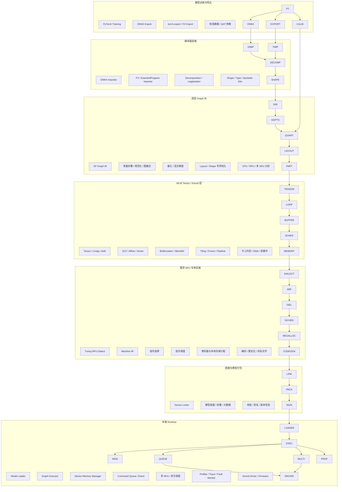
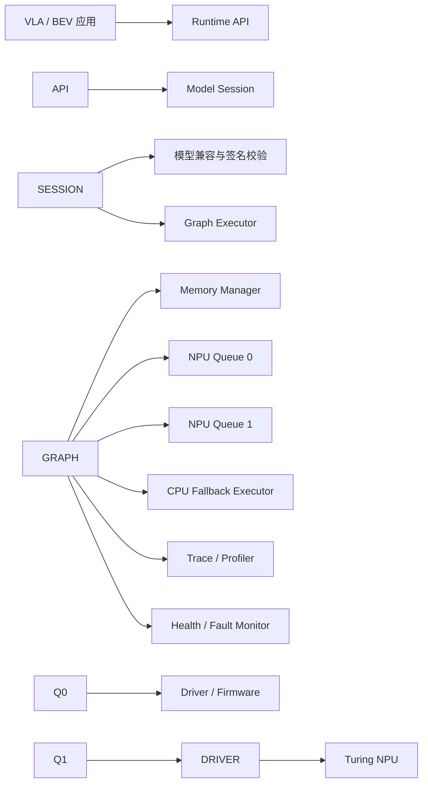

# 小鹏图灵 AI 编译器技术架构说明

> \*\*文档性质：推测性参考架构，不代表小鹏汽车已公开或确认的内部实现。\*\*  
> 本文依据小鹏公开披露的图灵 AI 芯片、Physical AI 全栈技术、TuringViT、VLA/VLM 车端部署需求，并结合主流 AI 芯片编译器工程实践，给出一套概率较高、工程上可落地的技术架构。
>
> \*\*版本\*\*：v1.0  
> \*\*日期\*\*：2026-10-10  
> \*\*适用读者\*\*：AI 编译器、模型部署、NPU 后端、Runtime、自动驾驶算法与系统工程师

\---

## 1\. 背景与判断边界

### 1.1 公开信息能够确认的部分

小鹏公开信息能够支持以下判断：

1. 小鹏正在构建覆盖 **图灵 AI 芯片、世界基座模型、软件与硬件应用** 的 Physical AI 全栈体系。
2. 图灵 AI 芯片面向车端、机器人和飞行汽车等场景，强调大模型推理、自研 NPU、神经网络专用架构与车规部署。
3. TuringViT 面向高分辨率、多视角、多帧视觉输入，强调硬件友好设计、低延迟和高效端侧部署。
4. 部分量产车型使用多颗图灵芯片，因此编译部署栈需要考虑单芯片多计算单元以及多芯片协同。
5. 小鹏尚未公开图灵编译器的前端格式、内部 IR、是否采用 MLIR、是否基于 TVM、机器指令格式、Runtime API 和模型文件格式。

### 1.2 本文采用的工程假设

本文按以下高概率路线展开：

```text
PyTorch 训练
   ├── ONNX 生产部署入口
   └── FX / torch.export 高保真入口
              │
              ▼
       小鹏自研 Graph IR
              │
              ▼
       MLIR Tensor / Kernel 层
              │
              ▼
       图灵 NPU 专用 Dialect
              │
              ▼
   自研 Machine IR / LLVM 组件
              │
              ▼
       汇编器、链接器、模型打包
              │
              ▼
       图灵 Runtime / Driver
```

该假设并不意味着：

* 小鹏一定直接使用 Torch-MLIR；
* 小鹏一定直接使用 LLVM CodeGen；
* 小鹏一定完全不使用 TVM；
* 文中出现的 Dialect、API、文件后缀或模块名称与小鹏内部名称一致。

更准确的定位是：

> \*\*自研 Graph IR 负责模型级语义和产品工程，MLIR 负责 Tensor/Kernel 多级 Lowering，自研 NPU Dialect 与 Machine IR 负责图灵硬件映射，专用 Runtime 负责车端确定性执行。\*\*

\---

## 2\. 架构目标

### 2.1 功能目标

编译器需要覆盖以下模型类型：

* CNN、BEV、Transformer、ViT；
* 多摄像头、多帧时序感知模型；
* VLM、VLA 和世界模型中的视觉编码、Token 处理与动作生成子图；
* 深度估计、占据网络、检测、分割、轨迹预测等模型；
* 学习式视觉里程计或学习式 VIO 网络部分；
* CPU、NPU 以及其他加速单元构成的异构模型。

对于传统 VIO 中的 IMU 预积分、滑窗优化、非线性求解和状态估计，通常仍应作为 CPU 上的 C/C++ 任务运行；只有神经网络特征提取、深度预测、匹配或端到端视觉里程计部分进入 NPU 编译链。

### 2.2 性能目标

编译器的核心目标不是单纯“模型能够运行”，而是同时优化：

* 端到端延迟；
* 周期抖动和最坏执行时间；
* NPU 计算单元利用率；
* 片上 SRAM 使用率；
* 外部内存带宽；
* 峰值内存；
* CPU/NPU 数据交换；
* 多 NPU 和多芯片并行效率；
* 精度损失；
* 模型加载时间与冷启动时间。

### 2.3 量产目标

车端编译部署系统还必须满足：

* 编译结果可复现；
* 模型与 Runtime 版本可追溯；
* 编译器升级后能够回归旧模型；
* 编译产物能够签名、校验和回滚；
* 算子实现与模型精度能够逐层验证；
* 对非法图、越界访问、资源超限和设备异常进行静态或运行时检查；
* 支持长周期维护和车端 OTA。

\---

## 3\. 总体架构



编译器分为两条逻辑链路：

```text
模型级编译：
PyTorch → ONNX/Export → Graph IR → 图优化 → 量化 → 异构分区

设备级编译：
Tensor IR → Kernel IR → NPU Dialect → Machine IR → 设备二进制
```

Runtime 不参与训练语义转换，主要负责：

```text
加载编译产物 → 绑定输入输出 → 分配内存 → 提交任务
→ 多 NPU 同步 → 收集状态 → 返回结果
```

\---

## 4\. 核心设计原则

### 4.1 双前端，单一内部语义

同时支持 ONNX 和 FX/`torch.export`，但两条入口最终必须汇聚到统一的 Graph IR：

```text
ONNX Node               ┐
                        ├──> Canonical Graph Op
ExportedProgram Node    ┘
```

这样可以避免后端为不同模型入口维护两套优化和代码生成逻辑。

### 4.2 Graph Compiler 与 Kernel Compiler 分离

Graph Compiler 处理：

* 模型语义；
* 算子关系；
* Shape；
* Layout；
* 量化；
* 融合；
* 异构分区；
* 子图调度。

Kernel Compiler 处理：

* Tensor 分块；
* 循环变换；
* 向量化；
* 片上内存；
* DMA；
* 双缓冲；
* 指令级并行；
* 设备指令生成。

二者通过明确的 Kernel Contract 连接，而不是让高层 Graph Pass 直接操作物理寄存器或 DMA 指令。

### 4.3 AOT 为主，动态机制受控

车端量产应以 AOT 为主：

```text
离线完成：
图优化、量化、分区、内存规划、Kernel 编译和链接

车端完成：
模型加载、地址绑定、命令提交和有限的 Shape 选择
```

动态分辨率可以采用：

* 多 Profile 预编译；
* Shape Bucket；
* 有边界的符号 Shape；
* 少量 Runtime 参数化 Kernel。

不宜依赖不可预测的车端大规模 JIT。

### 4.4 硬件特性显式表达

图灵 NPU 的矩阵单元、向量单元、片上存储、DMA、同步事件和多计算引擎，应在专用 Dialect 中显式表示，而不是隐藏在普通算子属性中。

### 4.5 确定性优先于无限动态性

自动驾驶部署比云端推理更重视：

* 固定或受控的执行图；
* 资源上界；
* 可预测的延迟；
* 可重放的调度；
* 明确的错误码；
* 可审核的编译产物。

\---

## 5\. IR 分层设计

|层级|建议 IR|抽象对象|主要优化|输出|
|-|-|-|-|-|
|L0|PyTorch / ONNX|训练模型、计算图|Export、Decomposition|前端图|
|L1|XP Graph IR|算子、Tensor、Shape、量化语义|图融合、常量折叠、Layout、分区|NPU 子图|
|L2|Tensor IR|结构化 Tensor 计算|算子展开、融合、Tiling|循环或 Kernel|
|L3|Loop / Vector IR|循环、向量、并行维度|循环交换、展开、向量化|Buffer 化程序|
|L4|Memory / Stream IR|Buffer、片上存储、DMA、事件|内存规划、双缓冲、流水线|NPU 任务图|
|L5|Turing NPU Dialect|NPU 矩阵、向量、搬运和同步操作|指令映射、资源约束检查|Machine IR|
|L6|Machine IR|虚拟寄存器、物理资源、机器基本块|指令调度、寄存器分配|机器码|
|L7|Model Package|代码、权重、元数据、重定位|链接、签名、版本封装|车端模型文件|

建议将“自研 Graph IR”和“MLIR IR”看成两个互补层次：

```text
自研 Graph IR：
更适合产品级模型兼容、量化元数据、版本升级、算子注册和异构分区

MLIR：
更适合结构化计算、多级 Lowering、Dialect 组合、循环和内存优化
```

\---

## 6\. 前端架构

### 6.1 ONNX 入口

ONNX 更适合作为稳定的生产入口，主要承担：

* 训练与部署解耦；
* 模型版本冻结；
* 算子白名单检查；
* 静态 Shape 或 Profile 固化；
* 第三方工具兼容；
* 旧模型和非 PyTorch 模型迁移。

编译流程：

```text
ONNX Model
  ↓
Schema Version Upgrade
  ↓
Initializer / Constant Load
  ↓
Shape \& Type Inference
  ↓
Operator Canonicalization
  ↓
XP Graph IR
```

ONNX Importer 需要处理：

* Opset 兼容；
* Optional 输入；
* Constant 与 Initializer；
* Subgraph 和控制流；
* Dynamic Axis；
* External Data；
* 自定义 Domain；
* 大权重分离存储；
* 算子版本升级。

### 6.2 FX / torch.export 入口

FX/`torch.export` 更适合新模型和高保真语义入口，主要处理：

* PyTorch 原生 Decomposition；
* 符号 Shape；
* 高阶算子；
* 自定义模块；
* Attention 与大模型图；
* 动态分辨率；
* 模型研发阶段的快速迭代。

推荐流程：

```text
nn.Module
  ↓
torch.export.ExportedProgram
  ↓
ATen Decomposition
  ↓
Functional Graph
  ↓
Shape Constraints
  ↓
XP Graph IR
```

该入口不应把 Python Runtime 带到车端。Python 仅用于模型捕获和离线编译，最终产物必须是独立于 Python 的设备模型。

### 6.3 Torch-MLIR 的位置

若使用 Torch-MLIR，它更可能承担：

```text
PyTorch / ATen
      ↓
Torch Dialect
      ↓
通用 MLIR 或自研 Graph Dialect
```

Torch-MLIR 本身不等于完整的图灵编译器。量化、分区、NPU Dialect、Machine IR、设备链接和 Runtime 仍需由小鹏自研或深度扩展。

\---

## 7\. 自研 Graph IR

### 7.1 设计目标

Graph IR 需要稳定表达：

* Operator；
* Tensor Value；
* 数据依赖和控制依赖；
* 静态与符号 Shape；
* 数据类型；
* Layout；
* Quantization 参数；
* Device Placement；
* Side Effect；
* Alias；
* 常量和权重；
* 多输入、多输出；
* 子图和控制流；
* 调试名称和源模型位置。

建议采用 SSA 风格的数据流表示：

```text
%0 = xp.conv2d(%input, %weight)
%1 = xp.bias\_add(%0, %bias)
%2 = xp.relu(%1)
%3 = xp.resize(%2)
```

融合后：

```text
%3 = xp.fused\_conv\_bias\_relu\_resize(
    %input,
    %weight,
    %bias
)
```

### 7.2 Graph IR Pass Pipeline

推荐的高层 Pass 顺序：

```text
1. Import Validation
2. Operator Version Upgrade
3. Shape / Type Inference
4. Constant Folding
5. Dead Node Elimination
6. Operator Decomposition
7. Canonicalization
8. Pattern Fusion
9. Layout Propagation
10. Quantization Preparation
11. Precision Assignment
12. Device Capability Check
13. CPU / NPU Partition
14. Subgraph Fusion
15. Memory Lifetime Analysis
16. Lowering to MLIR Tensor Layer
```

Pass 顺序必须可配置，但量产配置需要冻结和版本化。

### 7.3 算子规范化

不同前端算子应归一到较小的核心算子集合。例如：

```text
PyTorch aten.convolution
ONNX Conv
自定义 ConvBlock
        │
        ▼
xp.conv2d
```

复杂算子可以选择：

* 分解为基础算子；
* 保留为高层融合算子；
* Lowering 为专用 NPU Kernel；
* 交由 CPU Fallback；
* 调用经过认证的算子库。

\---

## 8\. 图优化体系

### 8.1 通用图优化

包括：

* 常量折叠；
* 常量传播；
* 公共子表达式消除；
* 无效节点删除；
* Identity 消除；
* Transpose 消除；
* Reshape 合并；
* Pad 合并；
* BatchNorm Folding；
* Conv-Bias-Activation 融合；
* MatMul-Bias-Activation 融合；
* LayerNorm、Softmax、Attention 模式识别。

### 8.2 自动驾驶专项优化

BEV、ViT 和多摄像头模型可能需要重点处理：

* 多路 Camera Backbone 合并；
* 图像预处理融合；
* Resize、Normalize、Color Convert 融合；
* Grid Sample；
* Scatter / Gather；
* Voxel Pooling；
* Deformable Attention；
* 多尺度特征融合；
* Temporal Cache；
* 多帧 Token 合并；
* BEV Query 与图像特征交互；
* 动态分辨率 Token Padding 消除。

以上是典型自动驾驶模型需求示例，不代表图灵 NPU 已公开支持的具体算子集合。

### 8.3 Layout 优化

Layout 不应只由单个算子决定，而应在子图范围传播：

```text
NCHW
NHWC
NCHWc
Blocked Channel Layout
Matrix Tile Layout
Vector Packed Layout
```

优化目标：

```text
最小化 Layout Transform
+ 满足 NPU Tensor Core 对齐
+ 提高连续访存
+ 降低外部内存带宽
```

\---

## 9\. 量化与混合精度

### 9.1 量化模式

编译器应支持：

* PTQ；
* QAT；
* Weight Only Quantization；
* Activation Quantization；
* Per-Tensor；
* Per-Channel；
* 对称与非对称量化；
* INT8、INT16、FP16、BF16 或芯片支持的其他格式；
* 关键层回退高精度；
* 混合精度搜索。

### 9.2 量化编译流程

```text
浮点模型
  ↓
插入 Observer 或读取 QAT 参数
  ↓
校准数据统计
  ↓
确定 Scale / Zero Point
  ↓
量化敏感度分析
  ↓
混合精度策略
  ↓
Quant-Dequant 消除
  ↓
量化算子融合
  ↓
NPU 量化 Kernel
```

### 9.3 Quantization Contract

模型团队与编译器团队之间应建立明确的量化契约：

```yaml
tensor: backbone.stage3.output
dtype: int8
scheme: symmetric
granularity: per\_channel
axis: 1
scale\_source: qat
fallback\_dtype: fp16
accuracy\_guard:
  metric: cosine\_similarity
  minimum: 0.995
```

该契约能够避免量化参数隐式散落在模型、脚本和编译器内部。

\---

## 10\. 异构分区

### 10.1 分区对象

系统可能包含：

* CPU；
* 图灵 NPU；
* 芯片内多个 NPU 或计算 Cluster；
* 图像预处理单元；
* 其他固定功能加速单元；
* 多颗图灵芯片。

编译器需要为每个节点确定执行位置：

```text
node.device = CPU
node.device = NPU:0
node.device = NPU:1
node.device = CHIP:1/NPU:0
```

### 10.2 分区约束

分区决策考虑：

* 算子是否支持；
* 数据类型是否支持；
* Shape 是否满足；
* 精度是否满足；
* 子图大小；
* 边界 Tensor 大小；
* Host/Device 拷贝；
* 跨 NPU 同步；
* 内存容量；
* 最坏延迟；
* 安全等级和故障隔离。

可采用类似以下成本函数：

```text
TotalCost =
    ComputeLatency
  + λ1 × TransferLatency
  + λ2 × PeakMemory
  + λ3 × LayoutConversion
  + λ4 × DeviceBoundaryCount
  + λ5 × RuntimeRisk
```

### 10.3 CPU Fallback 原则

CPU Fallback 只能作为受控能力：

* 编译期明确；
* 运行时不可随意改变；
* 边界 Tensor 尽量小；
* Fallback 算子具有确定性实现；
* 性能和最坏延迟经过验证；
* 不允许因未知算子在车端静默回退。

\---

## 11\. MLIR Tensor / Kernel 层

### 11.1 推荐使用的通用 Dialect

在不绑定小鹏内部实现的前提下，合理的 MLIR 组合可能包括：

* `tensor`：高层 Tensor；
* `linalg`：结构化计算；
* `arith`：标量算术；
* `math`：数学函数；
* `scf`：结构化控制流；
* `affine`：规则循环与访问分析；
* `vector`：向量操作；
* `memref`：Buffer 与内存视图；
* `async`：异步任务与事件；
* 自研 `xp.quant`；
* 自研 `xp.stream`；
* 自研 `xp.npu`。

### 11.2 Tensor 到 Kernel 的 Lowering

示例：

```text
linalg.matmul
   ↓ Tile
scf.for + tensor.extract\_slice
   ↓ Bufferize
memref.subview
   ↓ Vectorize
vector.contract
   ↓ NPU Map
xp.npu.matmul
```

### 11.3 核心优化

Kernel 层主要执行：

* Tiling；
* Loop Interchange；
* Loop Fusion；
* Loop Unrolling；
* Vectorization；
* Tensorization；
* Bufferization；
* Bank-aware Allocation；
* DMA 合并；
* Prefetch；
* 双缓冲；
* 三缓冲；
* 计算与搬运重叠；
* Producer/Consumer Pipeline；
* Kernel Fusion；
* Kernel Split；
* 自动或半自动 Schedule Search。

\---

## 12\. 图灵 NPU 专用 Dialect

### 12.1 Dialect 职责

图灵 NPU Dialect 用于表达“硬件能够直接理解，但仍高于机器指令”的操作：

```text
xp.npu.dma\_load
xp.npu.dma\_store
xp.npu.matmul
xp.npu.conv
xp.npu.vector\_add
xp.npu.vector\_exp
xp.npu.reduce
xp.npu.transpose
xp.npu.barrier
xp.npu.event\_record
xp.npu.event\_wait
xp.npu.collective
```

以上名称仅为说明性命名。

### 12.2 类型系统

专用类型可表达：

```text
!xp.npu.tensor<
    shape = \[1, 128, 80, 80],
    dtype = i8,
    layout = #xp.blocked<16>,
    memory = "local\_sram",
    bank = 2
>
```

### 12.3 资源属性

NPU Op 需要携带：

* 计算单元；
* Tile Shape；
* 向量宽度；
* SRAM 地址空间；
* DMA Channel；
* Pipeline Stage；
* 同步 Event；
* 精度模式；
* 饱和和舍入方式；
* 多 NPU Placement。

### 12.4 Verifier

Dialect Verifier 应在编译期检查：

* Shape 与指令约束；
* 地址对齐；
* Tile 是否越界；
* SRAM 容量；
* Bank 冲突；
* DMA 长度和步长；
* 数据类型组合；
* Event 依赖；
* 多引擎死锁风险；
* 设备版本兼容性。

\---

## 13\. 内存规划与数据搬运

### 13.1 内存层次

逻辑上至少需要区分：

```text
Host DDR
Device DDR / Shared Memory
On-Chip SRAM
Register / Local Storage
Constant Memory
Command Buffer
```

实际名称和层次由图灵芯片决定。

### 13.2 静态内存规划

对固定 Shape 模型，可以离线完成：

* Tensor 生命周期分析；
* 内存复用；
* In-place 合法性判断；
* 权重常驻；
* 激活峰值控制；
* SRAM 分块；
* Buffer 地址分配；
* 多 Stream 资源隔离。

### 13.3 双缓冲

典型流水：

```text
时间 T0：DMA Load Tile 0
时间 T1：Compute Tile 0 + DMA Load Tile 1
时间 T2：Store Tile 0 + Compute Tile 1 + DMA Load Tile 2
```

编译器需要同时生成：

* Buffer 轮转；
* DMA 描述符；
* Event；
* Wait；
* Store；
* 资源冲突约束。

\---

## 14\. Machine IR 与机器后端

### 14.1 Machine IR

Machine IR 应表达：

* 基本块；
* 控制流；
* 虚拟寄存器；
* 物理寄存器；
* 片上 Buffer；
* 指令 Operand；
* 隐式资源；
* 延迟模型；
* Hazard；
* Event；
* Relocation；
* 调试位置。

### 14.2 后端流程

```text
NPU Dialect
  ↓
Instruction Selection
  ↓
Pseudo Instruction Expansion
  ↓
Dependency Graph
  ↓
Resource-Aware Scheduling
  ↓
Register / Local Memory Allocation
  ↓
Spill / Reload
  ↓
Hazard Resolution
  ↓
Branch / Event Fixup
  ↓
Binary Encoding
```

### 14.3 LLVM 的可能位置

LLVM 组件可能用于：

* TableGen；
* MC Layer；
* 汇编和反汇编基础设施；
* ELF/目标文件支持；
* 通用寄存器分配算法；
* 调试信息；
* CPU 侧代码生成。

但 NPU 后端也可能采用完全自研的 Machine IR、Scheduler、Assembler 和二进制格式。本文不假定图灵 NPU 必然以 LLVM Target 形式实现。

\---

## 15\. 汇编器、链接器与模型容器

### 15.1 设备目标文件

单个 NPU Kernel 编译后可形成逻辑目标文件：

```text
Header
Code Section
Constant Section
Local Memory Requirement
Relocation Table
Symbol Table
Kernel Metadata
Debug Map
```

### 15.2 Device Linker

设备链接器负责：

* Kernel 合并；
* 符号解析；
* 常量去重；
* 权重地址绑定；
* 重定位；
* 跨 Kernel 调用或调度表；
* 多 NPU 子图装配；
* 设备版本检查；
* 最终模型打包。

### 15.3 模型容器

最终车端模型包可以包含：

```text
manifest
graph\_schedule
device\_code
weights
constants
quantization\_metadata
memory\_plan
shape\_profiles
runtime\_compatibility
debug\_symbols
security\_signature
```

示意目录：

```text
model\_package/
├── manifest.json
├── graph.bin
├── weights.bin
├── constants.bin
├── kernels/
│   ├── npu0.bin
│   └── npu1.bin
├── memory\_plan.bin
├── quantization.bin
├── profiles/
│   ├── 720p.bin
│   └── 1080p.bin
└── signature.bin
```

该目录仅用于表达逻辑组成，不代表实际文件布局。

\---

## 16\. Runtime 架构



### 16.1 Runtime API

说明性 API：

```c
xpStatus xpModelLoad(
    const void\* package,
    size\_t size,
    xpModelHandle\* model);

xpStatus xpSessionCreate(
    xpModelHandle model,
    const xpSessionOptions\* options,
    xpSessionHandle\* session);

xpStatus xpBindInput(
    xpSessionHandle session,
    uint32\_t index,
    const xpTensor\* tensor);

xpStatus xpEnqueue(
    xpSessionHandle session,
    xpStreamHandle stream,
    xpEventHandle\* completion);

xpStatus xpEventWait(
    xpEventHandle event,
    uint64\_t timeout\_us);
```

### 16.2 Runtime 主要模块

#### Model Loader

* 解析模型包；
* 校验签名；
* 检查芯片版本；
* 选择 Shape Profile；
* 加载代码和权重；
* 应用重定位；
* 注册 Kernel。

#### Graph Executor

* 根据离线 Schedule 提交节点；
* 维护依赖 DAG；
* 启动 CPU/NPU 子图；
* 管理 Event；
* 处理超时和错误；
* 支持固定周期执行。

#### Memory Manager

* Device Memory 分配；
* 权重常驻；
* 输入输出 Buffer；
* Tensor Arena；
* 零拷贝或共享内存；
* Cache 一致性；
* 多模型资源配额。

#### Queue 与 Event

* 多 Command Queue；
* 异步 DMA；
* 计算与搬运并发；
* 跨 NPU Event；
* Fence；
* 超时；
* Reset 与恢复。

#### Profiler

* Kernel 延迟；
* 子图延迟；
* DMA 时间；
* 带宽；
* NPU 利用率；
* SRAM 使用；
* Queue 空洞；
* CPU/NPU 边界；
* 多芯片同步时间。

\---

## 17\. 多 NPU 与多芯片调度

### 17.1 芯片内并行

可能采用：

* 算子级并行；
* Pipeline 并行；
* 不同子图分配到不同 NPU；
* 一个 NPU 运行视觉编码，另一个运行后续世界模型或动作头；
* 多摄像头任务并行；
* 计算与预处理并行。

### 17.2 多芯片并行

多颗图灵芯片可采用：

* Task Parallel；
* Model Parallel；
* Pipeline Parallel；
* Camera Group Parallel；
* 冗余或安全隔离执行；
* 智驾与座舱模型隔离。

### 17.3 编译器与 Runtime 分工

```text
编译器决定：
模型切分、数据边界、内存计划、通信点、静态 Schedule

Runtime 决定：
队列提交、地址绑定、事件推进、错误处理、设备健康管理
```

量产环境不宜把关键模型切分完全留给 Runtime 临时决定。

\---

## 18\. 编译示例：BEV 感知子图

原始模型：

```text
Camera Images
  ↓
Normalize
  ↓
Backbone Conv
  ↓
Multi-Scale Features
  ↓
View Transform / Attention
  ↓
BEV Feature
  ↓
Detection / Occupancy Head
```

可能的编译过程：

```text
1. Normalize 融入首层 Conv 或预处理 Kernel
2. Conv + Bias + Activation 融合
3. 多摄像头 Backbone 进行批处理或并行分区
4. NCHW 转换为 NPU 友好的 Blocked Layout
5. FP32 权重转换为 FP16/INT8
6. View Transform 中的 Gather/Grid Sample 识别为专用 Kernel
7. Attention 拆分或融合为矩阵、Softmax、归约 Kernel
8. 对大 Tensor 做 Tiling
9. 在 SRAM 中执行 Tile 级双缓冲
10. 将 Detection 与 Occupancy Head 分配到不同计算队列
11. 生成多 NPU Event 依赖
12. 打包为车端模型
```

\---

## 19\. 编译示例：TuringViT / VLA 视觉编码器

```text
Multi-Camera Multi-Frame Images
  ↓
Patch Embedding
  ↓
Turing Linear Attention / MHA
  ↓
Temporal Modeling
  ↓
Visual Tokens
  ↓
World Model / VLA
```

重点优化可能包括：

* 动态分辨率 Profile；
* Token 数量上界分析；
* Patch Embedding 融合；
* QKV Projection 融合；
* Linear Attention 专用 Kernel；
* Softmax Attention 分块；
* LayerNorm 融合；
* KV/Temporal Cache 内存规划；
* 多帧流水；
* 多摄像头并行；
* Token Padding 消除；
* 高分辨率下的带宽控制；
* 视觉编码器与下游模型的流水线并行。

\---

## 20\. 编译工具链

说明性命令：

```bash
xpcc compile \\
  --input model.onnx \\
  --input-format onnx \\
  --target turing-v1 \\
  --precision mixed \\
  --calibration calibration.json \\
  --shape-profile profiles.yaml \\
  --enable-multi-npu \\
  --output model.xpkg
```

调试命令：

```bash
xpcc inspect model.xpkg
xpcc dump-ir --stage graph model.onnx
xpcc dump-ir --stage npu model.onnx
xpcc profile model.xpkg --device 0
xpcc compare --reference pytorch --device turing model.onnx
```

命令和后缀仅为架构说明中的示意。

\---

## 21\. 编译器仓库建议结构

```text
turing-compiler/
├── frontend/
│   ├── onnx/
│   ├── torch\_export/
│   └── common/
├── graph\_ir/
│   ├── include/
│   ├── parser/
│   ├── serializer/
│   └── verifier/
├── graph\_passes/
│   ├── canonicalize/
│   ├── fusion/
│   ├── layout/
│   ├── quantization/
│   └── partition/
├── mlir/
│   ├── dialects/
│   │   ├── XPGraph/
│   │   ├── XPQuant/
│   │   ├── XPStream/
│   │   └── XPNPU/
│   ├── conversion/
│   └── transforms/
├── kernel/
│   ├── tiling/
│   ├── vectorization/
│   ├── memory\_planning/
│   └── schedule/
├── backend/
│   ├── machine\_ir/
│   ├── isel/
│   ├── scheduler/
│   ├── regalloc/
│   ├── assembler/
│   └── linker/
├── runtime/
│   ├── api/
│   ├── loader/
│   ├── executor/
│   ├── memory/
│   ├── driver/
│   └── profiler/
├── simulator/
├── tools/
├── tests/
│   ├── operator/
│   ├── graph/
│   ├── kernel/
│   ├── model/
│   └── hardware\_in\_loop/
└── docs/
```

\---

## 22\. 调试、验证与性能工具

### 22.1 正确性验证

需要建立四级对比：

```text
PyTorch Reference
        ↓
Graph IR Interpreter
        ↓
NPU Simulator
        ↓
Real Hardware
```

验证方式：

* 逐算子；
* 逐层；
* 子图；
* 完整模型；
* 多帧状态；
* 多 NPU 执行；
* 异常输入；
* 长时间稳定性。

### 22.2 数值指标

* 最大绝对误差；
* 最大相对误差；
* Cosine Similarity；
* SQNR；
* KL Divergence；
* Detection mAP；
* Occupancy IoU；
* Planning 或 VLA 闭环指标；
* 量化前后业务指标差异。

### 22.3 性能回归

每次提交至少检查：

* 编译成功率；
* 算子覆盖率；
* 模型覆盖率；
* 编译时间；
* 模型大小；
* 峰值内存；
* 端到端 P50/P90/P99 延迟；
* 最坏延迟；
* NPU 利用率；
* 带宽；
* CPU 占用；
* 多 NPU Scaling；
* 精度变化。

\---

## 23\. 可靠性、安全与版本管理

### 23.1 可复现编译

模型包应记录：

```yaml
compiler\_version: 1.8.3
target\_arch: turing-v1
firmware\_abi: 5
runtime\_abi: 7
frontend: onnx
frontend\_version: 19
model\_hash: "..."
calibration\_hash: "..."
pass\_pipeline\_hash: "..."
build\_id: "..."
```

### 23.2 兼容矩阵

需要维护：

|编译器|Runtime ABI|Firmware ABI|芯片版本|模型包版本|
|-|-|-|-|-|
|C1|R1|F1|T1|M1|
|C2|R1/R2|F1/F2|T1/T2|M1/M2|

### 23.3 故障处理

Runtime 需要定义：

* 非法模型；
* 签名失败；
* 内存不足；
* 设备超时；
* DMA 错误；
* Kernel Fault；
* Event 死锁；
* 芯片 Reset；
* 输出失效；
* 降级与回滚策略。

关键错误必须显式上报，不应静默产生未定义结果。

\---

## 24\. 架构决策记录

### ADR-001：采用 ONNX 与 FX/Export 双入口

**原因**：

* ONNX 适合量产稳定性；
* FX/Export 适合新模型和 PyTorch 高保真语义；
* 二者统一进入 Graph IR，降低后端维护成本。

### ADR-002：自研 Graph IR，MLIR 承担 Tensor/Kernel Lowering

**原因**：

* 产品级模型兼容和版本治理需要稳定的自研语义层；
* MLIR 擅长结构化计算、Dialect 和多级 Lowering；
* 避免把全部产品逻辑绑定到单一外部前端框架。

### ADR-003：图灵 NPU 使用专用 Dialect

**原因**：

* 显式表示矩阵、向量、DMA、SRAM、Event 和多 NPU 资源；
* 提前验证硬件约束；
* 便于硬件代际演进。

### ADR-004：Machine IR 与 Runtime 自研

**原因**：

* NPU 指令调度和资源分配高度依赖芯片；
* 多 NPU、车规、错误处理和执行确定性需要专用设计；
* 通用框架 Runtime 很难直接覆盖整车部署要求。

### ADR-005：以 AOT 为量产主路径

**原因**：

* 降低车端资源消耗；
* 固化执行路径；
* 保证最坏延迟；
* 支持签名、审核和回归。

\---

## 25\. 与 Torch-MLIR、MLIR、TVM 的关系

### 25.1 Torch-MLIR

适合承担 PyTorch 到 MLIR 的前端桥接，但不负责完整的图灵 NPU 后端和 Runtime。

```text
Torch-MLIR = 可选前端组件
≠ 完整图灵编译器
```

### 25.2 MLIR

最适合作为多级 IR 与 Lowering 基础设施：

```text
Graph / Tensor / Loop / Vector / Memory / NPU
```

本文判断 MLIR 或类似多级 IR 基础设施成为中后端骨架的概率较高。

### 25.3 TVM

TVM 仍可能用于：

* 原型验证；
* 算子调度研究；
* TIR 思路参考；
* 自动调优；
* 某些非核心后端；
* 早期芯片 Bring-up。

但若目标是建设从 Graph、NPU ISA、汇编器、链接器到车端 Runtime 的完整私有工具链，直接以 TVM 全栈为长期主干的概率相对较低。

\---

## 26\. 分阶段实施路线

### 阶段 0：硬件 Bring-up

* NPU 指令模拟器；
* 汇编器和反汇编器；
* 最小 Machine IR；
* MatMul、Conv、Vector、DMA 基础 Kernel；
* 单 NPU Runtime；
* 基本性能计数器。

### 阶段 1：最小模型编译器

* ONNX 静态 Shape；
* 自研 Graph IR；
* 常用算子；
* FP16/INT8；
* 基础图融合；
* Tensor 到 NPU Lowering；
* 单芯片部署；
* PyTorch/Simulator/真机差分测试。

### 阶段 2：自动驾驶量产能力

* BEV 专项算子；
* PTQ/QAT；
* Layout 全局优化；
* CPU/NPU 分区；
* 多 Profile；
* 多 NPU；
* 静态内存规划；
* Profiler；
* 模型包签名和版本管理。

### 阶段 3：VLM/VLA 与动态视觉模型

* FX/`torch.export`；
* 动态分辨率；
* Attention 专项优化；
* Temporal Cache；
* 多帧流水；
* 大模型混合精度；
* 多芯片模型切分；
* 自动 Schedule Search。

### 阶段 4：统一 Physical AI 编译平台

* 汽车、机器人和飞行汽车共享前端与 IR；
* 不同芯片后端；
* 统一模型包和 Runtime API；
* 统一性能数据库；
* 跨设备自动分区；
* 模型—编译器—芯片协同搜索。

\---

## 27\. 关键风险

### 27.1 前端风险

* PyTorch Export 语义变化；
* ONNX Opset 演进；
* 自定义算子数量失控；
* Python 行为无法稳定捕获；
* Dynamic Shape 约束不完整。

### 27.2 精度风险

* 量化导致长尾场景退化；
* 融合改变数值顺序；
* Softmax、LayerNorm 和归约误差；
* 多帧 Cache 状态不一致；
* Simulator 与硬件舍入行为不同。

### 27.3 性能风险

* Layout Transform 过多；
* 小算子导致 Queue 空洞；
* SRAM 不足；
* DMA 与计算未重叠；
* 多 NPU 通信抵消并行收益；
* CPU Fallback 边界过大。

### 27.4 工程风险

* 编译器、Firmware、Runtime 升级不同步；
* 二进制格式频繁变化；
* 缺乏逐层 Debug 能力；
* 性能回归发现过晚；
* 硬件 Errata 未进入编译器约束；
* 多团队共享 Pass 但缺乏版本治理。

\---

## 28\. 尚待公开信息验证的问题

以下问题目前不能从公开资料中确定：

1. 小鹏生产入口是否以 ONNX 为主。
2. 是否正式采用 `torch.export`、FX 或 Torch-MLIR。
3. 自研 Graph IR 是否基于 MLIR Dialect。
4. 中间层是否采用 MLIR、TVM TIR 或完全自研 IR。
5. 图灵 NPU 是否有公开或内部 Kernel DSL。
6. Machine IR 是否基于 LLVM CodeGen。
7. 设备目标文件是否采用 ELF 或私有格式。
8. Runtime 是否统一服务智驾、座舱、机器人和飞行汽车。
9. 多颗图灵芯片之间采用何种模型切分和通信机制。
10. 图灵芯片的片上内存、指令集和计算单元具体结构。
11. 编译器是否支持车端 JIT。
12. 编译产物如何满足整车功能安全流程。

\---

## 29\. 结论

本架构可以概括为：

```text
PyTorch
  ↓
ONNX + FX/torch.export
  ↓
自研 Graph IR
  ↓
图优化、量化、Layout、异构分区
  ↓
MLIR Tensor / Loop / Vector / Memory
  ↓
图灵 NPU 专用 Dialect
  ↓
Machine IR
  ↓
指令选择、调度、寄存器和片上存储分配
  ↓
汇编、链接、模型打包
  ↓
图灵 Runtime / Driver
  ↓
单芯片多 NPU与多芯片实时执行
```

其中最核心的架构判断是：

1. **PyTorch 是训练环境，不应直接成为车端 Runtime。**
2. **ONNX 与 FX/Export 很可能分别承担稳定量产入口和新模型高保真入口。**
3. **自研 Graph IR 用于产品级模型治理，MLIR 或类似多级 IR 用于 Tensor/Kernel Lowering。**
4. **图灵 NPU 必须拥有专用硬件 IR、Machine IR、汇编器、链接器和 Runtime。**
5. **TVM 可能参与原型、算子调度或工具研究，但不一定是整个量产工具链的核心骨架。**
6. **最终竞争力来自模型、编译器、算子、Runtime 与芯片的联合设计，而不是单独选择 MLIR 或 TVM。**

\---

## 附录 A：公开资料依据

* XPENG Investor Relations，“About XPENG”：公开描述其 Physical AI 全栈架构覆盖图灵 AI 芯片、世界基座模型以及软硬件应用。
* XPENG Turing AI Chip 官方技术页面：公开描述 750 TOPS、40 核处理器、自研 NPU、神经网络专用架构以及车规相关信息。
* 《TuringViT: Making SOTA Vision Transformers Accessible to All》：公开描述 TuringViT 的硬件友好设计、高分辨率低延迟特性和端侧高效部署。
* XPENG TuringViT 技术介绍：公开描述其服务第二代 VLA、多摄像头、多帧高分辨率视觉处理和车端计算约束。
* 小鹏 2026 年产品发布信息：公开披露部分车型采用三颗图灵芯片并形成 2250 TOPS 配置。

## 附录 B：缩略语

|缩略语|含义|
|-|-|
|AOT|Ahead-of-Time Compilation|
|BEV|Bird's-Eye View|
|DMA|Direct Memory Access|
|FX|PyTorch Graph Transformation Toolkit|
|IR|Intermediate Representation|
|ISA|Instruction Set Architecture|
|MLIR|Multi-Level Intermediate Representation|
|NPU|Neural Processing Unit|
|PTQ|Post-Training Quantization|
|QAT|Quantization-Aware Training|
|SSA|Static Single Assignment|
|VIO|Visual-Inertial Odometry|
|ViT|Vision Transformer|
|VLA|Vision-Language-Action|
|VLM|Vision-Language Model|


